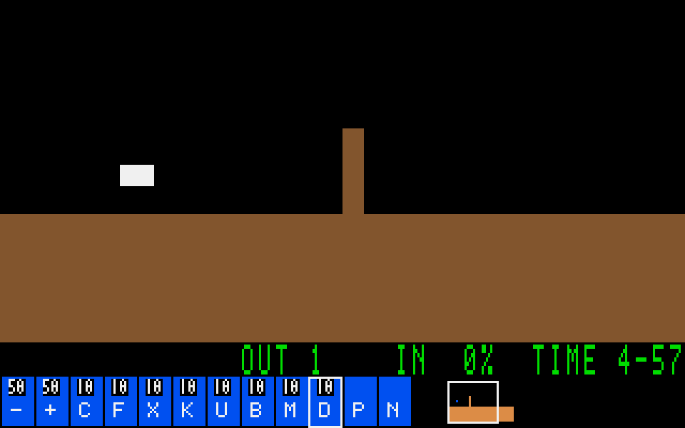

# SDL 표시 주기 보정

담당 [#107](https://github.com/edwardkim/ohmylemmings/issues/107), 상위 [#1](https://github.com/edwardkim/ohmylemmings/issues/1), 선행 [#106 기준값](issue-106_performance.md).

## 변경과 범위

기준 main `213d50c761db515f71aa51231f9a2357b70e7083`은 present를 마친 시각부터16ms를 다시 기다린다. 렌더·전송·표시 처리 시간이 매 프레임의 대기에 더해져 실제 약53fps였다. Native host 전용 FrameClock으로 `epoch + ceil(slot × render_every × 1e9 / 60)`의 절대 시각에 맞춘다. 틱 시계와 분리하며 렌더 비용이 누적되어 주기가 길어지지 않는다.

현재 시각까지 지난 슬롯은 산술식으로 한 번에 건너뛰어 몰아서 그리지 않는다. 초기/결과/캡처 강제 프레임은 예정 슬롯 이전이면 시계를 미루지 않는다. 숨김/복귀와 새 레벨은 표시 epoch만 재설정한다. `--fast`의 틱별 render_every·캡처/결과 전환 계약은 유지한다. 기본 DOS 틱·입력·시뮬레이션·자원·픽셀 합성과 PCM 엔진은 변경하지 않는다.

4개 결정론 테스트 중2개가 이전 모델에서 실패했고 수정 후4개 모두 통과했다. 60초/3601개 예정 시각의 ns 경계,101ms 지연 뒤6슬롯 생략·즉시 반복 방지, render_every3/강제 화면, 숨김600초·복귀/새 레벨 초기화를 검사한다.

## 같은 호스트 전후 비교

Intel N100/4cores, Linux7.2.5/Wayland/software SDL2.32.72, 60Hz/scale1,960×600창·논리320×200RGB24, 오디오44100mono/quantum512다. #106과 같은 Mayhem22 입력/DOS pacing을 사용하고 baseline1/candidate1/baseline2/candidate2/baseline3/candidate3 순서로 표시·오디오 ON60초씩 실행했다. 빌드·테스트와 겹치지 않는다. 원본·입력·환경·소스/실행 파일 해시, 각 사건의 분포와 원시 JSON pins는 [display_cadence.json](../../assets/manifests/display_cadence.json)에 고정한다.

|쌍|기존 FPS|수정 FPS|기존 gap p95|수정 gap p95|수정 마감 초과/건너뛴 슬롯/underrun|
|---|---:|---:|---:|---:|---|
|1|52.662|60.011|22.506ms|17.428ms|0/0/0|
|2|52.678|60.011|22.477ms|17.447ms|0/0/0|
|3|52.645|60.010|22.489ms|17.493ms|0/0/0|

**측정 범위 PASS:** 수정 버전은 세 번 모두3601프레임·841틱, 예정 present 마감 초과/슬롯 생략/관측 underrun0이다. 이전 세 실행도 각841틱·underrun0이며 모든6회 최종 상태 SHA가 기존841경계와 일치한다. FPS는13.92~13.99% 증가했고 gap p95는22.21~22.56% 감소했다. #106에서 추정했던 누적 대기 원인을 같은 실행 파일/호스트의 전후 비교로 확인했다.

FPS는 전체 프레임 수/실측 구간이며 초기/종료 프레임에 따른 작은 경계 편향이 있다. 준비/해시/덤프/JSON 기록은 구간 밖이다. 이전 #106의53.2fps와 이번 baseline 사이의 환경 변동은 보존하며, 이번에 번갈아 실행한 세 쌍으로 비교한다.

측정의 예정 시작은60Hz grid, present 완료 마감은 다음 슬롯 시작이다. 시작 지연과 완료 마감 초과를 분리한다. 강제 프레임은 별도 표시하며, frame gap16.667ms 초과를 물리적 dropped frame과 동일시하지 않는다. 스케줄링 마감 측정이며 디스플레이 scanout은 계측하지 않았다. baseline에는 명시적 deadline observer가 없어 실제 수/간격만 비교한다. Native VmHWM은 초기화/관측 버퍼를 포함하며 candidate의 추가4개 u128/예약 프레임 저장량도 공개한다.

## 동일성과 검증

합성 Builder64틱·원본 Fun01완주660틱·Mayhem22의841틱을 두 실행 파일의 fast/희소 렌더에서 재생한다. 전 경계 진단·지형/벽돌/객체 맵·논리RGB·SDL readback과 입력을 바이트로 대조한다. 원본40PCM(21곡/18효과/혼합1)의 고정44100샘플도 새로 합성해 #106 SHA와 일치했다. 장면 대조451파일(합성43/Fun01 195/Mayhem22 213)을 통과했다. 초기 PCM 비교의 게임 틱/오디오 IRQ 인자 오류는 수정하고 해당40개만 다시 확인했다. 알고리즘/고정 연산은 변경하지 않아 알고리즘30쌍을 추가 실행하지 않는다. 실제 호스트60초3쌍과 기존 회귀 CI를 수행한다.

위 그림은 원본 없는 합성 자산의 SDL readback이다. baseline/candidate가 동일한 바이트이며 원본 장면·PCM·실행 파일은 ignored `assets/local/issue-107-review/`에만 보관한다.

COMP 감사의 기존 소스/CI/전수 리플레이는 역사적 증거로 유지하고 이번 host 표시 변경의 이전 pin·영향 범위·대조 증거를 별도로 추가한다. 전체120레벨 장시간 플레이를 반복했다고 주장하지 않는다. 로컬 fmt/clippy/변경 테스트와 원본 없는 회귀, 정확한 게시 push/PR/main의 검사 수·로그/checkout·같은 트리·self-review·병합/소스 전달은 [#107](https://github.com/edwardkim/ohmylemmings/issues/107) 최종 기록을 따른다.

## 재현·후속

[계측 도구](../../tools/performance/README.md)의 actual SDL 명령에서 baseline/candidate 실행 파일과 새 JSON 경로를 번갈아 사용한다. `cargo test -p lemmings-desktop frame_clock --locked --offline`은 원본 없는 표시 시계 테스트다. 캡처/PCM 대조는 manifest의 입력/연산과 고정 도구를 따른다.

이번 수정은 측정한 네이티브 표시 주기 범위다. #106 Web의 평균60fps와 긴 callback 간격, 근사 JS heap·전용 interval peak/실제 hardware quantum·물리 DAC/scanout 미검증은 그대로 남긴다. G11 전체 마감과 G12는 후속 검토다.
