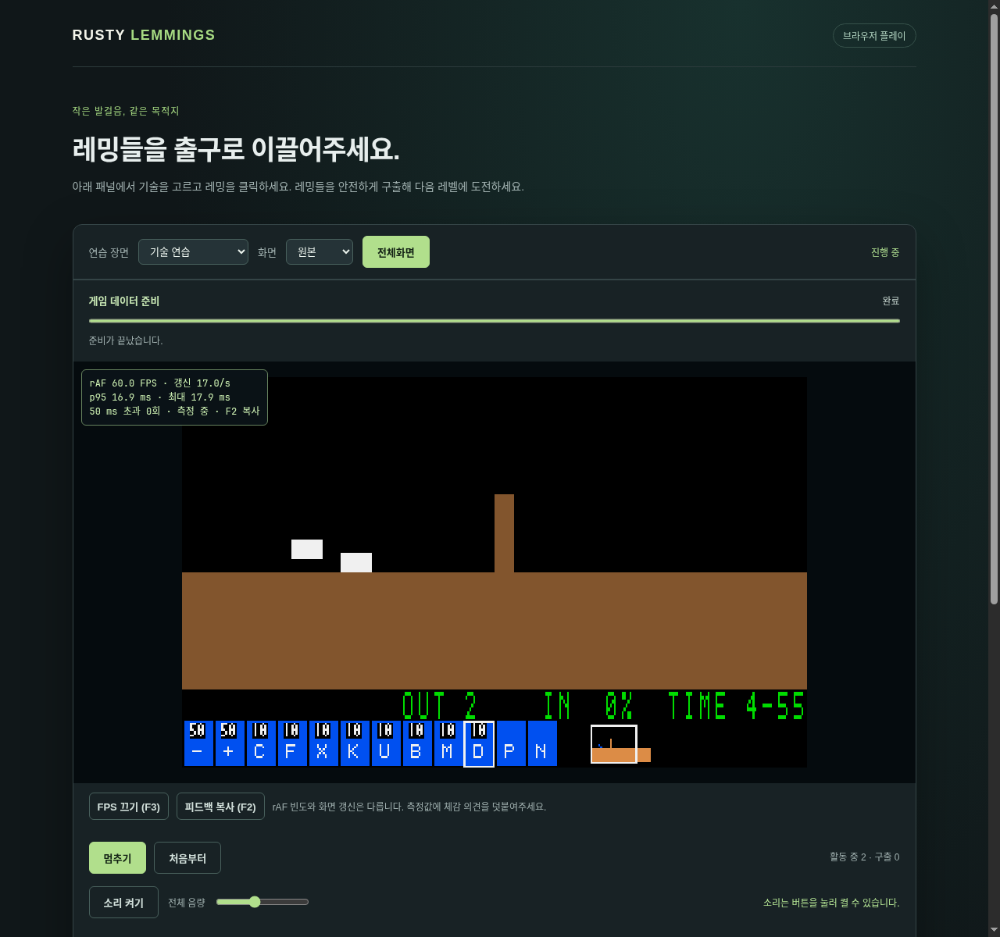

# 플레이 중 FPS 표시와 성능 피드백

담당 [#113](https://github.com/edwardkim/ohmylemmings/issues/113), [구현 계약](../working/issue-113_player_feedback.md). 2026-10-24 메인테이너의 제안과 구현 지시를 반영한다. 기존 [성능 검증 이월](issue-113_web_dispatch.md)과 **#113/G11 성능 NOT READY는 별도 잔여**다.

## 사용 방법

Web/Native에서 **F3**으로 패널을 켜고 **F2**로 요약을 복사한다. Web에는 버튼과 LAN HTTP 등 클립보드 차단 시 수동 복사 상자도 있다. 전체화면에서도 사용한다. 복사 결과의 `체감`에 끊김이 느껴진 상황을 적어 전달한다. Native 창 제목과 실행 안내에 F3을 안내한다. 자동 전송이나 음원/파일 경로 수집은 없다.

원본 자산 없는 합성 장면이며 수치는 UI 확인 당시의 짧은 관측이다.60fps 성능 인증 결과가 아니다.

## 측정 계약

- Web FPS는 실제 rAF 콜백 진입 간격이며 Canvas 갱신/s를 별도로 표시한다. Native는 SDL present 완료 간격이다. 측정 지점이 다르며 물리 scanout/실제 dropped frame 수가 아니다.
- 최근 최대240개 활성 간격의 FPS·nearest-rank p95·최대, 측정 전체의50ms 초과 횟수를 제공한다. 첫 관측은 기준점이다. 긴 간격을 자르거나 가변 주사율을60Hz로 강제하지 않는다.
- 기본 OFF이며 OFF에서는 표본/시계를 읽지 않는다. 저장 공간은 고정이고 갱신은 최대 초당2회다. Native는 캐시한 작은 텍스처의 SDL copy 한 번, Web은 DOM 갱신을 추가하며 게임 Canvas를 추가로 그리지 않는다.
- 로딩/숨김/일시정지/파일 선택/결과에서는 보류하고 재개 첫 프레임을 이전 구간에 연결하지 않는다. 레벨/표시 모드/전체화면 교체와 다시 켜기는 새 측정이다.
- 피드백은 버전·플랫폼/환경·레벨·표시 모드·크기·측정 요약의 허용 목록이다. Web 패키지는 workspace 버전, 개발 페이지는 `development`; Native는 Cargo 버전/OS/아키텍처/SDL driver·renderer를 제공한다.
- Native fast/캡처/정식 recorder에서는 플레이 HUD를 사용하지 않는다. 게임 논리/틱/자원/PCM/렌더 스케줄과 기존 성능 증거는 유지한다. 저사양 호스트의 중단한60초 반복이나 고성능 환경/구간 메모리 검증을 대체하지 않는다.

## 검증과 자체 검토

- JS 모듈/Rust Samples·Hud 부재를 먼저 실패시킨 뒤 통계·보류·상한·reset·피드백 허용 목록을 구현했다. Rust workspace728개, desktop clippy/format 통과.
- Python 최종327개와 `make check-python`의 자산/라이선스/compatibility/G11/Web 인덱스 검사를 통과했다. 패키지 버전 주입도 검증했다. 최종 CI 기록은 게시 후 추가한다.
- 실제 Chromium152/WASM/native33사례×2,11,960상태·6,877전체 RGB/Canvas 통과. HD13시나리오/7,593상태·821프레임과 기존 DOM/오디오/dirty draw 회귀를 유지했다. 새 실제 앱 검사는 기본 OFF·F3/F2·반복/수정키·추가 Canvas draw 없음·수치 분리·멈춤/재개·레벨 reset·클립보드/수동 복사를 확인했다.
- 첫 브라우저 검사에서 cross-realm clipboard Promise 완료 전 포커스를 확인한 테스트를 보정했다. JS 후속 검사는 같은 빌드의 변경 없는 WASM/HD 자산과 갱신한 JS/테스트로 전체66회를 통과했다. CI는 깨끗한 빌드를 수행한다.
- Xvfb/실제 SDL release 원본 Fun01에서 HD/원본·F3/F2·별도 X11 소비자의 실제 클립보드·Pause/Resume·F11·reset을 통과했다. dummy 오디오 장치의 기능 검사이며 성능 측정은 아니다. 보조 소비자의 조기 종료와 가상 서버/창 교체는 응답 대기와 준비된 창 재조회로 보완했다.
- 소유 headless 브라우저의 일반/전체화면 HUD와 Native 캡처를 눈으로 확인했다. 합성 화면만 문서에 첨부하며 원본 장면/로그는 ignored `assets/local/issue-113-player-feedback/`에 둔다. 사용자 CDP19222/HTTP8080·MP3 파일은 보존했다.

플랫폼 경계·observer/캡처/오디오·버퍼·보류/재개·패키지 허용 목록과 버전 주입 순서를 자체 검토했다. 과거 producer/실행/timing은 보존하고 현행 소스 인덱스만 별도 유지 보수 기록으로 연결한다. 공개 태그/릴리즈/버전별 노트는 변경하지 않는다.
