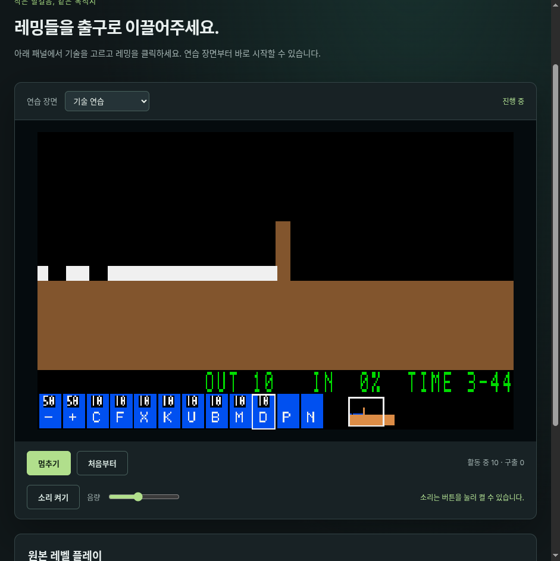

# Web 반복 그리기 보정·성능 검증 이월

현재 상태: 2026-10-25 메인테이너 지시로 #113 추적을 종료했다(Not planned). [종료 근거](../reports/issue-113_closure.md)를 따른다. 아래 OPEN/잔여/NOT READY 표현은 종료 전 기록이다.

담당 [#113](https://github.com/edwardkim/ohmylemmings/issues/113), 상위 [#1](https://github.com/edwardkim/ohmylemmings/issues/1), 다음 [#115 배포 준비](../plans/issue-115_release_preparation.md).

**현재 장비의 60fps 판정은 미통과이며, 사용자 지시로 더 좋은 호스트에 재검증을 이월한다.** G12 준비 착수는 사용자 승인에 따른 선행 조건 예외다. G11 성능 합격이나 G12 완료로 바꾸지 않는다. 현재 장비의 추가 최적화·60초 반복은 중단했다.

## 반영한 변경

논리 틱/입력에 변화가 없으면 이미 표시한 픽셀을 유지한다. 오디오 service는 매 rAF에 계속 호출한다. 입력은 즉시 표시하며 release/lost capture처럼 동기 draw가 없는 입력도 dirty 표시로 다음 rAF에 반영한다. `replaced()`가 이미 그린 경우 `attempt()`의 중복 draw를 생략한다. Rust/시뮬레이션·자원·픽셀 생성·PCM 엔진과 Native 표시는 불변이다.

개발용 진단은 고정 크기 reset/input/present 버퍼, Chromium trace와 trusted pointer probe를 제공한다. `PERF_TARGET_ID`로 소유한 로컬 테스트 탭을 새 탐색하여 재사용한다. 종료된 작업 탭10개를 정리하고 사용자 탭을 유지했다.

채택 코드의 연습 장면이다. 원본 자산이나 성능 수집기는 포함하지 않는다.

## 채택60초3쌍

N100/4CPU, Linux7.2.5/Wayland, Chromium152.0.7977.82, 표시/오디오 ON·Mayhem22·고정 입력이다. 양쪽에 같은 #111 정상 observer/CLI를 고정하고 전후를 번갈아 실행했다. trace/추가 이벤트 버퍼/heap 반복 조회 및 동시 빌드/테스트는 없었다. 초기 콜백을 포함한 모든 초과를 보존했다.

|쌍|기준 완료 마감 초과|보정 후 초과|기준/보정 후 Canvas 표시|
|---|---:|---:|---:|
|1|1|0|3604 / 842|
|2|40|1|3601 / 842|
|3|84|0|3592 / 842|

모든6회841틱·기존 상태/지형/다리/객체/RGB의5개 SHA 일치, 관측 underrun0·visibility0이다. 양쪽 콜백 실행 예산 초과는 전부0이다. 비용 중앙값은2.7~2.8ms→0.5~0.6ms다. Canvas 업로드와 rAF 빈도·물리 주사율을 구분한다. 동일 픽셀의 업로드가 줄었으며 논리 틱과 rAF 관측은 유지했다.

남은1건은 두 번째 실행의 첫 콜백(timestamp -6.7ms, 진입11.6ms, 완료12.3ms, 계약 대비 약2.333ms 초과)이다. 이를 합계에서 빼거나 평균 FPS로 상쇄하지 않는다. 이전 후보3쌍(기준0/12/1·후보0/0/0)은 dirty 경계 수정 전 pilot로 별도 보존했다. 이후 초기 rAF 예약/종료 경계의 짧은 실험도 보존했으나 채택 제품 코드에는 포함하지 않았다.

## Trace·입력 진단

별도 trace60초 구간의 초과69건은 renderer/frame/pipeline ID로 모두 연결됐다. 같은 compositor thread에서 ACK→send 중앙23µs·최대66µs, frame 시각→send 중앙13.934ms·최대15.398ms였다. renderer queue 중앙0.057ms, 측정한 지연/콜백 구간의 MinorGC/MajorGC 중첩0건이다. `dataLossOccurred=false`다.

확인한 사례는 콜백 이전 compositor ACK 대기 경로에서 예산 대부분이 소모됐다. [Chromium 프레임 파이프라인](https://chromium.googlesource.com/chromium/src/+/refs/heads/main/docs/life_of_a_frame.md)과 해당 브라우저 revision의 scheduler 소스를 대조했다. ACK의 GPU/OS 내부 원인이나 과거 untraced 구간의 원인까지 확정한 것은 아니다. trace 수집 profile도 정상 timing과 구분한다. 별도5초 pointer10회는 입력10회·추가 RAF 밖 present10회(초기2회 포함 총12회)를 만들었다. 과거에 저장하지 않은 입력을 복원한 결과는 아니다.

## 검증·인계

실제 앱의 무변화 rAF·틱/즉시 입력·release 갱신·단일 교체 draw·완료 정지와 관측 버퍼/입력 인수를 검사했다. 실패→보정을 확인했고, 채택 소스의 원본 포함 actual WASM/native43사례×2·14,980상태·8,617전체RGB/Canvas·DOM/오디오 명령 회귀를 통과했다. 새 전수120개나 새 PCM 인증으로 합산하지 않는다. 현재 호스트 보정 후의 구간 메모리와 고성능 환경 검증은 이월한다.

`make check-python`, `python3 tools/web_dispatch.py --local`, `python3 tools/web_deadlines.py --local`로 공개 벡터·원시/생산자 pins를 검사한다. [기계 기록](../../assets/manifests/web_dispatch.json)은 채택3쌍과 별도 trace를 연결하고 `web_deadline_ready:false`, `g11_ready:false`, `g12_entry_ready:false`를 유지한다. 사용자 승인된 **G12 준비**는 품질 gate의 무조건 통과와 구분한다.

#111의 이전 app/live/CLI 소스는 공개 reference 경로에 바이트 그대로 보존했다. #110/#111의 이전 초과와 NOT READY는 유지한다. source index 갱신을 과거 실행의 새 실행으로 표시하지 않는다. 자체 검토·정확한 CI/실제 병합/main·대응 소스 전달은 #113 게시 기록을 따른다. #113은 더 좋은 호스트의 성능 재검증 후속으로 OPEN을 유지하고, 배포 준비는 #115에서 진행한다.
