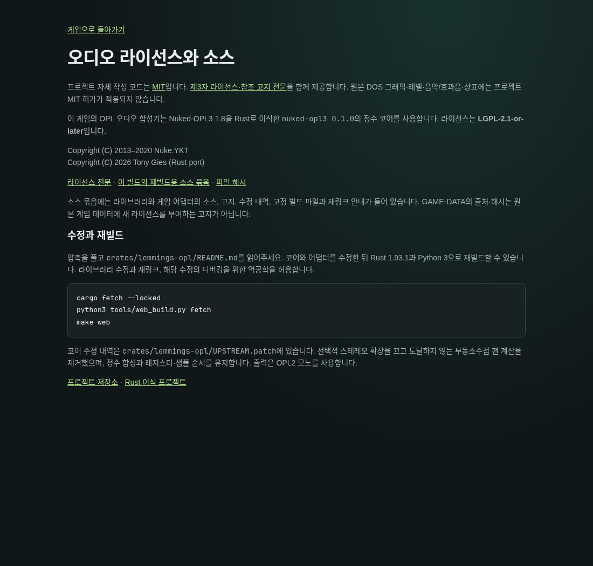

# #129 MIT 정책·고지 전달

이슈: https://github.com/edwardkim/ohmylemmings/issues/129

소유자가 “mit 로 진행하세요”라고 명시했다. [적용 범위](../plans/issue-129_project_license.md)에 따라 자체 작성 기여는 MIT로 공개하며, 루트 LICENSE와8개 crate의 workspace 상속을 추가했다. 파생 OPL crate의 LGPL-2.1-or-later와 C oracle·원저작권/수정·재링크 조건은 보존했다. 원본 DOS 데이터·상표와 제3자 권리에 새 허가를 부여하지 않는다.

## 출처·고지 목록

- 고정 Lemmix Licence.txt는 독자 고지이다. 고지/출처·변경 구분을 보존하고 그 파일이 언급한 DOS 데이터/Graphics32까지 MIT 대상이라고 표시하지 않는다.
- Lemmings.ts는 Thomas Zeugner MIT와 별도 OPL LGPL 부록을 원문 전체로 보존했다. 해당 JavaScript OPL은 제품 합성기가 아니다.
- SDL2 runtime2.32.10 Zlib 고지와 잠긴 Cargo 외부 의존성18개(MIT/Apache 선택, sdl2-sys MIT AND Zlib, unicode-ident의 Unicode-3.0 포함)를 기록했다. build/proc-macro도 목록에 포함하며 모두 제품 바이너리에 링크된다고 주장하지 않는다.
- notice38개를 third_party에 바이트 그대로 보존하고 THIRD_PARTY_NOTICES.txt로 전달한다. [inventory](../../assets/manifests/license_inventory.json)에 각 source/byte/SHA와 Cargo.lock archive checksum·라이선스 표현식을 기록했다. sdl2-sys는 crate archive에 루트 MIT 파일이 없어 같은 Git commit의 sdl2 루트 MIT와 자체 vendored SDL Zlib를 함께 보존했다.
- 캐시된 crates.io archive18개 SHA를 Cargo.lock과 대조하고, 해당 archive의 license member34개가 로컬 원문과 동일함을 확인했다. Lemmix/TS는 기존 고정 reference manifest, SDL은 기존2.32.10 runtime manifest와 대조했다.

## 구현·검증

새 패키지는 project_license=MIT와 LICENSE/THIRD_PARTY_NOTICES.txt를 포함한다. macOS는 서명 전 앱 Resources에 두 파일을 넣는다. Web 직접 빌드도 두 파일과 라이선스 안내 링크를 제공하며 대응 source bundle에 root 고지·third_party를 포함한다. SHA/inventory 검증에 더해 패키지의 고지 바이트를 검토한 소스와 대조한다.

project_license가 없는 기존 패키지는 당시 형식으로 검증하며 새 MIT를 소급 표기하지 않는다. 공개 v0.1.0의 Linux/Web/Windows/Mac4개 실제 archive가 기존 SHA 그대로 검증됨을 확인했다. 기존 태그/asset/Pages는 바꾸지 않고 이후 빌드에 적용한다. 새 릴리즈 게시 여부는 별도 지시를 따른다.

TDD에서 새 패키징 검사3개가 누락 project_license로 실패한 뒤 수정했다. MIT8개 상속·LGPL 보존·notice 누락/변조·Cargo.lock 변경·root/bundle drift와 package 자체 hash를 다시 만든 고지 교체도 검사한다. tools/license_policy.py를 make check-python에 연결했다. 실제 Web 재빌드·패키지/HTTP·전체 Python/CI 결과와 정확한 PR/병합은 최종 기록에 남긴다. 게임 로직·픽셀/PCM 알고리즘은 변경하지 않았으며 #113 성능 검증은 계속 이월한다.

- make check-python: Python253개와 새 license policy·기존 증거 감사 PASS. Cargo metadata의8개 MIT/OPL LGPL과 Cargo.lock 불변을 확인했다.
- 현재 소스로 release WASM을 새로 빌드하고 새 full Web ZIP을 추출해 /game/에서 실제 브라우저 검사 PASS.48개 파일의 패키지/소스·MIT/제3자 HTTP 고지, 원본120개 선택·RGB/Canvas, AudioContext PCM3072/비영3067, 저장 Fun01 입력 성공·Restart/Continue·refresh/누락 오류를 확인했다. 이 로컬 패키지는 개발 중 소스 snapshot790개이며 이후 최종 commit의 CI 산출물과 구분한다.
- 기존 공개4개 archive는 원래 SHA대로 검증했다. Web03597c78…/Linux189dafe2…/Windows44fef8d9…/Macea2883c5…이며 새 라이선스가 없는 당시 metadata를 유지한다.

