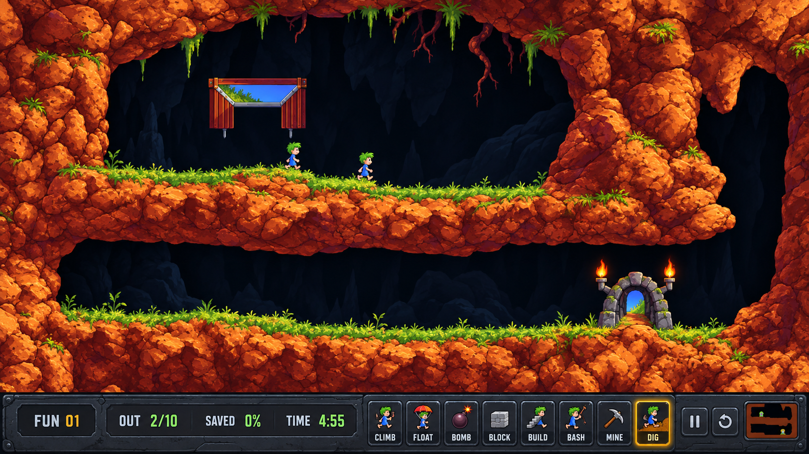

# #138 Fun 01 HD 아트 디렉션 첫 결과

이슈: https://github.com/edwardkim/ohmylemmings/issues/138 · 상위 https://github.com/edwardkim/ohmylemmings/issues/137

원본 픽셀의 확대만으로는 원하는 고화질 표현을 얻기 어렵다는 사용자 의견에 따라 새 2D 리마스터의 첫 시안을 제작했다. 실제 Fun 01의 두 층 동굴·오른쪽 하강 경로·입출구 배치와 작은 캐릭터 비율을 참고했다.

생성 도구는 built-in image_gen이며 CLI/API fallback은 사용하지 않았다. [최종 프롬프트](../../assets/remaster/prompts/issue-138_fun01_handpainted_v1.txt), [자산/원본 대응·규격·출처와 해시](../../assets/manifests/remaster_art_direction.json), [제작/표시 계약](../plans/issue-138_hd_art_contract.md)을 함께 남겼다. 새 그림은 프로젝트 assets/remaster에 보존했다. 실제 원본 캡처·추적/바이너리는 ignored assets/local에만 둔다.

## 시각·규격 검토

- 실제 생성 크기는1672×941, PNG2459339bytes, SHA256 `82a89240cd1b1be12a6b0db662dfe9e1dc8a6632e951540e9723b4454c8a02c9`이다. 목표1920×1080의 제작 완료 자산으로 표시하지 않는다.
- 첫 후보의 방향은 부드러운 손그림풍2D이며 사용자 확정은 아직 없다. 암석 재질·작은 캐릭터·입출구·새 패널을 하나의 장면에서 검토할 수 있다.
- 실제 지형 mask와의 경계 일치는 미검증이다. 시안에 합쳐진 캐릭터·지형·시설·UI는 별도 자산으로 제작해야 한다.
- CLIMB 그림은 걷기처럼 보이며 생성속도/Nuke 버튼이 빠져 있다. 패널 높이·그림 안의 글자/숫자와 좌표도 제품 규격으로 대신하지 않는다. 제작 계약에서 정확한 버튼/입력 영역과 상태 표시를 정의했다.
- 원본28애니메이션337프레임·5테마273지형/54객체·540객체 프레임/미리보기54개·특수4장면·19UI묶음200개를 대응 목록으로 기록했다. 새 런타임 자산의 실제 완료 수는0이다.

## 다음 구현

공통 표시 snapshot·좌표/입력과 패널 계약을 합성 테스트로 구현한 뒤, 분리 HD 자산과 실제 Fun 01의 걷기·굴착·계단·폭발을 연결한다. Native/Web의 원본 규칙/입력 동일성과 전체 상태·테마 확장은 #137의 후속이다. #138 종료는 시안·자산/표시 계약의 첫 절편 완료이며 전체 HD 모드 완료가 아니다.

검사 결과는 PNG 전체 chunk CRC·압축 데이터 해제, 그림/프롬프트와 원본 metadata4개의 크기/SHA,28개 애니메이션의 방향/치수/프레임/발 기준점,337프레임·지형/객체/UI 집계와 runtime_ready=false 모두 PASS이다. 변경 Markdown13개의 상대 파일 링크451개·git diff --check도 통과했다. self-review에서 시안의 표현·런타임 미구현·아이콘/패널과 경계의 한계를 대조했다. 문서/새 디자인 자산 변경으로 전체 플랫폼 빌드는 반복하지 않는다. PR 실제 병합 결과는 이슈에 연결한다. 기존 게임 코드/배포·#1 종료와 #113 성능 이월은 유지한다.
