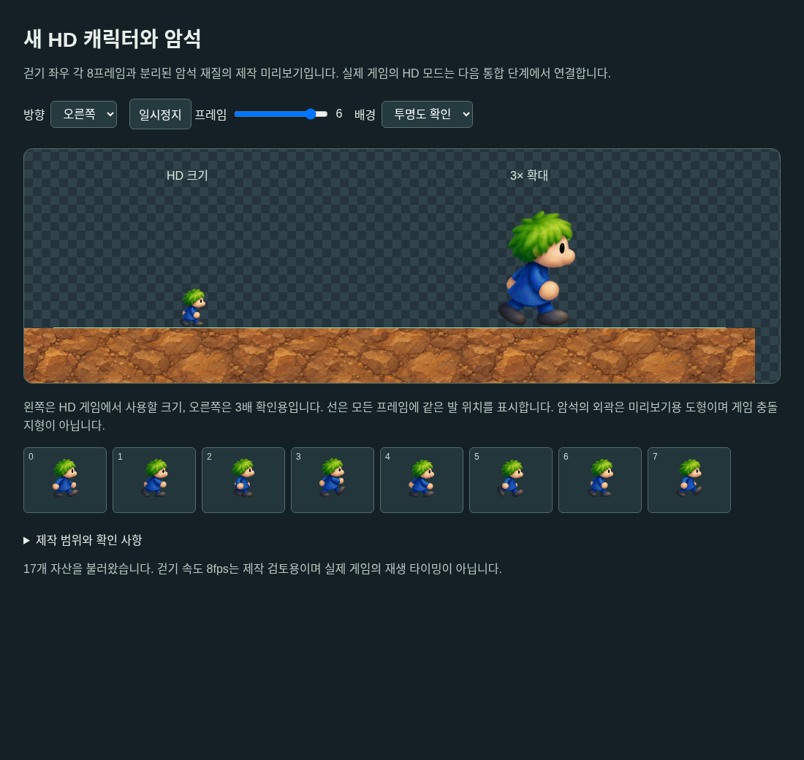

# #144 HD-03a 분리 자산·RGBA 팩

이슈: https://github.com/edwardkim/ohmylemmings/issues/144 · 상위 https://github.com/edwardkim/ohmylemmings/issues/137

[#138 계약](../plans/issue-138_hd_art_contract.md)을 이어 새 걷기 좌우8프레임씩과 암석 재질을 built-in image_gen으로 제작했다. [팩 manifest](../../assets/manifests/remaster_pack.json)에 실제 PNG·프롬프트의 규격/해시, 원본 slot0/2·frame0~7과 사각형·96×60 표시 크기·프레임별 발 기준점을 기록했다. 원본 그림을 확대하거나 생성 PNG 픽셀을 보정하지 않았다.

## 제작 결과와 한계

- 걷기: [선택 PNG](../../assets/remaster/issue-144-walk-v1.png), 실제1586×992 RGBA8. 요청1536×960과 달라4×4의 실제 정수 사각형을 명시했다. [선택 프롬프트](../../assets/remaster/prompts/issue-144_walk_v1.txt).
- 암석: [선택 PNG](../../assets/remaster/issue-144-rock-v1.png), 실제1254×1254 RGB8. 요청1024×1024와 다르며 해제 시 RGB를 그대로 두고 alpha255만 추가한다. [프롬프트](../../assets/remaster/prompts/issue-144_rock_v1.txt).
- 가장자리 정리 [edit 프롬프트](../../assets/remaster/prompts/issue-144_walk_v2.txt)는 포즈/배치도 바뀌어 채택하지 않았다. 실패본은 ignored assets/local에 두고 hash/사유를 manifest에 기록했다.
- 전체 걷기 PNG의 셀 경계에는 최대 alpha1의 희미한 잔여가 있다. 팩은 모든 픽셀 값을 그대로 보존하며 atlas `alpha_cutoff=1`을 명시한다. 표시기는 alpha가 cutoff 이하인 샘플만 제외하고 나머지는 straight alpha로 합성해야 한다. 경계/빈 프레임 검증과 미리보기도 같은 규칙이다. 완전한 alpha0 원본이라고 주장하지 않는다.
- 발 위치는 보이는 포즈의 중심·바닥을 HD 정수 좌표로 옮겨 선언했다. 실제 게임 합성에서 보행·색 번짐 품질은 추가 검토한다. 암석은 불투명 재질 패치이며 반복 경계의 무봉합은 인증하지 않았다. 그림이 충돌 mask를 대신하지 않는다.

## 공통 팩 계약

`LHDPAK01`8바이트, atlas/frame 개수의 little-endian u16 두 개 뒤에 atlas와 frame 레코드를 둔다. 최대64MiB·atlas16개·frame4096개·각 축4096이다. atlas는 width/height/RGBA 길이/CRC32/alpha cutoff의u32 다섯 개와 그대로 빌리는 RGBA8이다. cutoff는0~254이며 상위 비트/255는 거부한다. CRC는 우발적 손상 검사이며 출처의 신뢰/인증은 별도 SHA-256 manifest가 담당한다.

frame32바이트는 kind/slot(u8), 원본 frame/atlas/reserved(u16), x/y/w/h(u32), 표시 w/h(u16), 발 x/y(i16)다. actor는 고정 원본28슬롯의 정확한 frame 수를 확인하고 material0은 암석이다. 알려지지 않은 kind/ID·예약 비트·중복·빈/경계 밖 사각형·잘못된 표시 크기/anchor·잘린/남는 바이트를 거부한다. 없는 HD 상태의 조회는 None이며 임의 프레임으로 바꾸지 않는다.

Resources에는 원본 바이트 없이 고정 `LemmingAnimationInfo::for_slot`을 읽는 getter만 추가했다. 공통 `hd::assets::AssetPack`은 I/O·PNG·시계·플랫폼 의존 없이 bytes를 읽고 큰 RGBA는 복사하지 않는다. 원본 simulation/renderer·입력/PCM과 core의 의존 방향은 유지한다.

`tools/hd_assets.py`는 표준 라이브러리만 사용한다. 경로/심볼릭 링크 탈출·누락/크기/SHA·PNG CRC/순서·RGB/RGBA8·필터5종·제한된 zlib 해제·선언 크기·alpha·원본 slot/frame/필수 대응·중복을 검사한다. 팩 출력 디렉터리는 덮어쓰지 않는다. `make check-python`에 실제 PNG 검증을 연결했다.

## 재현과 검증

```sh
python3 tools/hd_assets.py check
python3 tools/hd_assets.py build --output assets/local/hd-assets-preview
cargo run -p lemmings-game --example hd_asset_probe --release --locked --offline -- assets/local/hd-assets-preview/assets.hdp
python3 -m http.server 19044 --bind 127.0.0.1 --directory assets/local/hd-assets-preview
```

브라우저에서 `http://127.0.0.1:19044/`를 열면 방향/8프레임·재생/정지·배경과 HD 크기/3배 확대를 확인한다. 원본 없는 자산 미리보기이며 실제 게임 HD 모드·논리 재생/성능의 증거가 아니다.



별도 headless Chromium에서 오른쪽0/왼쪽7/왼쪽3·세 배경을 제어해 각8개 썸네일·서로 다른 Canvas SHA와 정지/재개·콘솔 오류0을 확인했다. CUA 브라우저 연결은 제공되지 않아 로컬 전용 headless/CDP 세션을 사용했고 검사 후 종료했다. 기존 사용자 탭/19222 세션은 조작하지 않았다.

TDD: API/도구 부재 실패 뒤 구현했다. 추가 검사에서 bool schema·PNG 순서/PLTE 실패를 확인하고 고쳤다. Rust8개와 Python12개가 통과했다. 실제 팩12,583,908바이트/SHA `96577145aa904f52dd24d08773ec0f1b81f1336743a072d827ff60015c7fe1c6`를 빌드해 Native probe의2atlas/17frame·16걷기·RGBA CRC를 확인했다. 실제 브라우저에서 PNG 미리보기의 로딩/HD 크기와 프레임을 확인했다. 워크스페이스·WASM/전체 Python·정확한 CI와 병합은 아래 완료 기록/이슈를 따른다.

로컬 최종: Rust645/doc29·workspace Clippy/format·WASM library build·Python265/라이선스/기존 증거 감사 PASS. 변경 Markdown11개/상대 파일 링크272개·git diff --check·self-review PASS. 현재450개 source pin과 기존3개 이전 pin을 보존했고 과거 NOT READY/성능 관측을 변경하지 않았다. 새 HD 앱/JS 실행 검사가 아니라 공통 로더/WASM 컴파일·실제 PNG 팩/개발 미리보기 범위다. 정확한 PR/CI·병합은 GitHub #144와 완료 기록에 연결한다.

## 완료 기록

구현 [PR #145](https://github.com/edwardkim/ohmylemmings/pull/145)을 실제 merge `81daacbfb6b2d18115c6b01a96f1f6e7b86fa592`로 병합했다. 검토 head `dbff8d5354ce44d09921da7eb85cb06becccb0a2`와 merge의 전체 tree `dffbdea35b5594a1055ed7ae58c83e6a1f996c69`가 일치한다.

동일 head의 [CI39800118020](https://github.com/edwardkim/ohmylemmings/actions/runs/39800118020)에서 Rust native·Python tooling·WASM libraries·Web browser·Windows full game·macOS Apple Silicon/Intel7개 검사 SUCCESS를 확인했다. 중복 push39800025581 취소는 성공으로 집계하지 않는다. 이 CI의 기존 게임/설치 회귀와 로컬 Native HD 팩/개발 미리보기·WASM 컴파일의 범위를 구분하며 실제 HD 앱/JS/GPU 실행으로 해석하지 않는다.

완료 문서·상위 계획/진행·작업일지를 별도 문서 PR에 동기화했다. 완료 Markdown7개의 상대 파일 링크136개·git diff --check·self-review PASS. 게임 소스의 플랫폼 빌드를 반복하지 않는다. 실제 완료 문서 PR의 병합·#144 종료 근거는 GitHub 이슈에 연결한다. 실제 HD 게임·입출구/직업/UI와 다른26애니메이션321프레임은 #137 후속이며 #113 성능 이월/기존 NOT READY와 Chrome156 진단 #142를 유지한다.

## 후속

이 절편은2걷기 슬롯/16프레임과 암석1종의 팩 후보이다. 전체28애니메이션337프레임 중 나머지26/321과 입출구·직업 동작·UI/전체 테마는 미제작이다. `runtime_ready=false`이며 실제 Native/Web HD 게임 화면·입력/GPU·새 배포는 #137 후속이다. #1 CLOSED·#113 OPEN/저사양60fps 반복 중단과 기존 공개 v0.1.0/Pages를 유지한다. Chrome156 CI 대기 진단은 #142에서 별도 추적한다.
