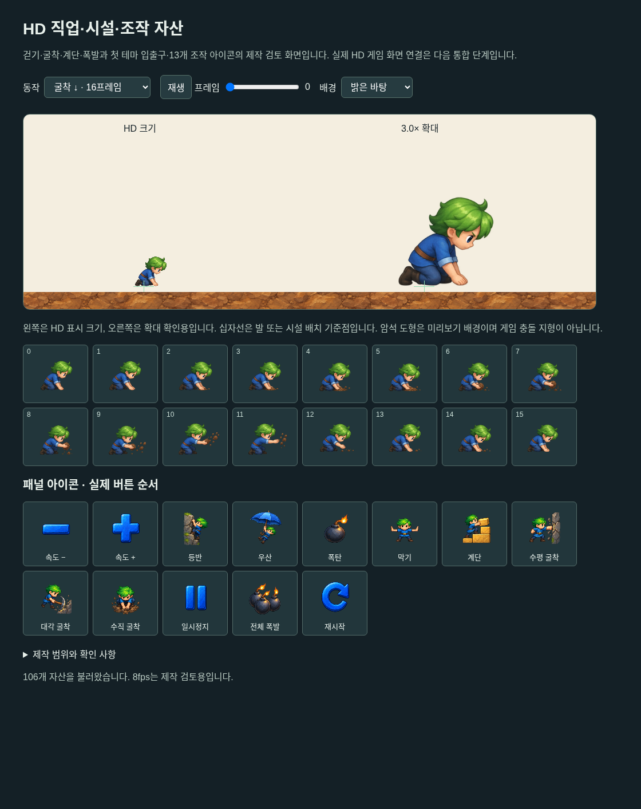
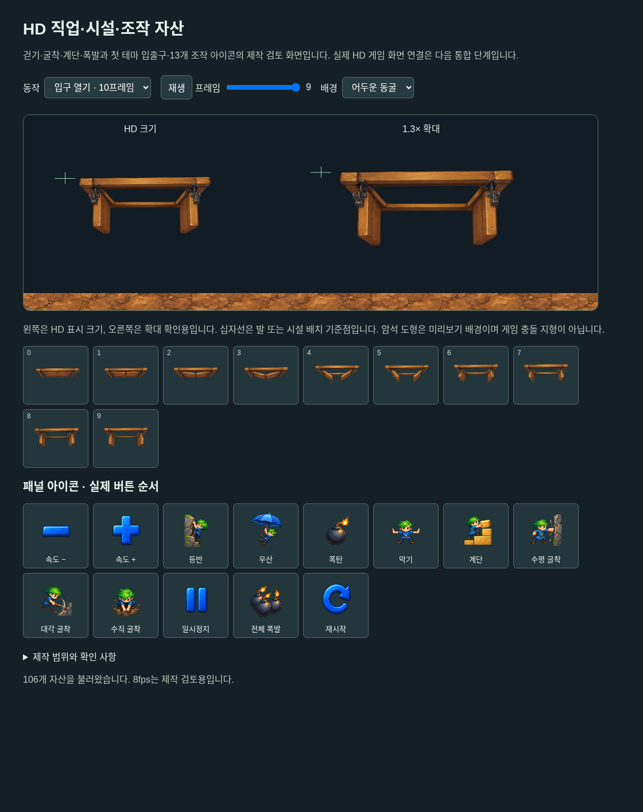

# #147 HD-03b 직업·시설·패널 자산

이슈: https://github.com/edwardkim/ohmylemmings/issues/147 · 상위 [#137](../plans/issue-137_2d_remaster.md)

[#144](issue-144_hd_assets.md)의 걷기/암석 팩에 새 직업65프레임·첫 테마 시설11프레임·조작13아이콘을 추가했다. 생성은 built-in image_gen을 사용했다. 선택 PNG 다섯 장은 생성 원본을 그대로 보존하며 [manifest](../../assets/manifests/remaster_pack.json)에 실제 규격/해시·사각형·표시 크기/기준점·정확한 프롬프트를 연결했다. 픽셀 확대나 Python/Pillow 보정으로 제작하지 않았다.

## 자산과 범위

| 자산 | 선택 PNG / 정확한 프롬프트 | 실제 크기 | 대응 |
|---|---|---|---|
| 굴착 | [PNG](../../assets/remaster/issue-147-dig-v1.png) / [prompt](../../assets/remaster/prompts/issue-147_dig_v1.txt) | 1536×1024 | slot4,16프레임 |
| 계단 좌우 | [PNG](../../assets/remaster/issue-147-build-v1.png) / [prompt](../../assets/remaster/prompts/issue-147_build_v1.txt) | 1774×887 | slot10/11,각16프레임 |
| OhNo/폭발 | [PNG](../../assets/remaster/issue-147-bomb-v1.png) / [prompt](../../assets/remaster/prompts/issue-147_bomb_v1.txt) | 1122×1402 | slot26의16 + slot27의1프레임 |
| 첫 테마 입출구 | [PNG](../../assets/remaster/issue-147-facilities-v1.png) / [prompt](../../assets/remaster/prompts/issue-147_facilities_v1.txt) | 1536×1024 | set0/id1입구10, id0출구1 |
| 조작 아이콘 | [PNG](../../assets/remaster/issue-147-ui-v1.png) / [prompt](../../assets/remaster/prompts/issue-147_ui_v1.txt) | 1254×1254 | 8직업 + Slower/Faster/Pause/Nuke/Restart |

기존16걷기 프레임과 암석을 포함해7atlas/106자산, 캐릭터7애니메이션81프레임이다. 전체28/337 중 나머지21/256과 다른 시설/테마·효과·전체 UI는 후속이다. 실제 앱에 통합한 HD 애니메이션은 여전히0이며 `runtime_ready=false`다.

원본 GROUND0O.DAT의1056바이트/SHA `86ecce12dea563b97d07339028780a0a50fc2cc75a67f682bf4d9aff8cf4b24a`를 pinned dos_original.json과 대조했다. id0출구의 frame_count1/first_frame0/48×17과 id1입구의10/1/48×25를 확인했다. 입구는 절대 disk frame0~9를 모두 보관하고 게임의 first_frame1·스케줄은 바꾸지 않는다. 원본 바이너리는 커밋하지 않았다.

요청 크기·균일 셀 간격과 생성 결과가 달라, 실제 투명 여백을 측정한 명시적 정수 경계를 사용한다. UI도 실제 행 경계357/670/970을 사용한다. 생성 RGBA 일부는 최대alpha254이므로 완전한255 샘플을 필수로 요구하지 않는다. 각 프레임은 cutoff보다 큰 잉크와 경계 여백을 가져야 한다. 계단 atlas의 경계 잔여는 최대alpha4, 나머지 새 atlas는alpha1 cutoff로 표시 시 제외한다. 모든 원본 RGBA 값은 팩에 그대로 남는다.

직업별 표시 canvas와 발 기준점은 source PNG 밀도와 별개다. 굴착은 움직이는 흙덩이의 중심을 발로 쓰지 않도록 고정 x34를 사용한다. 입구는 고정 lintel 중심/윗면을 기준으로 문 움직임을 유지한다. 출구는288×180 canvas에 anchor(0,78)로 원본102HDpx 높이보다 위로 확장한다. 이는 그림 배치 정책이며 원본 trigger/충돌/이동에는 영향이 없다. 실제 HD-04에서 캐릭터 크기·동작 위상/발의 안정성과 출구 doorway/원본 trigger의 정합을 반드시 검토한다. 이번에는 픽셀 잘림·방향·동작/아이콘 의미와 제작 미리보기만 확인했다. 암석의 반복 경계 인증도 후속이다.

## 공통 팩과 TDD

`LHDPAK01` v1의 기존 레코드와 actor(kind0)/rock(kind1)를 유지했다. kind2는 slot=set×16+object_id, frame은 절대 disk 인덱스다. 현재지원은 set0/id0·1이며 다른 시설은 거부한다. kind3는13개 고정 조작 ID와 frame0만 허용하고 `AssetKey::Icon(Control)`로 조회한다.8직업 순서는 기존 `panel::SKILLS`를 재사용한다. 없는 상태는 None이며 Minimap은 동적 내용이므로 고정 아이콘이 없다. 숫자/문자·선택/비활성 테두리는 실제 UI가 그린다.

Rust 로더는 큰 RGBA를 빌리며 PNG/I/O·시계/플랫폼 의존을 추가하지 않았다. core/resources·원본 simulation/render/입력/PCM은 수정하지 않았다. 기존64MiB/16atlas/4096frame/각축4096·CRC/SHA·범위/중복/예약 비트 검사도 유지한다.

추가 Rust2개·Python2개 테스트의 API 부재/부분 alpha 거부 실패를 확인한 뒤 구현했다. 시설 프레임 한계·미지원 set/ID·13조작/Minimap·프레임0 제한·이전 키 인코딩·alpha253 샘플 보존을 검사한다. 최종 HD Rust10/Python14개 PASS. 원본 #144 팩도 새 로더에서2atlas/17frame·16걷기/CRC PASS여서 v1 호환성을 확인했다.

## 재현과 로컬 검증

```sh
python3 tools/hd_assets.py check
python3 tools/hd_assets.py build --output assets/local/hd-actions-preview
cargo run -p lemmings-game --example hd_asset_probe --release --locked --offline -- assets/local/hd-actions-preview/assets.hdp --hd03b
python3 -m http.server 19047 --bind 127.0.0.1 --directory assets/local/hd-actions-preview
```

`http://127.0.0.1:19047/`에서 동작/프레임·배경/재생을 선택한다. 명령은 새 출력 폴더를 요구한다. 팩44,046,160바이트/SHA `69390dd1aa4ccf255da348c3a6cb5eebb51507eb295850b7286fe2788940e9d3`, Native probe7atlas/106frame·81actor/11object/13icon/CRC PASS다. 원본 게임 파일 없이 실행한다.





자체 headless Chromium/CDP 세션에서9동작 그룹/16끝점 사례·프레임 범위/썸네일·13아이콘·세 배경·정지/재개/콘솔 오류0을 확인하고 세션을 종료했다. 굴착/계단/폭발/입구/출구를 실제 캡처로 검토했다. 시설 확대가 캔버스 오른쪽을 벗어나던 미리보기 배치를 고쳐 재검증했다. QA 보조 스크립트의 DOM 준비 전 조회/서버 종료로 실패한 실행은 PASS로 집계하지 않았다. 최종 검사만 위 결과이며 사용자의19222 탭은 조작하지 않았다. 이 화면은 실제 HD 게임/게임 타이밍·성능 검증이 아니다.

로컬 workspace Rust647/doc29·Clippy/format·WASM library build·Python267·라이선스/기존 compatibility/G11/Web 감사 PASS. 기존7개 이전 source pin을 보존하고10개 PNG/프롬프트를 추가해 현재460개를 검사했다. 과거120레벨/COMP/성능 기록을 재실행 결과로 바꾸지 않았다. #113 성능 이월/NOT READY·#142 Chrome156 진단·#1 CLOSED와 Windows11 지원/공개 v0.1.0/Pages를 유지한다.

변경 Markdown9개/상대 파일 링크185개·git diff --check와 self-review를 통과했다.

게시/정확한 CI head·7개 검사와 실제 PR 병합 근거는 [#147 최종 기록](https://github.com/edwardkim/ohmylemmings/issues/147)에 연결한다. 로컬 통과만으로 이슈를 종료하지 않는다. 다음은 HD-04의 실제 Fun01 Native/Web 합성·원본 모드 선택과 입력 통합이다.

## CI 설치 지연과 재검사

CI39866059128 attempt1의 Web 잡120128578123은 SDL2 apt 의존성 설치/업그레이드 중 시간을 소모해10분 제한으로 cancelled되었다. Azure Ubuntu 미러에서22.5MB를 요청한 뒤 실제20.2MB 다운로드에9분26초가 기록됐다.22:46:01 Rust 도구 설치가 시작됐고22:46:08 취소됐다. 브라우저 equivalence/패키징은 skipped이므로 기능 실패/Chrome156 재현이나 PASS로 집계하지 않는다. 로그는 ignored assets/local/issue-147-review/web-ci-attempt1.log에 보존하고 같은 head의 Web 잡만 재실행했다. 최종7개 검사는 같은 run의 latest job 결과를 기준으로 한다.

## 완료 기록

구현 [PR #149](https://github.com/edwardkim/ohmylemmings/pull/149)을 실제 merge `653762ff7383d87a5963fc2bc39c43d25983fdd2`로 병합했다. 검토 head `3ff29f8df90f8bcad4c31eff84d9c11829f7bd25`와 merge의 전체 tree가 일치한다.

같은 head의 [pull_request CI39866059128](https://github.com/edwardkim/ohmylemmings/actions/runs/39866059128)의 attempt2/latest job에서 Rust native·Python tooling·WASM libraries·Web browser·Windows full game·macOS Apple Silicon/Intel7개 검사 SUCCESS를 확인했다. 이전 head의39865871403/39865910861과 최종 head의 중복 push39866053572 취소는 PASS로 집계하지 않는다. 기존 게임/설치 회귀와 로컬 HD 팩/미리보기·WASM 컴파일 범위를 구분하며 실제 HD 앱/GPU 실행으로 해석하지 않는다.

완료 문서·상위 계획/진행·일지를 동기화했다. 문서 전용 PR의 실제 merge와 #147 종료·root main 동기화는 GitHub 이슈의 최종 기록을 따른다. #137은 OPEN이며 다음은 HD-04 실제 Fun01 통합이다. 나머지21애니메이션256프레임 등 누락 자산과 새 동작/출구 기준점의 실제 합성 검토는 후속으로 유지한다.

Web 재검사의 Chrome155.0.8059.39에서 동등성/여정/사운드·전체 Web 패키지 설치 PASS를 확인했다. 실패 원본 로그는72440바이트/SHA `ca9f25f0ee7ad268a431ae96679d4e2064e95fe88565d4d98bc72f77e38e9859`다. Chrome156 #142의 결과 대기 타임아웃 재현/해결을 주장하지 않는다.

완료 Markdown6개/상대 파일 링크141개·공백·self-review PASS. 문서 변경만 포함하므로 기존 게임 소스의 전체 플랫폼 검사를 반복하지 않는다.
