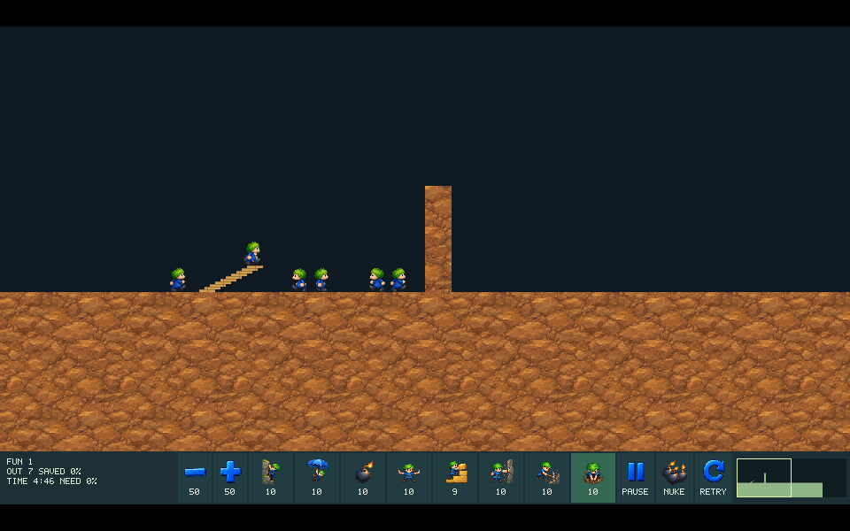

# #151 HD-04 실제 Native/Web HD 미리보기

이슈: https://github.com/edwardkim/ohmylemmings/issues/151 · 상위 [#137](../plans/issue-137_2d_remaster.md)

Native SDL과 Web Canvas에1920×1080 HD 미리보기와 원본 모드 전환을 연결했다. 게임1920×960/패널120은 기존 논리320×160과 같은 세션을 사용한다. [#147 자산 팩](issue-147_hd_actions.md)의7애니메이션81프레임·입출구11프레임·13아이콘을 사용하며, 아직 없는 동작/효과는 실제 원본 스프라이트를 표시한다. 다른 테마나 일방통행 표시가 있는 지형은 원본 재질을 사용한다. 전체337프레임/테마·효과 제작 완료가 아니다.

## 표시·입력과 수정

공통 `hd::scene`은 버전1의12개i32 고정 레코드로 사각형·텍스처 복사·게임 clip 명령을 제공한다. PNG/I/O·SDL/브라우저 의존을 core/resources에 넣지 않았다. 논리32×32 chunk를 HD192×192 텍스처로 캐시하고, visible/brick mask가 바뀐 chunk만 다시 만든다. 화면에 처음 들어온 chunk는 지연 생성한다. 호스트는 revision이 바뀐 텍스처만 전송하며 세션 교체 시 캐시를 무효화한다. 매 표시마다 전체 Full HD 맵을 CPU로 합성하지 않는다.

배경은 실제 `render_terrain`/`render_bricks`를 사용하므로 폭발의 표시 지연과 굴착/계단 경계를 유지한다. 시설은 원본 절대 프레임/트랩 상태·앞뒤 순서·only-on-terrain/no-overwrite/상하 반전을 사용한다. 가림은 원본 논리 그리기 provenance로 판정하고 새 그림의 alpha를 충돌/trigger로 되먹이지 않는다. 발/카메라/HD 패널은 #140 좌표를 사용한다.

실제 Fun01에서 원본 입구는 source1 닫힘→2~9 열기→0 열린 상태 유지임을 확인했다. #147 제작 cell0~9를 source1~9,0으로 다시 연결했다. PNG 바이트를 편집하지 않았고 [manifest](../../assets/manifests/remaster_pack.json)에 보정 근거를 남겼다. 출구는 실제 trigger/지형에 맞춰 기존 anchor(0,78)를 사용한다. 출구 위 object7의 불꽃은 아직 원본 효과이므로 픽셀 표현이 남아 있다.

8직업·속도 누름/반복·Pause/Nuke 두 번 클릭·선택·우클릭·재생 guard는 기존 입력 상태 머신을 재사용한다. HD 미니맵은 새 영역의 카메라 정밀도를 유지하고, 재시작은 틱 입력과 분리한 세션 교체다. 원본/HD 전환은 held 입력을 해제하고 동일 게임을 계속한다. Native는 SDL 논리 좌표를 중복 배율 변환하지 않으며 모드 전환으로 시계/틱을 초기화하지 않는다. Web은 실제 canvas 크기/경계로 CSS 좌표를 변환한다.

Native의 기본 원본 경로/소프트웨어 renderer와 기존 RGB stream/성능 계약은 유지한다. `--hd`/`--hd-pack` 명시 시 사용 가능한 SDL renderer를 선택하며 Linux Wayland/OpenGL을 실제 확인했다. HD의 일반 capture는 canonical 원본 RGB와 별도의 실제 출력 PPM을 남긴다. 원본 stream/벤치마크 중 HD 전환은 사용하지 않는다.

## 실행과 개발 패키지

```sh
make hd-assets
cargo run -p lemmings-desktop --release --locked --offline -- --hd
# 전체화면 시작: 위 인수에 --fullscreen 추가. F8 원본/HD, F11 전체화면.
make web
```

원본 데이터 준비는 기존 [assets 안내](../../assets/README.md)를 따른다. `make hd-assets`는 원본 PNG/프롬프트 SHA를 검사하고 ignored `assets/local/hd-runtime/assets.hdp`를 준비한다. 같은 입력은 캐시를 검증해 재사용하고 손상된 컴파일 캐시를 다시 만든다. `--hd-pack FILE`도 지원한다.

Web 화면 선택의 HD 미리보기·전체화면 버튼을 사용한다. Web build/개발 패키지는 팩을 포함하고 누락/다른 내용의 팩을 거부한다. 검증한 실제 개발 패키지에서 Fun01을 자동 로드한 뒤 제품 UI를 검사했다. Windows/macOS/Linux의 HD 팩을 포함한 최종 지원 패키징과 새 공개 배포는 HD-06 후속이다. 공개 v0.1.0/Pages는 갱신하지 않았다.

## 검증

- TDD: 공통 렌더러/입력 API 부재·런타임 캐시 부재 실패 후 구현했다. 신규 Rust7개와 Python1개를 포함해 로컬 Rust654/doc29·Python268, Clippy/format·WASM library build·라이선스 검사 PASS. 사각형 wire·지형 한 점 변경/한 chunk 갱신·기존 텍스처 유지·시설 가림/순서·원본 fallback·손상 팩/invalid pointer·재시작과 입력을 검사한다.
- 브라우저 HD 합성3직업 시나리오에서783상태·203표시와 걷기/굴착/계단/OhNo/폭발 슬롯의 실제 사용, 읽기 전용 상태/mask/사운드·캐시·손상 팩/입력을 확인했다. 기존 Web 회귀33사례/66실행·11960상태/6877Canvas readback도 PASS다. 로컬 브라우저는 Chromium152.0.7977.82다.
- 실제 Fun01: 기존 [입력 기록](../../assets/manifests/solution_replay.json)의 `60 0 AssignDigger 0`을 사용했다. 새로운 경로 탐색/전체 레벨 재검증을 주장하지 않는다. Native 원본/HD의 전체 state/trace·입력·최종 terrain/brick/object-map 바이트가 일치한다. 전체 state SHA는 `ea2928b414411969e486c3d775731ba9b73f2f55198d935a086ba3715428fdad`다.
- 같은 실제 Web 제품의 원본/HD 세션을664회 명시적 step으로 비교해10명/100% 구출했다. Native는 control_step660에서 완료해661행, Web 검증은 완료 후4개의 동일 정지 상태를 더 남겨665행이다. 공통661행과 추가 정지 상태·세 최종 맵이 모두 일치한다. 처음 길이만 비교한 보조 검사 실패를 기능 차이로 집계하지 않는다.
- 제품 DOM에서 원본/HD 전환의 상태 보존·8직업·실제 레밍 클릭/Digger 할당·Pause/미니맵/재시작·전체화면·원본 복귀를 확인했다. 전체화면의 가상800×600 출력에서 canvas800×450의16:9와 여백 분리를 확인했다. Node/CDP 보조 스크립트의 비동기/중복 변수 오류를 수정하고 최종 fresh 세션에서 콘솔 예외0/PASS를 확인했다. 실패한 보조 실행을 통과로 세지 않는다.
- Native 실제 Wayland/OpenGL/1920×1080·소리 제출/비제로 표본을 관측했다. 실행 중 control_step122의 Pause가 기록돼160/iteration122로 마쳤으므로 이 관측을 완주/성능/물리 청취 증거로 쓰지 않는다. X11 driver는 이 환경에서 사용 불가였고 Wayland를 사용했다. 정해진 완주 증거는 위 고정 입력 실행이다.

실제 원본 게임 캡처/바이너리와 전체 상태 기록은 작업 worktree의 ignored `assets/local/issue-151-review/`에 보존했다. 공개 [검증 요약/해시](../../assets/manifests/hd_integration.json)는 수치/출처와 범위만 기록한다.



위 이미지는 원본 파일 없이 만든 자체 지형·생성 HD 그림의 실제 SDL 출력이다. Fun01 원본 캡처를 커밋하지 않았다. 자체 장면은 Builder 입력을80경계에 넣고240경계에서 캡처했다.

제품 UI 재검사는 실제 Web 개발 패키지를 localhost에 제공하고, 별도의 빈 disposable Chromium/CDP를 실행한 뒤 다음 명령으로 한다. 원본 자료가 포함되므로 출력은 반드시 ignored assets/local의 새 폴더다. 기존 사용자19222 세션은 조작하지 않았다.

```sh
node tools/web/hd_product.cjs http://127.0.0.1:19051/ http://127.0.0.1:19052 assets/local/hd-product-review
```

## 범위와 게시 근거

`runtime_ready=true`는 현재 부분 HD 미리보기의 사용 가능을 뜻하며 `full_remaster_ready=false`다. 원본 fallback을 UI/진단에 표시하고 나머지21애니메이션256프레임·다른 시설/효과·테마·bitmap 문자/윤곽 다듬기를 HD-05로 유지한다. 기존 #113 성능/메모리 이월과 NOT READY·#142 Chrome156 진단·#1 CLOSED를 변경하지 않았다. 저사양60fps 반복은 재개하지 않았다.

정확한 PR head의 CI7개·실제 merge와 완료 문서/일지 동기화는 [#151 최종 기록](https://github.com/edwardkim/ohmylemmings/issues/151)에 연결한다. 로컬 통과만으로 완료 처리하지 않는다. #137은 전체 제작/동일성/지원 배포 인수까지 OPEN이다.
