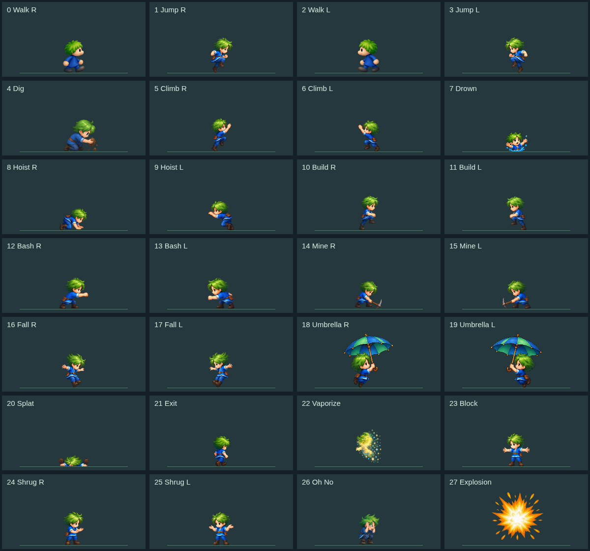
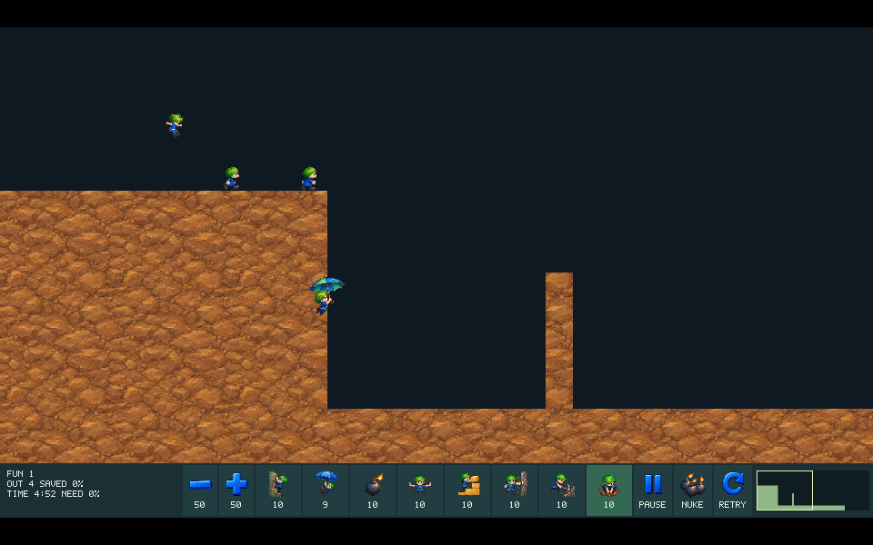

# #154 HD-05a 캐릭터 전체 프레임

이슈: https://github.com/edwardkim/ohmylemmings/issues/154 · 상위 [#137](../plans/issue-137_2d_remaster.md)

기존7동작81프레임에 남은21동작256포즈를 연결해 Native/Web HD 미리보기의 캐릭터28슬롯337논리 프레임을 모두 대응했다. 다른 시설/효과·5테마/특수 장면·글꼴/전체 UI와 지원 HD 배포는 HD-05 후속/HD-06이다. `runtime_ready=true`는 미리보기 사용 가능이며 `full_remaster_ready=false`다.

## 제작·프레임 대응

built-in image_gen으로 선택한 새12장의 PNG와 정확한 프롬프트는 [자산/프롬프트 목록](../../assets/remaster/README.md), 실제 크기·해시·source cell/slot/frame·사각형·표시 크기·발 기준점은 [대응 목록](../../assets/manifests/hd_actors.json)과 [팩](../../assets/manifests/remaster_pack.json)을 따른다. PNG RGB/alpha 샘플을 Python/Pillow 등으로 편집·재표본화하지 않았다. 원본 픽셀을 확대해 제작하지 않았다.

- Jumping/Falling10, Climbing/Hoisting32, Bashing64, Mining48, Umbrella16, Blocking/Shrugging32, Exiting/Drowning24, Splatting16, Vaporizing14포즈를 선택했다.
- 생성된 행 수/방향이 요청과 달랐다. Basher56포즈의 오른쪽3행+마지막행32와 왼쪽3행24에 별도 왼쪽8을 더했다. Miner40포즈 중 겹친2개를 제외한38개에 보완9포즈와 별도 왼쪽1을 더했다. 미사용 셀도 원본 PNG에 그대로 남기며, 중복 키/가짜 누락 채움으로 집계하지 않는다. Shrug의 행 안에 섞인 방향도 실제 좌우 절반을 명시적으로 선택했다.
- 전역 균일 격자는 등반·납작해짐·익사의 높이 변화를 잘랐다. 알파의 연결 실루엣/실제 투명 여백으로 포즈별 사각형을 측정했다. 모든 새 선택 프레임은 cutoff8에서 경계 여백·잉크 검사를 통과한다. cutoff는 렌더링 시에만 적용하며 팩의 원본 RGBA 값은 보존한다.
- 등반 미리보기의 색을 배경 실패로 먼저 판단했으나 실제 바깥 알파는0이었다. 알파/합성 검증으로 바로잡았고 불필요한 파생 시트는 선택하지 않았다. 같은 원본 PNG를 최종 자산으로 보존한다.
- 발 위치는 기존 논리 좌표의6배이며 그림의 크기/기준점만 대응한다. 축소되는 구출/사라짐 효과는 자체 작은 bbox 바닥을 발로 취급하지 않고 원래 몸 기준을 유지한다. 그림은 충돌·물/불/출구 trigger·직업 사건이나 틱에 반영하지 않는다.



최종 위상 검토에서 Miner의 원본 지형 삭제1·2프레임과 Basher의16단위2~5프레임에 타격 포즈를 맞췄다. 생성 순서의 여러 동작 반복을 원본 사건 시계로 사용하지 않는다. TDD로 이 시점의 실제 source cell/팩 사각형 연결을 고정하고, 픽셀/게임 틱을 바꾸지 않고 선택 포즈의 순서만 보정했다.

## 팩·호환·검사

RGBA 팩은19atlas/362자산(캐릭터337·시설11·아이콘13·암석1),119,548,732바이트/SHA `8bdb5875f17784516d58a5a196dc373ce33da7873ac5399349c8374bf4d660eb`다. v1 레코드 형식은 유지하고 bounded 한계를128MiB/32atlas로 확장했다. 이전64MiB/16atlas 실행 파일은 새 대형 팩을 거부한다. 새 로더에서 기존44MB/7atlas/106자산 팩을 실제로 읽고 CRC·프레임/시설/아이콘 호환을 확인했다.

TDD로 Python의 전체337키 요구/누락과32atlas 경계, Rust의 전체 키 누락/32atlas 경계를 먼저 실패시킨 뒤 구현했다. `complete_actors=true` 팩은 한 프레임이라도 빠지면 제작 검사에서 실패한다. `missing_actor_frames()`는 기존 부분 팩도 계속 허용하며 누락을 명시한다. 신규 Rust2개·example1개/Python3개를 포함해 workspace Rust656/doc29·example1·Python271, format/Clippy·WASM library build·라이선스 검사 PASS다. example 테스트는 `make check-desktop`에서도 실행한다.

19개 원본 RGBA atlas를 처음에 복사/업로드하는 비용이 있다. 큰 팩의 임의 상한 해제 대신128MiB를 유지하며, Web HD 검사도 한 번 로딩한 팩을 장면 전환에 재사용한다. 이후에는 기존 변경 chunk/texture revision만 갱신한다. 이번은 기능 검증이며 초기 메모리·로딩 지연·고성능 호스트60fps 인수를 대신하지 않는다.

## 실제 검증과 범위

- Native 공통 렌더러: 유효한 Actor 복원 API로28슬롯337프레임을 각각 만들고 정확한 HD slot/frame 사용·원본 대체 없음·전체 상태/사운드 비변경을 확인했다. 이는 복원한 합성 상태이며 자연 진행으로337상태 모두에 도달했다는 뜻이 아니다.
- 브라우저 자산 검토:28동작337프레임 Canvas readback, 시설 포함30그룹60끝점·아이콘13·배경3종·콘솔 예외0 PASS. 정지/슬라이더와 표시 기준점을 확인했다. 검토 도구의 초기 CDP 준비 전 조회/새 출력 폴더 검사 실패는 PASS에 포함하지 않고 준비 재시도 후 새 폴더에서 검증했다.
- 실제 WASM/Canvas:13합성 시나리오7,593상태·821표시에서 원본과 전체 상태·최종 terrain/brick/object-map·렌더 전후 사운드가 일치하고 원본 캐릭터 대체가0이었다. 자연 재생에서 관측한 슬롯은0/2/3/4/5/7/10/12/14/16/17/18/20/21/22/23/26/27의18개다. 다른10슬롯/나머지 위상의 모든 자연 전환을 검증한 것으로 과장하지 않는다. 별도 전수 복원/Canvas 검증과 구분한다. 기존 Web33사례66실행·11,960상태/6,877Canvas readback도 PASS다. 로컬 브라우저는 Chromium152.0.7977.82다.
- 실제 SDL: 고정 입력의 Fun01/자체 우산 장면에서 원본과 HD의 full state/trace·입력·최종 terrain/brick/object-map 파일이 바이트 동일했다. 우산 장면은 실제 새 우산/낙하 캐릭터를 표시했다. SDL dummy/software·fast 검증으로 GPU 성능/실장치 청취를 주장하지 않는다.
- 실제 전체 Web 제품:8직업 선택·실제 레밍 클릭/Digger 할당·Pause/미니맵/재시작·전체화면·원본/HD 전환, 콘솔 예외0 PASS. 같은 Fun01 고정 입력664step에서10명/100% 구출. Native는 완료 후 정지해661행, Web 검증은 같은 마지막 상태4개를 더 기록해665행이며 공통661행과 최종3맵이 일치한다.



위 두 이미지만 공개하며 원본 게임 캡처/바이너리·전체 trace와 실패 로그는 ignored `assets/local/issue-154-review/`에 보관한다. SDL PPM 캡처는 픽셀 변경 없는 PNG 형식 변환만 수행했다. 실제 Web 제품 준비에서 worktree의 기본 원본 경로 누락으로 패키징이 실패한 실행과 그404 검사는 성공으로 세지 않는다. 검증된 root 원본 경로·스테이징한 새 PNG/대응 소스가 포함된 새 패키지로 다시 검사했다. 로컬 개발 패키지의 소스 snapshot은 최종 PR head와 구분하며 최종 배포 검사 근거는 CI를 따른다.

## 재현

```sh
make hd-assets
cargo run -p lemmings-game --example hd_asset_probe --release --locked --offline -- assets/local/hd-runtime/assets.hdp --all-actors
cargo run -p lemmings-game --example hd_character_probe --release --locked --offline -- assets/local/hd-runtime/assets.hdp
cargo run -p lemmings-desktop --release --locked --offline -- --hd
make web
python3 tools/hd_assets.py build --output assets/local/hd-actors-preview
```

자산 검토는 출력 폴더를 localhost에 제공하고 별도의 빈 disposable Chromium/CDP에 `node tools/hd_assets_check.cjs PREVIEW_URL DISPOSABLE_CDP_URL NEW_EVIDENCE_DIR`를 사용한다. 실제 제품 UI 재현은 기존 `tools/web/hd_product.cjs`를 따른다. 사용자19222 탭은 조작하지 않았다.

[#113](https://github.com/edwardkim/ohmylemmings/issues/113) 성능 이월/NOT READY, [#142](https://github.com/edwardkim/ohmylemmings/issues/142) Chrome156 진단, #1 CLOSED·Windows11 지원과 공개 v0.1.0/Pages 유지 정책을 보존한다. 정확한 PR head/CI7개·실제 merge·완료 문서·root 동기화는 [#154 최종 기록](https://github.com/edwardkim/ohmylemmings/issues/154)에 연결한다. 로컬 통과만으로 종료하지 않는다.

위상 보정 후 최종 팩으로 전수337복원/Canvas·13사례7593상태821표시·실제 Native Miner 원본/HD300step·Fun01 HD664step과 실제 전체 Web 제품 UI/Fun01을 다시 검사했다. 원본 Native와 최종 Web 공통661상태·세 맵 동일/PASS다. 기존 우산 장면의 frame binding은 보정 대상인Miner/Basher와 분리돼 있다. 최초 head의 CI는 위상 보정을 위해 취소했으며 최종 head의 검사를 별도 확인한다.
