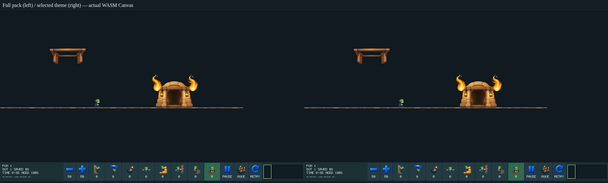

# #169 테마별 HD 자산 로딩

이슈: https://github.com/edwardkim/ohmylemmings/issues/169 · 상위 [#137](../plans/issue-137_2d_remaster.md)

전체27atlas/440키·131,699,864바이트를 매번 로딩하던 구조를 공통 자산+현재 테마의18~19atlas/94,165,832~100,517,336바이트 선택 로딩으로 바꿨다. 현재 상주 자산 입력의128MiB/32atlas 한도 안에서33,700,392~40,051,896바이트(약32~38MiB)의 여유를 확보했다. 이는 직렬화된 자산 집합 수치이며 프로세스/GPU 전체 메모리·전환 중 peak·60fps 판정이 아니다.

## 구성과 보존 조건

원본 PNG·atlas RGBA/크기/cutoff와 모든 프레임 rect/display/anchor를 그대로 보존한다. 재배치·자르기·재표본화 없이 atlas별 v1 파일27개와336바이트 `catalog.hdi`로 분할한다. 전체 카탈로그 파일 합계131,700,512바이트이며 공유 atlas를 복제하지 않는다. 혼합 페이지는 전체를 유지하므로 선택 집합에 다른 테마의 일부 키가 포함될 수 있다. 공통 캐릭터337프레임은 항상 유지한다.

`LHDIDX01`은 공통·일반5테마·향후 특수4장면 scope와 파일 크기/CRC를 기록한다. 파일명은 고정 `atlas-NNN.hdp` 형식으로 호스트가 생성한다. 선택한 v1 파일을 `LHDSET01`로 묶어 공통 parser가 중복 키·중첩·잘림·크기/atlas/frame 한도와 CRC를 검사한다. 기존 단일 `LHDPAK01` 팩도 계속 읽는다. 기존 renderer에서 frame atlas ID만 합쳐진 집합의 인덱스로 바꾸고 원래 페이지 좌표는 유지한다.

디스크 전체 카탈로그는512MiB/128atlas로 제한하지만 활성 선택은 기존128MiB/32atlas다. `remaster_pack.json`의 선택적 `catalog_extensions`에는 별도 제작 manifest의 path/bytes/SHA-256 pin을 넣는다. 각 확장 팩을 독립 검증/컴파일한 뒤 카탈로그를 합쳐 전체 키 중복과 모든 테마/특수 조합의 활성 예산을 검사한다. 따라서 제작 전체가 단일 팩 한도에 묶이지 않는다.50개 atlas의 원본 없는 분리 팩을10개씩 선택하는 테스트로 전체32개 초과와 활성 한도 보존을 확인했다. 새 특수 장면 key/그림 자체는 이 절편에서 만들지 않는다.

## 호스트와 실패 처리

- `make hd-assets`는 기존 팩과 `assets/local/hd-runtime/atlas/`를 만든다. Native 기본 HD 경로는 카탈로그가 있으면 이를 사용하며 `--hd-pack FILE_OR_DIRECTORY`로 구형 파일/디렉터리를 지정할 수 있다. 테마가 바뀔 때 새 집합을 검증한 후 교체한다. HD 대화형 전환 실패는 현재 레벨/renderer를 보존하고 오류를 알린다. 원본 모드에서는 이전 HD 테마를 해제하고 다음 HD 활성화 때 로딩하므로 선택적 HD 파일 오류가 원본 진행을 막지 않는다. 자동 검증용 scripted 전환 실패는 명시적으로 종료한다.
- Web은 HD 선택 시 현재 테마만 가져오고 공통 페이지를 재사용한다. 새 테마 검증 후 이전 테마 캐시와 Canvas texture를 놓는다. 레벨 교체 후 로딩 동안 논리 틱을 진행하지 않는다. 다운로드 실패 시 선택한 새 레벨의 원본 모드로 복구하며 재시도로 HD를 켤 수 있다. 파일 교체 실패가 진행 중인 시뮬레이션을 되감거나 임의로 진전시키지 않는다.
- Web catalog404에서만 기존 단일 팩 URL로 호환 fallback한다. 손상/HTTP500 등을 구형 파일로 숨기지 않는다. 다운로드 길이를 스트리밍 중 검사하고 CRC/공통 parser를 통과해야 교체한다. 캐시는 현재 집합 하나이며 로딩 중에는 검증 전 새 집합과 이전 집합이 일시 공존한다.
- 개발 Web 빌드는 기존 단일 팩도 회귀용으로 남긴다. Web 패키지는 catalog가 있으면 분할 파일만 포함하여 전체 팩을 중복 포장하지 않는다. 공개 Releases/Pages는 변경하지 않는다.

## 검증과 self-review

- Rust697테스트·Clippy/format, Python297테스트 PASS. 카탈로그 scope/크기/CRC/잘림/중복/중첩·단일 팩 호환·원자적 renderer 교체·확장 manifest pin 검증을 포함한다.
- 전27atlas RGBA/cutoff/크기와440키 rect/display/anchor가 기준 팩과 동일하다. [수치·페이지 해시](../../assets/manifests/hd_loading.json)를 기록한다.
- Native와 실제 WASM의 자체5코스947상태/5구출이 동일하며 기존 전체 팩 대비 실제 PPM/120Canvas쌍의 RGBA 차이0이다. 공통 페이지 네트워크 요청은 한 번이고5테마 전체 전환 시 각 페이지를 한 번씩만 받았다.
- Native 원본 Fun01 구출→Fun02 Continue에서 전체/선택 팩의229화면·진단 파일이 같다. 실제 Web Fun01 UI8기술·할당·일시정지·미니맵·재시작·전체화면·665상태/10구출 통과. 제품 UI Fun01/02/04/05/06/22 전환의 전체 팩 대비 화면도 동일하다. 테마 다운로드를 차단한 뒤 원본 복구·재시도와 게임 상태 보존을 확인했다.
- 기존 Web33사례/66실행/11,960상태/6,877Canvas와 HD13사례/7,593상태/821표시 PASS.
- 실제 브라우저 초기 연결에서 native fetch를 객체 메서드처럼 호출한 오류를 발견하여 global fetch wrapper로 고쳤고 제품 검증을 재실행했다. 첫 QA 종료의 임시 프로필 삭제 경합은 검사 완료 후 launcher 정리 오류였으며 이후 자체 프로필 종료 절차를 보정했다. 실패 로그는 ignored evidence에 보존한다.

게임 코어/틱/충돌/입력 규칙·음악 합성은 바꾸지 않았다. #165 BGM의 알려진 재시작 결함은 그대로 후속이며 기존 sound-state 동일성 검사를 BGM 정상 판정으로 확대하지 않는다. #113 성능 이월/NOT READY, #142 진단은 유지한다. 특수4장면·나머지 함정/효과·글꼴/전체 UI·지원 HD 배포를 완료하기 전 #137을 닫지 않는다. 소스 감사·최종 CI/실제 병합과 root 준비는 이어서 기록한다.

Web 패키지에서 catalog/27페이지만 포장하고 전체 팩 중복을 제외함을 로컬 검증했다. 검증 보고서의 archive 변수에 catalog member가 덮어써지던 초기 오류는 실패 테스트를 추가해 수정했다. 최종 PR CI에서 다시 생성한 패키지를 인수 근거로 사용한다.

최종 소스551pin 감사·G11 기록 검증·298문서 상대 링크 PASS. 변경된 Native host의 이전 producer pin은 display_cadence/source_maintenance_169에 보존하고 현재 source/evidence pin을 동기화했다. 기존 성능 관측값이나 NOT READY 판정은 바꾸지 않았다.
