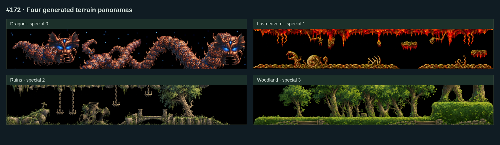

# #172 특수 4장면 HD

이슈: https://github.com/edwardkim/ohmylemmings/issues/172 · 상위 [#137](../plans/issue-137_2d_remaster.md)

VGASPEC0~3의 용·용암 동굴·유적·숲을 새 손그림풍 파노라마로 대응했다. Taxing15·Tricky14·Mayhem22·Fun22에서 사용한다. 일반5테마/캐릭터/입출구는 기존 그림을 유지하고, 시뮬레이션·원본 모드·사운드 합성은 변경하지 않는다. 아직 남은 함정/효과/글꼴/전체 UI와 지원 HD 배포/인수가 있어 전체 리마스터 완료는 아니다.

## 그림과 실제 표시

built-in image_gen으로4PNG를 생성했고 선택 출력 파일을 바이트 그대로 보관한다. 실제 출력은2170~2172×724~725이며 중앙의2170~2172×362 파노라마를 frame rectangle으로 참조한다. 프롬프트에서 요청한3840×640 출력이 그대로 생성됐다고 간주하지 않는다. 정확한4개 프롬프트·참조 출처/해시·PNG 크기/해시는 [hd_special.json](../../assets/manifests/hd_special.json)에 기록한다. 참조는 Rust VGASPEC 해석 결과의960×160 그림이며 원본 캡처/바이너리는 ignored evidence에만 둔다.

생성 그림은 원본 실루엣과 완전히 같지 않다. renderer는 world x304~1263/y0~159에 그림을 맞춰 샘플링하며, **불투명 표시 영역은 기존 논리 지형 mask가 결정**한다. 따라서 기존1논리 픽셀의 경계/잔구멍은 보존되며 그림의 내부 세부가 새로워진다. 새 그림을 충돌·보행·굴착 판정에 사용하지 않는다. 빈 mask는 투명, builder 벽돌/철의 기존 표시 우선순위도 유지한다. 청크/카메라 변화는 그림 원점을 바꾸지 않는다. 매 표시마다 전체 파노라마를 다시 만드는 대신 기존 dirty 청크 경로를 사용한다.

`AssetKey::Special { set }`/kind4는0..3과 frame0만 허용한다. 잘못된 set/frame·다른 키와의 alias를 거부한다. reset 시 현재 레벨의 selector를 선택하고, 지원 그림이 없는 legacy pack에서는 원본 지형으로 복귀한다. 새로운 진단 `special_panorama`는 현재 선택을 나타내며 원본 게임 진단을 대체하지 않는다.

## 분할 팩과 예산

[별도 제작 manifest](../../assets/manifests/remaster_special.json)는4개 required key를 고정하며, 기본 manifest가 bytes/SHA pin으로 확장을 연결한다. 기존 단일 팩은131,699,864바이트/SHA `07e240a23f338fef77e7f9fbf6fc439ba3e0dd3972566f9e848bcbe106014ff4`를 유지한다. 새 그림은 catalog 경로에서만 전달되며 구형 단일 팩은 기존 원본 special fallback을 유지한다.

카탈로그는31atlas+catalog의32파일/144,356,368바이트다. 활성 일반 테마 집합은 바뀌지 않으며, 특수 조합은97,328,332~103,682,748바이트로128MiB/32atlas 한도를 지킨다. 일반5테마×특수 없음/4종의25조합을 검사했다. 전체 디스크 크기와 활성 자산 입력 크기, 프로세스/GPU 메모리 peak는 다른 수치다. 성능 #113의 이월/NOT READY를 바꾸거나60fps를 새로 판정하지 않는다.

## 검증과 남은 마무리

- TDD: 새 typed key가 없을 때 Rust 검사 실패, 이후0..3/frame0/잘못된 키 검사 통과. 카탈로그의 특수scope별 선택과 일반 레벨 제외, renderer의 world 좌표/양쪽 경계·굴착 투명화·reset/fallback·읽기 전용 상태 검사를 포함한다.
- Rust699테스트, Python298테스트, format/Clippy 통과.
- 기존27런타임 페이지가 바이트 단위로 같다. 새4프레임의3,143,608 RGBA 샘플도 PNG 참조 영역과 모두 같다.
- Native120개 초기 레벨과 선택된1,920틱에서 HD/원본 상태·지형·벽돌·객체·사운드 상태가 동일하다. 이는120레벨 완주 판정이 아니다. 특수4레벨의 실제 SDL 화면도 별도로 확인했다.
- 사용자 요청으로 기존8080의 `/preview-172/`에 별도 작업본을 준비했다. CDP19222의 빈 탭에서 Fun22/HD/1920canvas/일시정지/오류 없음을 확인했고 사용자가 확인 후 계속 진행을 승인했다. 사용자 탭과 preview 복사본은 이후 QA로 바꾸지 않는다.
- Web 비교 도구 초기에 HD쪽만 레벨을 두 번 로딩하여 sound generation 번호가 달라지는 실패가 있었다. 두 모드의 로딩 횟수를 같게 고쳤으며 사운드 제품 코드는 바꾸지 않았다. 실패 로그를 보존하고 최종 Web 검사 결과를 별도 기록한다.

Web120장면/1,920틱/352Canvas에서 네 special selector, 일반5테마,14일방통행 장면과 Native/WASM 최종 상태·모드별 상태/마스크/사운드 동일성을 확인했다. 콘솔 오류0이다. 기존 Web33사례/66실행/11,960상태/6,877Canvas와 HD13사례/7,593상태/821표시도 통과했다. 로컬 `make check-web` 전체 및 소스 감사·CI/self-review·실제 병합을 완료했다. 개발 환경 준비 식별자는 이슈에 기록한다. BGM #165는 리마스터 완료 이후이며, sound-state 동일성/비영 PCM은 지속 BGM 청취 통과를 뜻하지 않는다. 공개 Releases/Pages는 변경하지 않는다.

위 이미지는 새 그림만 표시한 브라우저 갤러리이며 게임 캡처가 아니다. 실제 Native/Web 원본 레벨 캡처는 `assets/local/issue-172-review/`에 보존한다.

재현: `make hd-assets` 후 `cargo run -p lemmings-game --example hd_terrain_probe --release --locked --offline -- assets/local/hd-runtime/atlas assets/local/dos-original`로 Native120행을 저장한다. 전체 게임 데이터가 준비된 Web과 별도 빈 QA 브라우저에서 `node tools/web/hd_terrain.cjs PRODUCT_URL DISPOSABLE_CDP_URL NEW_EVIDENCE_DIR NATIVE_JSONL --special`로 대조한다. 사용자 플레이 탭에 실행하지 않는다.

게시 전 self-review: `make check-python` 전체·558소스 pin·G11 기록 무결성·301Markdown 상대 링크를 통과했다. 이전 producer pin과 성능 관측값을 보존했다. 구현 변경은 game HD 표시/typed 자산과 제작·검증 도구에 한정하며 core/resources/audio 제품 소스는 바꾸지 않았다.

## CI와 실제 병합

PR #173 head `f96a5c78d9ee5afccb4324be59e6b2c11a31ba2e` / CI39928593396의7개 SUCCESS (첫 실행6개, 재실행 Rust native1개), 실제 merge `d8e6dacc554157ba3fcd91d9297d1c6b7242f1b0`와 검토 head 전체 tree 일치를 확인했다.

[PR #173](https://github.com/edwardkim/ohmylemmings/pull/173) · [CI39928593396](https://github.com/edwardkim/ohmylemmings/actions/runs/39928593396). Python·WASM·Rust native·Web·Windows·macOS Apple Silicon/Intel을 모두 통과했다. PR checkout `8ed912afa66b54bb880066a7f35bd40b2833e97a`도 검토 head와 tree가 같다. 첫 실행의 Rust 검사·Linux 설치는 통과했으나 결과 파일 업로드가 ECONNRESET으로 실패했다. 해당 job만 재실행해 최종 통과를 확인했으며 첫 실행 전체를 성공으로 세지 않는다. 중복 push39928584782 취소도 통과로 세지 않는다. 기존 전체 게임 패키지 검사와 전체 HD 배포/성능 인수는 구분한다. 완료 문서 실제 병합·root Native4장면/8080 준비·사용자 preview 보존 및 종료 근거는 [#172](https://github.com/edwardkim/ohmylemmings/issues/172)에 기록한다.

CI Web ZIP은143,783,524바이트/SHA-256 `7fdbc30f80574ce5e7e738b722c8b151b02a37285e67001b587b763d403f3740`,82파일·966소스·28게임 파일이다. 카탈로그의 새4페이지 전달과 새 설치120레벨/재시작·전환·하위경로·소스/고지를 통과했다. 오디오 smoke는 BGM 지속 청취 판정이 아니다.
