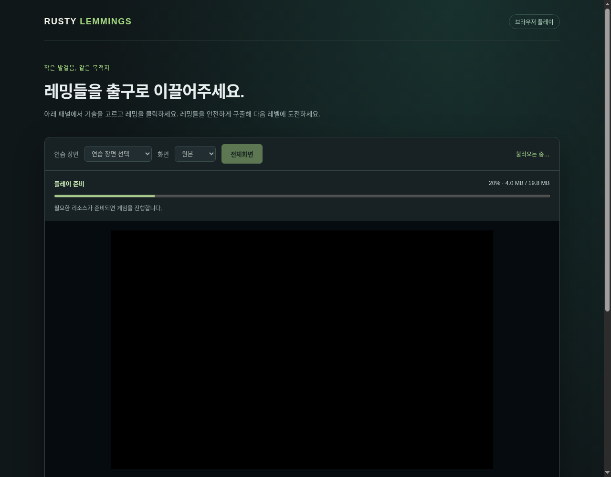

# #196 웹 점진적 다운로드와 진행률 UX

이슈: https://github.com/edwardkim/ohmylemmings/issues/196

## 요구와 기준

메인테이너가 #194 게시 도중 웹 초기 용량 축소·플레이 중 백그라운드 준비와 다운로드 진행률 UI/UX를 요구했다. v0.2.0 태그/공개를 보류하고 구현했다. #195 준비 PR은 CI [40045197480](https://github.com/edwardkim/ohmylemmings/actions/runs/40045197480) 7개 성공 후 main `b5d0d4d36a89d404768e08bfcca4f3005de06895`에 병합됐으며 그 tree는 `5d5425d43e1527e49b321e6abb4fdc27605a2676`다. 이번 추가 변경은 별도 동일 tree CI를 통과해야 게시할 수 있다.

## 측정과 선택

전체 Web ZIP은 대응 소스/고지·모든 레벨과 HD 자산을 갖춘 오프라인 배포 단위다. 브라우저는 ZIP/대응 소스를 자동으로 받지 않는다. 기존 HD 로더는 테마 단위만 골랐고, 초기 게임 시작 전에 공통337캐릭터·그 테마 전체 시설·공유 지형 페이지를 기다렸다. 로컬 비압축 HTTP에서 테마0의 HD 요구량은113,884,752바이트/24파일이었다. 직접 gzip만 적용하면53,320,183바이트로 여전히 크다.

현재 레벨의 초기 기술 수와 배치된 객체/위험물·지형/특수 장면으로 모든 도달 가능한 애니메이션/시설 키를 계산한다. 기술0개 레벨의 전체 폭파도 포함한다. ODDTABLE의 실제 기술 수를 반영하고 다음 레벨 계획은 LEVEL/ODD/GROUND 메타데이터만 읽는다. 지형 합성이나 게임 틱은 실행하지 않는다. 원본120레벨의 현재 계획과119개 다음 계획을 실제 다음 레벨에서 계산한 결과와 대조했다.

Web은 여러 테마가 섞인 지형을 나누고, 원래 RGBA·크기·앵커·경계 샘플을 보존한53개 gzip 페이지/899키로 전달한다. 첫 Fun01에는8페이지/19,751,567바이트(약19.8MB)가 필요하다. 엔진과 원본28파일454,336바이트·스크립트/메타데이터는 별도다. 모든120계획이32페이지/128MiB 해제 한도 안에 있으며 가장 큰 레벨의 압축 HD 요구량은44,211,596바이트다. Native 전체 오프라인 HD 카탈로그/이미지는 그대로다.

[Compression Streams](https://developer.mozilla.org/en-US/docs/Web/API/Compression_Streams_API)의 gzip 해제, [Fetch Priority](https://web.dev/articles/fetch-priority), [Cache API](https://developer.mozilla.org/en-US/docs/Web/Progressive_web_apps/Guides/Caching)를 사용한다. 별도 서버 설정이나 새 압축 라이브러리 없이 GitHub Pages의 정적 파일로 제공한다. 첫 필수 파일은2개 요청으로 처리하고, 플레이가 시작되면 다음 레벨만1개 낮은 우선순위 큐로 받는다. 새 필수 요청·탭 숨김은 배경 요청을 중단한다. Data Saver/2G는 다음 레벨을 열 때 준비한다.

압축 파일은 SHA-256 경로를 사용하고 전달 형식 식별자로 캐시를 구분한다. 브라우저 저장소는 현재 버전만 유지하며 실패 시64MiB 메모리 캐시로 계속한다. HTTPS에서는 SHA-256, 비보안 LAN에서는 CRC/길이 및 해제 후 원본 CRC를 검사한다. 각 응답/해제/전체 세트 크기를 제한하고 Rust가 완전한 세트를 검증한 후 교체한다. 배경 준비는 압축 파일만 저장하며 렌더러나 게임을 교체하지 않는다.

## 사용자 화면

엔진·게임 데이터·플레이 준비를 구분한다. HD는 실제 준비한 바이트/필수 총 바이트·백분율·캐시 재사용을 표시하고 다음 레벨 준비는 별도 상태로 알린다. 처음 준비 중에는 조작을 비활성화한다. 필요한 다운로드/검증이 끝나기 전에는 시계가 진행되지 않는다. 오류는 진행량을 보존하고 다시 시도로 같은 레벨을 계속한다. 배경 실패는 현재 플레이를 막지 않는다. progress/label/status와 키보드 버튼을 제공하며 전체화면에서도 진행률과 다시 시도 패널을 표시한다. 시간으로 진행률을 추정하지 않는다. 표시 MB는1,000,000바이트다.

## 로컬 검증

- TDD: 누락된 계획/전송/로더에 대한 실패 확인 후 Rust 계획/경계·API7개, Python317개, 포맷·대상 전체 clippy 통과. Node 로더 검사는 첫 파일 선택·중간 바이트 진행·캐시·손상/재시도·배경 무변경·필수 요청 우선·저장소 실패를 통과했다.
- 실제 전체 게임 Web ZIP은191,541,655바이트/108파일이었다. 새 설치 브라우저에서120원본 레벨·6개 HD 테마/특수 선택·Fun01 665상태/10명 구출·원본 모드/재시작/다음 레벨·디지털 PCM·필수 파일4종 누락·HTTP 소스/고지를 통과했다. 이 ZIP은 로컬 기능 검증 스냅샷이며 최종 CI/태그 파일의 해시는 릴리즈 manifest를 따른다.
- 별도 Chromium19394/서버19396에서10Mbps 모의 제한으로 최종 UX를 확인했다. 최초 HD8파일19,751,567바이트, 약19.068초/152관측·대기 틱0, 이후 다음 레벨4파일·재방문 HD 네트워크0. 이 시간은 해당 로컬 조건의 관측이며 서비스 속도 보장이 아니다.
- 기존 전체 HD와 Fun01 665상태/오디오 상태·23 Canvas RGBA가 정확히 같다. Fun03의 필수 파일503 실패 중 실제 rAF를 허용해도 상태/시계가 정지하며 다시 시도 후 같은 상태를 유지했다. 전체화면 진행률·초기 조작 차단·콘솔 예외0을 확인했다.
- 사용자19222/8080/preview-172/preview-165는 보존한다. BGM #165 청취 미확인·성능 #113 NOT READY는 유지한다. 이번 결과는 새120레벨 HD 완주, FPS 또는 사람의 청취 합격 판정이 아니다.

로컬 원시 파일의 해시/소스 영향은 [검증 manifest](../../assets/manifests/web_progressive.json)에 고정한다. 코드 PR/최종 동일 tree CI·병합과 공개 Pages 인수는 #196/#194 후속 완료 기록에 남긴다.

최초 최종 CI40050018517에서317개 단위 테스트·COMP/G11/기한 감사는 통과했으나 Web dispatch의 현행 app.js 출처 pin 갱신 누락을 거절했다. source_maintenance_196에 이전 pin을 보존하고 현재 연결을 갱신했다. 성능 관측/producer/NOT READY는 그대로다. 전체 `make check-python`(HD 자산·317테스트·모든 감사·322,560 모션 전이/108통합 재생) 로컬 통과 후 새 동일 tree CI7개를 실행한다.

자체 검토에서 연속된 느린 전송도 고정120초 제한에 걸리던 경계를 보완했다. 수신마다 무응답 타이머를 갱신하여 계속 오는 전송은 완료하고,120초 무응답만 오류/재시도로 처리한다. 이전 코드의 가속 회귀 실패·새 코드의 긴 연속 전송 성공/중단 전송 거절을 확인했다. 렌더/게임 상태·화면은 바뀌지 않아 기존 인수 증거를 유지하며 최종 전체 CI는 새 소스 tree로 실행한다.
