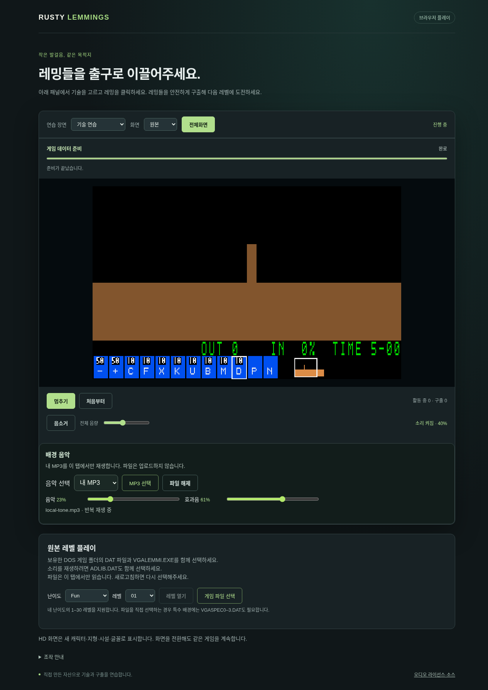

# #202 사용자 로컬 MP3 BGM 구현·검증

이슈: https://github.com/edwardkim/ohmylemmings/issues/202

상태: 구현·로컬/플랫폼 검증·self-review·실제 병합·배포와 메인테이너 최종 사용 확인까지 완료. #202를 완료 처리한다. 기준 main `3ee06c63bd33fab9456c3383c7422b7a97231cf4`. [계획](../plans/issue-202_local_mp3.md) · [선행 검토](issue-200_custom_bgm_review.md).

Web은 별도 MP3 선택과 원본/내 음악/끄기, 음악·효과음·전체 음량, 한 곡 반복, 준비/재생/차단/오류/재시도·파일 해제를 제공한다. HTMLMediaElement와 object URL을 사용하며 업로드·영구 파일 복사·전곡 WASM/AudioBuffer 디코딩을 하지 않는다. 새로고침 후 재선택한다.512MB 이하 DRM 없는 MP3가 대상이다.

Native는 MP3를 창에 드롭하거나 `--bgm FILE`로 선택한다. 별도 파일 선택 대화상자는 없다. F6 원본/MP3/끄기, F7 재시도, F5 파일 해제, `[`/`]` 음악·`,`/`.` 효과음 음량을 지원하고 창 제목에 상태를 표시한다. MP3 worker의8개×1024프레임 큐와 현재 블록,64KiB 입력 버퍼·제한된 메타데이터/커버아트 처리로 파일 전체 디코딩을 피한다. mono/stereo MP3를 장치 표본율로 변환하고 원본 효과음과 스테레오 출력에 혼합한다. 파일 읽기/디코딩은 게임/장치 처리 스레드 밖에서 수행하며 교체 시 이전 수신 큐를 해제한다.

공통 OPL 드라이버의 음악/효과음 사건·채널 배정·시계는 유지한다. 합성 채널의 출력 gain만 분리하고 release tail의 역할을 보존한다. Unity100/100은 기존 integer PCM과 같으며0gain에서도 envelope/oscillator/VM은 계속 진행한다. 원본/내 음악/끄기 선택은 출력만 바꾸고 시뮬레이션에는 들어가지 않는다. 결과/숨김에서 음악을 정지하며 새 세대·재시작/복귀에서 처음부터 재생한다. 게임 Pause에서는 계속 재생한다. MP3 실패는 게임/원본 효과음을 중단하지 않는다.

Symphonia0.5.5의 MP3 feature만 Native에 고정했다. 총30개 registry 의존성의61개 고지와 대응 소스 URL을 license_inventory/THIRD_PARTY_NOTICES에 기록했다. Symphonia는 MPL-2.0이며 수정하지 않았다. LGPL OPL 변경 기록/patch/소스 전달을 갱신했다. 프로젝트 자체 MIT와 음원 권리는 별개이며 상용 음원을 포함하지 않는다.

## 로컬 검증

- TDD red: AudioOutput의 set_mix 부재로 새 테스트 실패, 구현 후 음악 무음·전체18효과음 지속/시계·unity 동일성/잘못된 음량 원자성 검사 통과.
- 고정 C buffered 대조24사례/3,502,528프레임 통과. 기존 PCM golden을 변경하지 않았다.
- Native worker: 합성 MP3 stereo/loop·표본율/상한 블록·없는/잘못된 파일 검사 통과. 실제 SDL dummy 큐의 stereo·소비·숨김 시 제거·모드 전환 probe 통과(peak6251).
- 실제 Chromium의 파일 입력으로 합성 MP3 선택·사용자 소리 켜기·좌우2048샘플 비영/서로 다른 출력·loop·음량·숨김/복귀·끄기/효과음 gain 유지·손상 MP3 오류/재시도 표시·해제/원본 복귀를 확인했다. 게임 상태 동일, 업로드 요청0, 브라우저 예외0.
- Node 수명주기 검사: autoplay 차단/재시도·취소/늦은 play 완료·세대·독립 gain·오래된 파일 사건 무시·URL 해제 통과.
- 전체 회귀/패키지/CI와 최종 self-review를 완료했다. 실제 사람의 새 MP3 청취 판정은 아직 없다. 최종 절에 인수 범위를 기록한다.

스크린샷은 프로젝트가 직접 합성한440/660Hz MP3와 연습 장면이다. 원본 게임/K-pop 녹음이 아니다. fixture의 생성 명령·해시·크기는 [기록](../../assets/manifests/local_music_fixture.json)에 고정했다. 실제 원본 및 HD 게임 재생·배포 인수는 최종 검증에서 별도로 기록한다.

## 최종 CI·병합·메인테이너 제공 파일 검증

[PR #203](https://github.com/edwardkim/ohmylemmings/pull/203)의 self-review와 [CI40058528349](https://github.com/edwardkim/ohmylemmings/actions/runs/40058528349)를 완료했다. Windows 전체 게임·macOS Apple Silicon/Intel·Linux Native·Web 브라우저·WASM·Python **7개 모두 SUCCESS**다. 설치 검사는 압축 해제한 실행 파일로 새 MP3 stereo/큐/정지 probe까지 실행한다. Windows hosted OS는 Server2022이며 실제 사용자 Windows11 청취 판정을 대신하지 않는다.

| 항목 | 고정 값 |
|---|---|
| 최종 head | `efc8a1630763136b085564f783000f239edaca87` |
| CI checkout | `e7a18b2bf84169652cb53b6e73823cc3e5d6bddb` |
| 실제 merge | `b60e389a04b1592a276483d8e9d2ca155b87dcc3` |
| 공통 tree | `70192659e861ddb60531bfc3a20a56f417507bec` |

CI checkout과 실제 merge tree가 같다. 로컬 `make check-rust`의 Rust724개·기존 PCM/C/게임 사운드 검사, `make check-python`의 Python319개·HD/COMP/G11/성능 자료 감사·322,560전이/108재생을 통과했다. 원본21곡×60초와 효과음 혼합도 고정 C buffered 출력과 바이트 단위로 같았다. 기본 PCM golden과 게임 사건 trace를 변경하지 않았다. 처음 누락한 과거 audio.js producer는 동일 바이트의 공개 snapshot으로 옮겼으며 과거 측정값·producer·NOT READY는 보존했다. 취소/실패한 이전 CI는 성공에 포함하지 않는다.

메인테이너가 제공한 로컬 MP3 두 파일(44.1kHz stereo, 약206/223초)도 추가 확인했다. Web HD 게임에서 각 파일의 실제 재생·곡 끝 반복·곡 교체/이전 재생 정지·숨김/복귀·해제/원본 복귀를 확인했고, MP3가 재생되는 동안 원본 효과음의9,151개 비영 PCM 샘플도 출력됐다. 업로드 요청/브라우저 예외는0이었다. Native는 각 파일로 실제 게임 루프를 실행하고 SDL disk 장치가 출력한 약325,000 stereo 프레임/파일의 비영·서로 다른 좌우 출력을 확인했다. 별도 SDL dummy probe도 통과했다. 두 원본 파일의 크기/SHA는 전후 동일하다. 파일명·경로·원본·파생 PCM/스크린샷은 공개 기록에 넣지 않고 ignored 개인 검증 경로에만 보관한다.

main 개발 버전과 로컬 개발 서버/`preview-202/`에 반영한다. **#202는 메인테이너의 실제 MP3 청취 확인 대기로 OPEN을 유지**한다. 파일 제공을 사람의 청취 합격으로 해석하지 않는다. 기존 #165 인수와 #113 NOT READY, 게시된 v0.2.0 태그/파일/버전 노트는 그대로 보존한다. 이 기능은 main 개발 버전이며 새 릴리즈/Pages 게시는 별도다.

## v0.3.0 정식 게시 (2026-10-24)

메인테이너 지시로 [#205 정식 릴리즈/Pages](issue-205_release_v030_completion.md)를 완료했다. 위 main 개발 버전/별도 게시 문구는 당시 기록이다. 실제 공개 HTTPS 게임에서 제공 MP3 두 파일의 재생·곡 끝 반복·교체·숨김/복귀·효과음 동시 출력과 업로드/예외0을 다시 확인했다. #202는 새 MP3의 사람 청취 응답만 기다리며 OPEN을 유지한다.

## 메인테이너 최종 인수 완료 (2026-10-24)

메인테이너가 #202 종료 여부를 확인하며 “확인은 했습니다.”라고 실제 사용 확인을 전달했다. 구현/자동 검사/제공 MP3 디지털 출력·배포는 이미 완료했고, 마지막으로 남겨 두었던 사람의 사용·청취 확인도 충족했으므로 #202를 완료 처리한다. 위 OPEN/응답 대기 문구는 확인 전 당시 기록이다.

기능은 [v0.3.0 정식 배포](https://github.com/edwardkim/ohmylemmings/releases/tag/v0.3.0)에 포함했고 [#208 v0.3.1](issue-208_native_polish.md)에서 Native F4/Ctrl+O/Cmd+O 파일 선택 창·앱 아이콘까지 개선했다. [최신 다운로드](https://github.com/edwardkim/ohmylemmings/releases/tag/v0.3.1) · [웹 플레이](https://edwardkim.github.io/ohmylemmings/). 게시된 버전 노트·태그·asset은 당시 기록으로 보존한다. #113 성능 NOT READY는 별도다.
