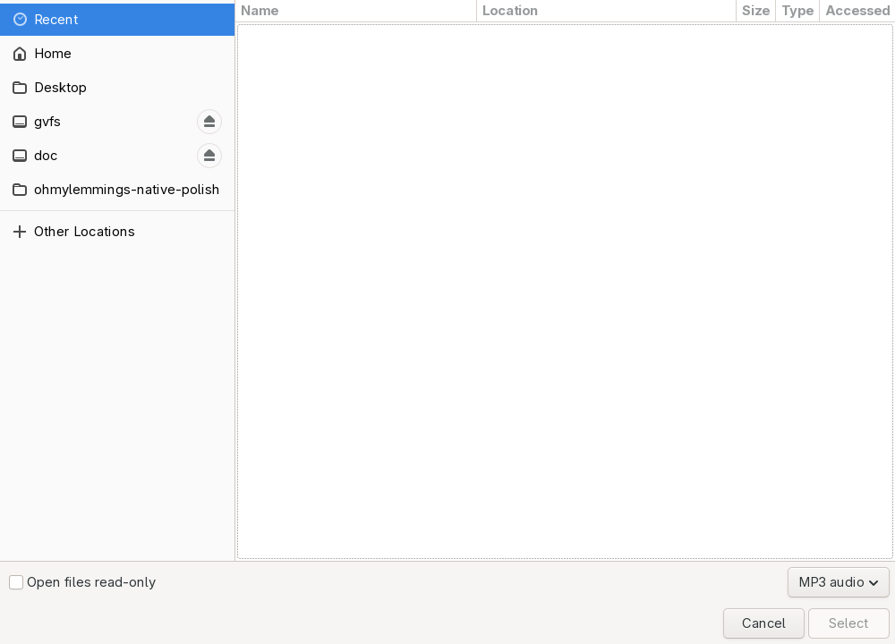

# #208 Native MP3 선택 대화상자·앱 아이콘 / v0.3.1

이슈: https://github.com/edwardkim/ohmylemmings/issues/208

상태: 구현·로컬 Rust/Python·실제 Native UI 검증 완료. 플랫폼 CI·병합·패키징/게시 검증은 후속 절에 고정한다. [계획](../plans/issue-208_native_polish.md) · [v0.3.1 실행 안내](../releases/issue-208_v0.3.1.md). 기준 main `0a7ddaca3675d575a2ffb67ed261fa7e202c5431`.

## 파일 선택 동작

Native에서 F4/Ctrl+O(macOS Cmd+O 포함)로 운영체제 MP3 단일 파일 선택 창을 연다. 대소문자 확장자·공백/유니코드 경로를 지원한다. 기존 드롭/--bgm과 같은 AudioService 선택 경로를 사용하며 취소 시 음악/모드/음량을 바꾸지 않는다. 창 제목에 F4 선택 안내를 표시한다. Alt+F4·일반 O·키 반복/Shift 조합은 선택 창을 열지 않는다.

선택 창이 열리는 동안 SDL 장치 큐를 정지/비우고 Stream/선택을 유지한다. 호스트의 동기 대화상자 처리 동안 게임 틱은 진행하지 않으며, 복귀 시 호스트 시계/표시 deadline을 재설정한다. 세션의 Pause나 시뮬레이션 시계는 변경하지 않는다. 포인터/누른 패널을 해제하고 대화상자의 오래된 키/클릭을 버린다. 창 닫기/표시 사건은 유지한다. 전체화면을 잠시 해제했다가 기존 상태로 복원한다. 결과/음소거·손상 MP3/재시도 등 기존 음악 정책은 유지한다.

rfd0.17.2를 정확히 고정했다. Windows Common Item Dialog·macOS NSOpenPanel·Linux XDG portal/zenity를 사용하며 SDL raw-window-handle로 부모 창을 전달한다. Linux에서는 libdbus와 파일 선택 portal backend 또는 zenity가 필요하다. 선택한 음원은 업로드/번들링/영구 복사하지 않는다.

격리한 Xvfb/D-Bus의 GTK portal에서 캡처했다. 원본 DOS/사용자 음악을 포함하지 않은 합성 게임 테스트다. 일반 데스크톱의 창 장식은 해당 운영체제/창 관리자에 따른다.

## 실행파일·앱 아이콘

원본 DOS 픽셀/다운로드 이미지/폰트 없이 작성한 SVG와 [재생성 안내](../../apps/desktop/resources/README.md)를 제공한다. 프로젝트 MIT이며 [해시/출처](../../assets/manifests/app_icon.json)에 고정했다.

- Windows: embed-resource3.0.12로 EXE에7크기(16/24/32/48/64/128/256) ICO와 Cargo의 FileVersion/ProductVersion을 내장한다. 리소스 컴파일 실패는 빌드를 실패시킨다. 패키징 도구가 실제 PE의 RT_GROUP_ICON101/RT_ICON을 읽고 전부 원본 PNG와 비교한다.
- macOS: 앱 Resources에 ICNS16~1024를 넣고 Info.plist CFBundleIconFile을 연결한다. 서명 이전에 스테이징하고 패키지/서명 검증에 포함한다.
- SDL: 64×64 RGBA를 실행파일에 내장해 작업 디렉터리와 관계없이 창 아이콘을 설정한다. Linux 패키지에는256픽셀 PNG도 제공한다. 시스템 아이콘 설치/사용자 데스크톱 설정 변경은 하지 않는다.

## 검증과 범위

- TDD: 선택 단축키가 없는 상태에서 실패를 확인한 뒤2개 키 경계 검사를 통과했다. 새 modal 오디오 probe 항목을 요구하는 검사도 먼저 실패하고 구현 후 통과했다.
- Rust 전체726개, Python325개 통과. fmt/clippy·기존 원본 OPL/C/음악/게임 사운드와 COMP/G11/과거 성능 자료 감사도 통과했다. 초기 의존성 개수 고정값30은 새 검토 목록74로 갱신했다.
- 실제 격리 Native UI: F4/Ctrl+O 열기, 선택/취소, 한글·공백 이름/.MP3 선택과 반복, 선택 창2초 동안 표시 캡처 동결, 선택 후 취소 시 음악 유지, 전체화면 복귀·F5 원본 전환을 확인했다. X11 _NET_WM_ICON의64×64 ARGB도 내장 RGBA와 전 픽셀 일치했다.
- 실제 SDL dummy stereo probe는 선택 창 동안 queue pause/clear·선택/모드 보존·복귀 후 재생을 확인했다. 같은 probe를 각 플랫폼의 압축 해제한 패키지 실행 파일에서도 실행한다.
- 실제 LLVM Windows 리소스 컴파일러/PE 링커로 아이콘을 내장한 독립 합성 PE를 만들고7개 RT_ICON 바이트를 비교했다. 손상/누락/잘못된 크기·경계/중복/변조 아이콘과 패키지 입력을 거부하는 오프라인 검사를 추가했다. 플랫폼 CI에는 실제 Windows Shell 아이콘 추출·FileVersion/ProductVersion 일치와 macOS iconutil ICNS 디코딩을 추가했다. 실제 게임 Windows EXE/Mac 앱 판정은 플랫폼 CI 결과를 따른다.

no_std 코어·게임 규칙·기본 OPL/PCM 합성은 변경하지 않았다. 외부 registry74개/고지136개를 기록하며 기존61개 고지/번들 원문을 보존했다. objc2 계열 crate에 누락된 LICENSE.md는 각 archive의 cargo_vcs_info 커밋에 고정한 공식 저장소 원문을 보관했다. 기능 소스 인덱스만 갱신하고 과거 producer/측정값은 유지했다.

사용자19222/8080·기존 미리보기와 Music 원본, 게시된0.1.0/0.2.0/0.3.0 태그·asset·버전 노트를 보존한다. #202 사람 청취 응답과 #113 NOT READY를 별도로 유지한다.
