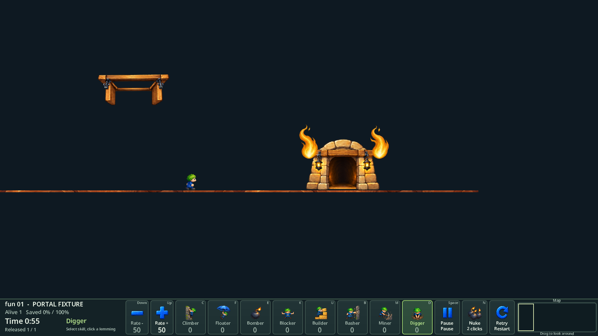
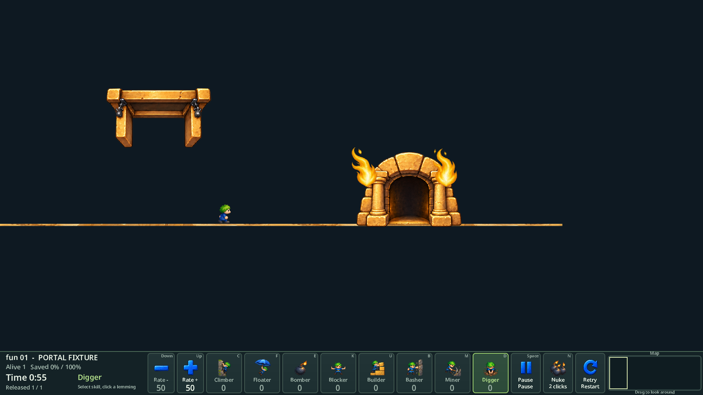

# HD 지형·지물 품질 개선

담당 [#215](https://github.com/edwardkim/ohmylemmings/issues/215). [계획](../plans/issue-215_hd_surface_quality.md), [진행 기록](../working/issue-215_hd_surface_quality.md).

## 변경과 인수

메인테이너는 질감 개선 이후 수직벽의 직선 윤곽을 지적했다. 5재질과 입출구55프레임을 교체하고, 재질 반복 주기를256→768HDpx로 늘렸다. 보간/이음새 혼합 캐시와 지형 경계 명암을 적용했으며 굴착 시 인접 청크를 갱신한다. 수직면은 재질별 최대2~5HDpx를 안쪽으로 깎아 작은 파단면을 표시한다. 보행면·얇은 벽·강철·건설 계단은 보존한다. 캐시는 선택 재질1개, 최대4MiB다.

메인테이너가 “완벽한 느낌은 아니지만 많이 개선되었습니다. 이번엔 이 수준에서 진행하는 것을 승인합니다.”라고 현재 시각 수준을 인수했다. 큰 기둥 형태 재설계·강철 미술·나머지 함정/장식 그림은 이번 인수 범위에서 제외하고 개선 여지로 남긴다. 새 플레이 피드백5건은 [#216](https://github.com/edwardkim/ohmylemmings/issues/216)으로 분리한다.

built-in image_gen으로 생성한 PNG는 원본 바이트 그대로 보존했다. [자산·정확한 프롬프트 목록](../../assets/remaster/README.md), `hd_surface_quality.json`의 출처/해시/55프레임 정렬 기록으로 추적한다. 기존 PNG도 보존한다.

## 검증

- 질감 구현 전체 `make check-rust`:731개 Rust 테스트 및 오디오/상태 참조 검사 통과. Python330개 통과.
- 윤곽 추가 후 HD 관련19테스트, 양쪽5테마 절삭 상한/보행면/얇은 벽/마스크 불변 테스트, clippy 통과.
- 요청8레벨(Fun02/03/04/05/06/07/08/12)100틱 Native 전후 상태·맵·입력160파일 동일.
- 실제 Native/Web5테마 합성 코스947상태, Canvas120프레임, 입출구55/출구효과30프레임, 맵·오디오 동일 및 콘솔 오류0.
- 실제 Web Fun01 664틱/10구출 Won, 기술 선택/배정·미니맵·일시정지·재시작·전체화면·원본 복귀 통과.
- runtime pack131,060,268bytes, 전체 Web압축 페이지96,920,745bytes(기존95,537,433). 초기 다운로드 합계가 아니며 기존 점진적 전송을 유지한다.
- #113 성능 NOT READY는 유지하며60fps 인수/전체120레벨 신규 완주를 주장하지 않는다. CI/병합 결과는 후속 확정 기록에 남긴다.

## 자체 합성 장면

원본 레벨 캡처는 ignored local에만 보관한다. 아래는 자체 합성 코스의 실제1920×1080 Web 캡처다.

공식 태그·버전·릴리즈·Pages는 변경하지 않는다. 로컬 `/preview-215/`와 `/preview-215/contour-review.html`에 승인 후보를 유지한다.
