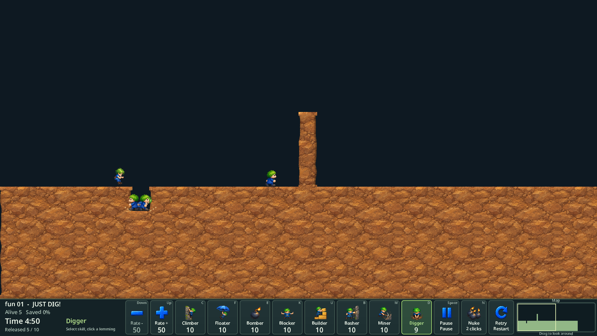

# WebGPU 구현·v0.3.4 배포 검증

담당 [#246](https://github.com/edwardkim/ohmylemmings/issues/246), [계획](../plans/issue-246_webgpu.md), [릴리즈 노트](../releases/issue-246_v0.3.4.md).

## 구현과 로컬 인수

WebGPU adapter/device/비동기 파이프라인을 준비하여 원본 RGB·HD draw-list를 직접 표시한다. premultiplied RGBA·선형 필터·draw 순서·960px 게임 영역 clip을 지원하며 revision이 같은 텍스처는 재업로드하지 않는다. 원본은 nearest 필터로 표시한다. 입력 canvas를 유지하고 같은 위치의 GPU 표시 canvas를 사용하므로 장치 손실에도 포커스/입력/게임 상태를 유지한다. 미지원·비보안 origin·실패·3초 시간 초과·GPU 오류/loss에는 Canvas2D로 복구한다. 실제 renderer와 사유는 화면/F2에 기록한다.

- Node 계약 테스트: API 없음/비보안/명시 Canvas2D/초기화 실패·시간 초과와 늦은 자원 해제/초기화 중 loss/실행 중 loss/동기 draw 실패·캐시 revision/해제/명령 순서·clip·premultiplied alpha 통과. 구현 모듈이 없을 때 실패를 확인한 뒤 구현했다.
- Python 전체340개·배포/Pages/Web 빌드 관련34개 테스트 통과. 최초 전체 검사에서 소스 pin 불일치를 발견하여 이전 pin과 역사 판정을 보존하면서 현재 source-index를 갱신했다.
- WASM 빌드와 `make check-wasm` 통과. 실제 WASM/Native/Canvas2D 회귀33사례×2회,11,960상태·6,877프레임/readback 통과. HD13장면·7,593상태·821프레임·337캐릭터 프레임과 입력/음향/지형 일치를 포함한다.
- Chromium152/Intel gen-12lp, `isFallbackAdapter=false`에서 실제 WebGPU 원본 RGB 픽셀 전수 일치. 합성 blend/crop/negative destination/clip/revision, 굴착·폭발·승리/실패 HD 화면, 게임/음향 상태 유지와 device.destroy에 따른 복구 통과.
- 실제 제품 DOM에서 Fun01→02→22 HD 전환, 원본/HD 선택, 입력 canvas/표시 위치 일치, Pause 상태 device loss·복귀 입력·원본 전환·재시작 통과. 초기 GPU 선택과 fallback 안내도 확인했다.

HD는 Canvas2D와 완전 동일한 픽셀을 주장하지 않는다. 합성 확대 이미지의 필터 가중치 차이는 최대12/255였고, HD 장면 RGBA 평균 차이는0.0144~0.1749/255·최대15/255였다. 합성 비필터/clip 영역은2/255 이내로 검사한다. 필터 영역은16/255 이내로 제한했다. 전체120레벨 재완주나 FPS 성능 측정은 이번 검증에 포함하지 않는다.

Linux headless 실제 GPU 검사에는 `--enable-unsafe-webgpu --enable-features=Vulkan --use-angle=vulkan --disable-vulkan-surface`를 임시 프로필에만 사용했다. 일반 사용자 브라우저 설정은 변경하지 않았다. GPU canvas를 Canvas2D로 직접 읽으면 검증용 캡처가 투명하게 반환되는 문제가 있어, 실제 GPU texture→mapAsync readback으로 검증했다. 처음 두 옵션만 사용한 시도에서는 Chrome SharedImage 오류도 발생했다. 실패한 시도는 통과 증거에서 제외하고 보존했다.

개인 원시 증거: `assets/local/issue-246/`. 최종 GPU: `gpu-original-final/summary.json`. Canvas 회귀: `web-regression/summary.json`. 기존 사용자 브라우저/서버와 원본 MP3는 유지했다.

## 배포 진행

메인테이너가 구현 완료 후0.3.4 릴리즈·Pages 게시를 승인했다. Cargo workspace/lock9개와 한·영 안내/릴리즈 노트를0.3.4로 준비했다. 플랫폼 CI·태그 전 사전 검증·정식 게시·공개 파일/소스/플레이 검증 결과는 완료 후 이 절에 기록한다.
