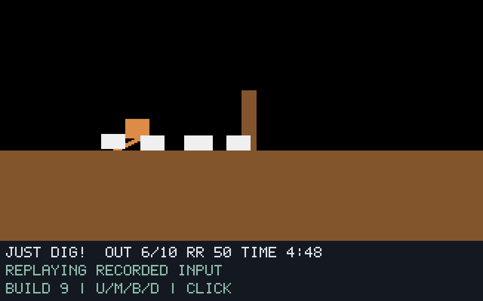

# G07-04 Builder 결과

이슈: [#34](https://github.com/edwardkim/ohmylemmings/issues/34), 상위 [#1](https://github.com/edwardkim/ohmylemmings/issues/1).

## 구현

Builder 할당과 수량, 12개 벽돌, Building/Shrugging 상태, 양방향 계단 생성과 발·머리·경계 충돌을 no_std 코어에 구현했습니다. 기존 세 굴착 직업과의 전환, ID 순 지형 관측, 산술 오류 시 해당 개체와 지형 보존을 유지합니다. 네이티브에서는 U/M/B/D 선택·클릭·안정된 ID 재생·스프라이트·수량을 연결했습니다.

충돌 마스크와 벽돌 재질을 별도로 보존하므로 같은 틱의 굴착/재생성에서도 새 벽돌색을 표시합니다. 실제 DOS 비교에서 발견한 첫 custom 지형색 연결 오류는 자체 합성 GROUND 회귀 테스트를 먼저 실패시킨 뒤 보정했습니다.

## 로컬 검증

- 새 코어 12개 테스트(프레임·벽돌 수·방향 360조합 포함), 데스크톱 5개, Python 6개를 확인했습니다. 전체 `make check`는 378.189초에 성공했으며 Rust 359개·문서 27개·Python 53개, 포맷·Clippy·빌드·모델/기준·기존/Builder SDL·WASM을 통과했습니다.
- 실제 Pascal 28함수와 합성 8사례/16재생/6736상태·모든 경계별 지형 추가/삭제가 일치하고 SDL 718캡처가 픽셀 단위로 일치합니다. CI는 원본 없이 자체 합성 데이터와 실제 함수 실행에서 기록한 golden을 검사합니다.
- 최종 원본 Fun07 네이티브 4실행/1244상태/139캡처가 기준 함수·SDL readback과 일치했습니다. 실제 U키/마우스로 입력80의 ID0을 기록했습니다. 렌더 간격1/7·실시간 재생의 상태 서명은 `985c867c7211450e7fb36b116c0d686e29b11c35c439306cce56e3ce4afd3cc0`입니다.
- 최종 DOS 두 실행의 1303개 숫자 샘플·4760게임 영상 프레임에서 수량20→19·Building0x80·벽돌12개 진입을 읽기 전용으로 관측했습니다. 220/260/340 전체320×160 장면×2회가 0픽셀 차이입니다. 정확한2배 픽셀/스캔라인·RGB565 정규화만 사용하며 커서 마스크·위치 이동·색 허용 오차는 없습니다.
- 원본 Digger/Basher/Miner의 렌더 간격1/7 회귀 6재생/2046상태/146캡처와 기존 상태/삭제 서명이 일치합니다. F00 341상태의 서명 `3e56870904094448fdeab59715ce9c7ad96ec25deb9ff34017cd24058d74d4fe`도 유지합니다.
- 최종 release 재빌드의 실행 파일 해시는 기존 네이티브 증거와 동일한 `d2a4c1768e56c7e47c917d9cacb970f0cbcf03684e710ea98bab060bf0358893`입니다. 원본50개·고정 소스46개와 DOS 두 실행 사본의 각50개 파일 불변을 확인했습니다. 109소스/1201산출물 해시와 출처·실행 조건·원본 불변 검증은 [Builder manifest](../../assets/manifests/builder.json)에 기록합니다.

## 화면 자료

아래는 원본 데이터 없이 자체 생성한 지형·스프라이트를 실행한 SDL 화면입니다. U 선택과 계단 재질을 보여 줍니다. 원본 Fun07 화면과 DOS/네이티브 비교 그림은 ignored `assets/local/`에만 보관합니다.

## 실행 조건과 한계

이번 Arch DOSBox가 실제 생성한 256바이트 RUSSELL.DAT의 해시를 고정하고 offset0만9→0으로 바꾼 별도 런타임 seed를 사용했습니다. 원본50개와 EXE·에뮬레이터·게임 메모리는 변경하지 않습니다. 이전 Ubuntu 생성 파일과 나머지 바이트가 같다고 간주하지 않습니다. 반복 두 실행의 바이너리·seed·정규화한 설정·mapper·입력 절차가 같습니다.

숫자 관측은 비동기 필드 폴링이므로 원자적 전체 상태나 입력 틱 정렬을 인증하지 않습니다. 전체 플레이 영역의 세 장면 일치와 전체 화면/HUD·속도·모든 직업·객체/구출/승패·음향·전체 DOS 인증을 구분합니다. 초기 색 교정 실행과 runtime guard 종료 실행은 최종 횟수에서 제외하고 bootstrap 파일은 seed 출처로만 보존합니다.

## 게시와 다음 절차

구현 `2039e329b29391ff0b82238571494404015904e2`의 [push CI](https://github.com/edwardkim/ohmylemmings/actions/runs/39200250629)와 [PR CI](https://github.com/edwardkim/ohmylemmings/actions/runs/39200279750)에서 정확한 head SHA·Rust native/Python tooling/WASM libraries 세 작업·실제 로그를 확인했습니다. Rust359/문서27/Python53·Builder16재생/6736상태/718캡처·기존 SDL/모델·clean-input/SDL SDK/잠금 의존 준비가 성공했습니다. 원격250개 파일의 모드/blob이 로컬 커밋과 같습니다.

2026-10-19 사용자 지시에 따라 [PR #35](https://github.com/edwardkim/ohmylemmings/pull/35)를 self-review했습니다. 고정 원문의 할당·벽돌 배치·하위 이동/충돌·소진/상부 처리 순서, 복원 불변식·산술 오류 보존·ID 순 지형 관측, SDL 재질·객체 합성·일시정지/ID 입력 재생, 기준 호스트·golden·DOS 반복 판정과 보고 범위를 검토했습니다. 추가 코드 수정이 필요한 결함은 발견하지 못했습니다. 작성자 자체 검토 결과입니다.

최종 문서 커밋의 CI, 병합 SHA·#34 종료는 [이슈 기록](https://github.com/edwardkim/ohmylemmings/issues/34)에서 추적합니다. G07-04의 구현·검증·자체 검토를 마쳤으며 G07 전체는 진행 중입니다.

[계약과 재현 명령](../tech_insights/issue-34_builder.md), [진행 기록](../working/issue-34_builder.md), [작업일지](../orders/20261019.md#issue-34).
