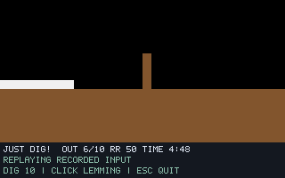

# G07-05 Blocker 결과

이슈: [#36](https://github.com/edwardkim/ohmylemmings/issues/36), 상위 [#1](https://github.com/edwardkim/ohmylemmings/issues/1).

## 구현

Blocker 할당/수량·16프레임 Blocking·4픽셀 객체 맵의 방향 전환 영역을 no_std 코어에 구현했습니다. 아홉 칸의 원래 바이트를 저장하고, 영역 겹침을 거부하며, 발판 소실 때 같은 틱에 복원합니다. 이후 개체는 ID 순서에 따라 변경을 관측합니다. 기존 네 직업의 객체 확인 프레임과 강철/일방통행 제한을 연결하고, 방향 전환 전에 읽은 객체 캐시를 후속 할당에서 재사용합니다.

네이티브는 K/U/M/B/D 선택·클릭·안정된 ID 재생·실제 Blocking 스프라이트·수량과 영역 추적을 지원합니다. 보이는 Xwayland 창의 정수 배율/검은 여백 전체를 검증하도록 SDL readback을 보완했습니다. 데스크톱 설정은 변경하지 않았습니다.

## 검증

- 코어 새9개 테스트는6개 할당 가능 행동×16좌표 정렬,9칸×3겹침 코드, 양방향/직업 프레임 게이트, 강철 복원, 동일 틱 굴착/해제 순서, 잘못된 복원/ID·맵 누락·캐시 읽기 순서를 다룹니다. 네이티브 새4개와 Python 새5개를 포함합니다.
- 실제 Pascal37함수와 합성8사례/16재생/6736상태·SDL340캡처·모든 경계별 지형/객체 맵 변경·캐시가 일치합니다. 원본 없이 CI에서 같은 golden과 어댑터 해시를 검사합니다.
- 원본 Fun03 네이티브4실행/1244상태/53캡처가 기준 함수와 일치합니다. 실제 K키·클릭은 경계80의 ID0을 기록했습니다. 렌더 간격1/7·실시간 재생의 상태 서명은 `972ea96103421be4bbdde6d297740d17a9afe811eeeb5ac47e0e1aca6d5108b3`입니다.
- DOS 두 실행에서1306개 비동기 숫자 샘플·4762게임 영상 프레임을 보존했습니다. 수량10→9·Blocking0x100·저장9바이트를 읽기 전용으로 관측했고, 220/260/340의 전체320×160 장면×2회가0픽셀 차이입니다. 정확한2배 픽셀/스캔라인·RGB565 코드 정규화만 사용합니다. 커서 마스크·위치 이동·색 허용 오차는 없습니다.
- 기존 Digger/Basher/Miner/Builder의 렌더 간격1/7 회귀8재생/2728상태/220캡처와 각 기존 서명이 일치합니다. F00의341상태 서명 `3e56870904094448fdeab59715ce9c7ad96ec25deb9ff34017cd24058d74d4fe`도 유지합니다.

최종 `make check`는128.598초에 성공했습니다. Rust372개·문서27개·Python59개·포맷/Clippy/오프라인 빌드·기존 모델/전체 SDL·WASM을 통과했습니다. 모든 SDL 통합 사례는 release 빌드 하나로 실행하며 단위 테스트는 debug 빌드를 유지합니다. 초기 전체 검사의 종료 신호 실행은 완료에서 제외했습니다. 최종 실행 파일 해시는 `c4f18256d6a79e833b233c734b26e4e2928d8537c36c80f70e8d21e06e476367`입니다. 출처·소스/산출물 해시는 [manifest](../../assets/manifests/blocker.json)에 기록합니다.

## 자체 검토와 화면 근거

self-review에서 고정 원문의 전환·영역 저장/복원·상호작용 확인 순서·캐시 수명·기존 API와 오류 보존, 객체 초기화·SDL 입력/화면·기준 호스트·반복 DOS 판정을 검토했습니다. 객체 맵 초기화가 원래 파일 슬롯 번호를 그대로 사용하던 차이를 발견했습니다. 실패하는 회귀 테스트를 먼저 확인하고 입구 제외 후 압축한 목록의 처음16개·트랩 번호를 사용하도록 보정했습니다. 강철 덮어쓰기·음수 패딩·잘못된 효과 코드도 자체 바이트 fixture로 확인합니다. 수정 후 원본 네이티브와 네 직업 회귀의 재실행도 같은 서명으로 통과했습니다. 작성자 자체 검토 결과입니다.

아래는 자체 생성 지형/스프라이트로 Blocker 입력80 이후 경계220을 실행한 SDL 화면입니다. 합성 레밍은 검사 목적의 사각형이며 원본 Fun03의 실제 스프라이트·DOS/네이티브 비교 그림은 ignored `assets/local/`에 보관합니다.

## 실행 조건과 한계

원본50개·고정 소스46개를 검증했습니다. #34에서 실제 생성한256바이트 RUSSELL.DAT을 해시로 고정하고 offset0만9→0으로 바꾼 별도 seed를 재사용했습니다. DOSBox0.74-3·VGA/PC2·고정10000cycles와 mapper/메뉴/키보드 절차를 유지합니다. 원본50개와 EXE·에뮬레이터·게임 메모리는 변경하지 않습니다. 두 실행은 서로 다른 녹화 경로·같은 프로토콜을 요구합니다.

최종 기준은 reference-3, 최종 네이티브는 native-final-2입니다. 초기 기준 어댑터/캐시 준비물과 크기·초점 처리에 실패한 네이티브 실행, 초기/중간 바이너리 실행은 최종 횟수에서 제외합니다. 성공한 DOS proof-1/2만 두 실제 실행으로 셉니다. 비동기 숫자 폴링과 세 장면 대조는 원자적 전체 DOS 상태·입력 틱 정렬·전체 HUD/속도·전체 게임 호환성을 인증하지 않습니다.

Bomber에 의한 Blocker 해제는 Bomber 통합에서 검증합니다. 트랩/물/불/구출/승패·음향과 G07 전체 완료는 후속입니다. 게시·실제 CI·병합/종료는 [#36](https://github.com/edwardkim/ohmylemmings/issues/36)에 기록합니다.

[계약과 재현 명령](../tech_insights/issue-36_blocker.md), [진행 기록](../working/issue-36_blocker.md), [작업일지](../orders/20261019.md#issue-36).
