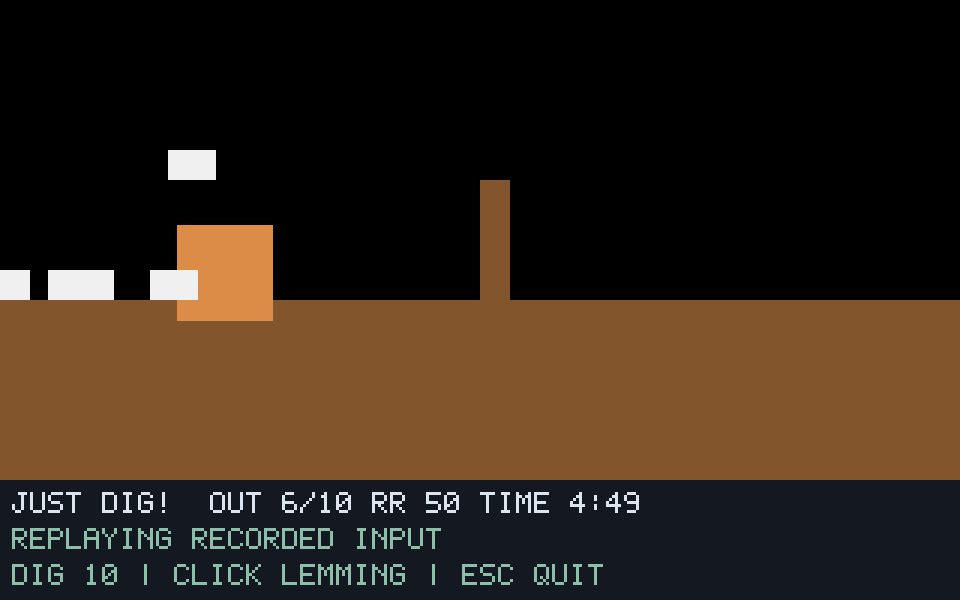

# G07-06 Bomber 결과

이슈: [#38](https://github.com/edwardkim/ohmylemmings/issues/38), 상위 [#1](https://github.com/edwardkim/ohmylemmings/issues/1).

## 구현

Bomber 할당·수량·79틱 카운트다운·기존 행동 병행·OhNo16프레임·폭발·52틱 입자를 구현했습니다. 폭발은 저장된 Blocker9칸을 먼저 복원하고 발의 물/강철 코드를 확인한 뒤16×22 마스크를 지웁니다. ID 순서와 동일 틱의 지형/객체 맵 관측을 유지합니다. 코어는 no_std이며 리소스/렌더링/I/O 의존성이 없습니다.

SDL은 E키 선택·클릭·안정된 ID 재생·원본 숫자/OhNo/폭발/입자를 표시합니다. 입자8160바이트는 기존 원본 EXE에서 읽으며 고정 Lemmix 표와 전체 해시가 같습니다. 엔진 리소스만 있고 EXE가 없으면 입자 그림을 생략합니다. EXE를 제공했지만 크기/MZ 프로필이 다르면 오류입니다. 런타임 프로필 검사는 전체 파일 해시 검증을 대신하지 않으며 원본 확보 도구가 해시를 검증합니다.

## 검증

- 코어 새9개는 기존 직업과의 병행·중복/거부·79/16/1/52틱 경계·Splatting 취소·Blocker 복원 후 강철/물 판정·마스크/좌표 경계·중간 오류 보존·ID 순서를 검사합니다. 리소스 새2개·네이티브 새5개·Python 새3개도 포함합니다.
- 고정 Pascal43함수의 실제 실행과 합성8사례/16재생/6736상태·SDL514캡처·경계별 전체 지형/객체 맵 변화와 카운터가 일치합니다. 원본 없이 CI에서 같은 golden과 어댑터 해시를 검사합니다.
- 원본 Fun06 네이티브4실행/1364상태/111캡처가 기준 함수와 일치합니다. 고정 입력80 Blocker/100 Bomber의 렌더 간격1/7·실시간 재생 상태 서명은 `500544b5ecd9352dfa13d0426de61bfe2e8eca1ab471af5456a63c96d43f5e95`입니다. 실제 E키·클릭은 경계80 ID0 Bomber를 기록했습니다.
- 서로 다른 DOS 두 실행에서1365개 비동기 숫자 샘플·4761게임 영상 프레임을 보존했습니다. F6 Blocker와 F5 Bomber 선택·각 수량5→4·타이머·OhNo/폭발/입자 후 제거를 읽기 전용으로 관측했습니다. 130/146/162의 숫자,195의 폭발,196의 첫 입자,260/300/340의 폭발 후 전체320×160 장면이 두 실행 모두0픽셀 차이입니다. 정확한2배 픽셀/스캔라인·RGB565 코드 정규화만 사용하며 커서 마스크·위치 이동·색 허용 오차는 없습니다.
- 기존 Digger/Basher/Miner/Builder/Blocker 렌더 간격1/7의10재생/3410상태/248캡처와 각 과거 서명이 일치합니다. F00의341상태 서명 `3e56870904094448fdeab59715ce9c7ad96ec25deb9ff34017cd24058d74d4fe`도 유지합니다.

최종 `make check`는177.289초에 성공했습니다. Rust388개·문서27개·Python62개·포맷/Clippy/오프라인 빌드·기존 모델/전체 SDL·WASM을 통과했습니다. 최종 실행 파일 SHA-256은 `9336f4d026960252112ffa758d810bb39ee4b9c5d81250161cc160298dd92946`입니다. 출처·소스/산출물 해시는 [manifest](../../assets/manifests/bomber.json)에 기록합니다.

## 자체 검토와 화면 근거

self-review에서 원문 할당·타이머/행동/객체 순서·저장 영역 복원·오류 보존·ID 순서, 리소스 경계·SDL 입력/재질/표시 수명·기준 호스트·DOS 반복 판정을 검토했습니다. 실제 DOS 영상은 Lemmix와 숫자 표시 위치가 오른쪽1/아래4픽셀 다르고 폭발 지형 표시가 한 프레임 늦었습니다. 실패 테스트를 먼저 추가하고 숫자 앵커와 표시용 지형만 보정했습니다. 시뮬레이션은 같은 틱에 지형을 삭제합니다. Pause는 표시용 프레임을 유지하며 렌더 횟수로 수명을 진행하지 않습니다. 수정 후 전체 검사·최종 네이티브·기존 다섯 직업 회귀와 두 DOS 녹화 대조를 다시 통과했습니다. 작성자 자체 검토 결과입니다.

아래는 자체 생성 지형/스프라이트의 경계195 폭발 화면입니다. 합성 레밍과 폭발은 검사용 사각형입니다. 원본 Fun06의 실제 스프라이트·비교 화면은 ignored `assets/local/`에 보관합니다.

## 실행 조건과 한계

최종 reference-3·native-final-2·original-regressions-final·dos-proof-2/3·dos-compare-final만 최종 실행 횟수에 포함합니다. reference-1/2의 Pascal 호스트 준비 오류, DOS proof-1의 F5 선택 실패, 초기 잘못된 DOS 상태 비트 해석과 표시 보정 전 네이티브/회귀/비교는 최종 완료 근거에서 제외합니다. 보정 전 성공한 전체 검사는 이전 단계 기록으로 구분합니다.

원본50개·고정 소스46개와 각 DOS 사본50개를 확인합니다. #34의 실제256바이트 seed를 해시로 고정하고 offset0만9→0으로 변경합니다. DOSBox0.74-3·VGA/PC2·fixed10000cycles·같은 mapper/컨트롤러·서로 다른 녹화 디렉터리를 요구합니다. 원본50개/EXE·에뮬레이터·게임 메모리는 변경하지 않습니다.

DOS의 실제 원시 상태는 Blocker 비트가 남은0x8100(OhNo)/0x8102(폭발·입자)입니다. 저장된 제거 바이트는 입자 종료 후255가 되므로 코어의 논리적 제거 시점과 같은 상태라고 간주하지 않습니다. 비동기 숫자 관측과 여덟 화면 앵커는 원자적 전체 DOS 상태·입력 틱/속도·전체 HUD·모든 직업/객체/구출/승패·음향을 인증하지 않습니다. Climber/Floater·Nuke·G07 전체 완료는 후속입니다.

게시·실제 CI·병합/종료는 [#38](https://github.com/edwardkim/ohmylemmings/issues/38)에 기록합니다. [계약과 재현](../tech_insights/issue-38_bomber.md), [진행 기록](../working/issue-38_bomber.md), [작업일지](../orders/20261019.md#issue-38).
