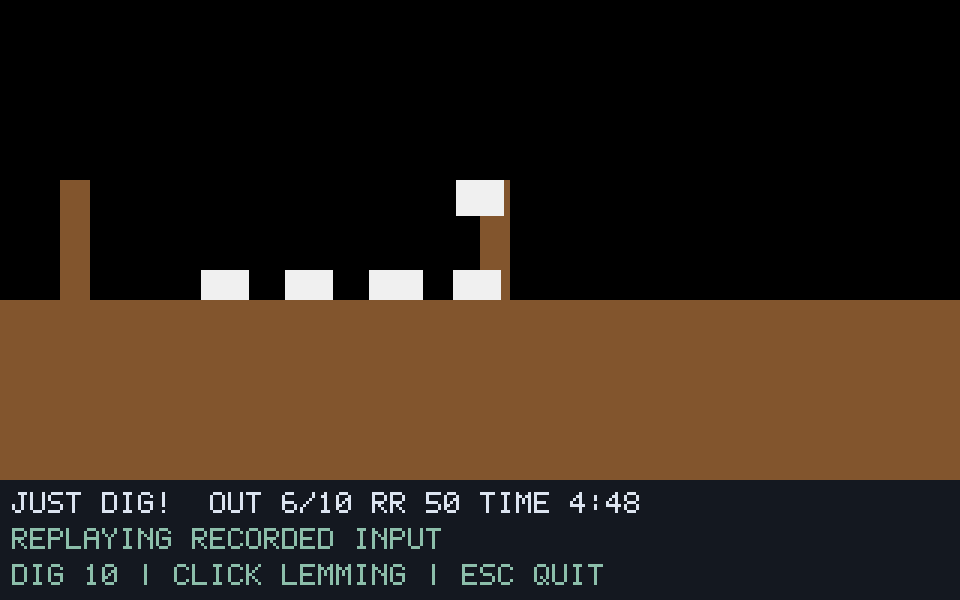

# G07-07 Climber 결과

이슈: [#40](https://github.com/edwardkim/ohmylemmings/issues/40), 상위 [#1](https://github.com/edwardkim/ohmylemmings/issues/1).

## 구현

Climber 영구 능력·수량·높은 벽의 Climbing 진입·Hoisting·머리 충돌/상단 반전·낙하를 no_std 코어에 구현했습니다. 다른 직업이나 Bomber 카운트다운과 함께 유지하며 Blocker/제거/중복 할당은 거부합니다. DOS의 Shrugging 중 할당 버그는 action만 Walking으로 바뀐 뒤 Once 애니메이션이 남도록 별도 상태로 보존합니다. 기본 DOS 규칙과 버그 비활성 규칙을 구분합니다.

SDL은 C키·클릭·안정된 ID 재생·수량·원본 Climbing/Hoisting 방향 스프라이트와 발 앵커를 지원합니다. `climber.jsonl`은 영구 능력과 Walking Once 상태를 기록합니다. `--synthetic-climber`는 자체 생성 좌/우 벽을 사용합니다. 코어에 리소스·렌더링·I/O 의존성을 추가하지 않습니다.

## 검증

- 코어 새10개 테스트는 할당 가능 행동·중복/거부·양방향 벽 높이·등반 프레임/턱 진입 높이·Hoisting/객체 확인·머리/상단 반전·Shrugging 버그·산술 오류 보존·Bomber 만료와 Blocker/제거 거부를 다룹니다. 네이티브 새2개와 기존 숫자 앵커의 Climbing/Hoisting10조합 확장, Python 새3개를 포함합니다.
- 고정 Pascal46함수의 실제 실행과 합성10사례/20재생/8420상태·SDL1100캡처·모든 경계의 지형/객체 맵·영구 능력/애니메이션 상태가 일치합니다. CI는 같은 golden과 어댑터 해시를 원본 없이 검사합니다.
- 원본 Fun04 네이티브4실행/1364상태/240캡처가 기준 함수와 일치합니다. 렌더 간격1/7·실시간·실제 C키/클릭의 상태 서명은 모두 `964db67253e4a4ca45cc0b9e4c2ae669e96ecfdeeaeb8c7fedef1cecde62fe3e`입니다. 실제 클릭은 경계80 ID0을 기록했습니다.
- 독립된 DOS 최종 두 실행의1278샘플/4761게임 영상 프레임에서 수량10→9·영구 능력 bit0·Climbing0x20·머리 충돌 후 Falling0x4/Walking을 읽기 전용으로 관측했습니다. 두 입력은 모두 counter81의Walking(695,77)이었습니다. 136/160/180/200/220/260/300/340 전체320×160 장면이 두 실행 모두0픽셀 차이입니다. 정확한2배 픽셀/스캔라인·RGB565 코드 정규화만 사용하며 커서 마스크·위치 이동·색 허용 오차는 없습니다.
- 기존 Digger/Basher/Miner/Builder/Blocker/Bomber 렌더 간격1/7의12재생/4092상태/304캡처와 각 이전 서명이 일치합니다. F00의341상태 서명 `3e56870904094448fdeab59715ce9c7ad96ec25deb9ff34017cd24058d74d4fe`도 유지합니다.

전체 `make check`는227.933초에 성공했습니다. Rust400개·문서27개·Python65개·포맷/Clippy/오프라인 빌드·기존 모델/전체 SDL·WASM을 통과했습니다. 이후 DOS 도구의 판정/초기 창 재시도를 보정하고 최종 Python65개·두 실제 DOS 실행도 다시 통과했습니다. 최종 바이너리 SHA-256은 `0b94994d6c093da0267e625ad9bb82f57124e33e48b212975205216bd2740f58`입니다. [manifest](../../assets/manifests/climber.json)에139소스/2255산출물 출처와 해시를 고정합니다.

## 자체 검토와 화면

self-review에서 원문 할당·프레임 진행/전환·상단/머리 충돌·객체 확인 순서, 영구 능력/Once 상태의 수명, 산술 오류 보존·ID 순서·계층 의존성, SDL 입력/앵커·기준 호스트·DOS 반복 판정을 검토했습니다. 실제 관측으로 수량과 등반 원시 상태 전제를 보정했고, SDL이 초기 X11 창을 교체할 때 자신의 자식 창만 재탐색하도록 보완했습니다. 실패한 준비 실행은 최종 성공 두 회로 세지 않습니다. 작성자 자체 검토 결과입니다.

아래는 자체 생성 지형과 스프라이트의 경계220 등반 화면입니다. 합성 레밍은 검사용 사각형이며 원본 Fun04의 실제 스프라이트·DOS/네이티브 비교 그림은 ignored `assets/local/`에 보관합니다.

## 실행 조건과 한계

최종 reference-2·native-final·original-regressions·dos-proof-4/5·dos-compare-final을 완료 횟수에 포함합니다. reference-1의 호스트 Blocker 플래그 누락, native-proof-1의 잘못된 Fun04 Hoisting 발생 전제, native-proof-2의 중간 바이너리, DOS proof-1의 수량 전제 오류·proof-2의 원시 상태 판정 오류·proof-3의 교체 중인 창 핸들 오류는 최종 완료 근거에서 제외합니다. proof-2의 성공한 제어/진단용 화면 일치도 최종 두 실행으로 세지 않습니다.

원본50개·고정 소스46개와 각 DOS 사본50개의 불변을 확인했습니다. #34에서 실제 생성한256바이트 seed를 해시로 고정하고 offset0만9→0으로 변경합니다. DOSBox0.74-3·VGA/PC2·fixed10000cycles·같은 mapper/컨트롤러·서로 다른 녹화 경로를 유지합니다. 원본/EXE·에뮬레이터·게임 메모리는 변경하지 않습니다.

이 Fun04 경로는 Hoisting 이전에 돌출 지형으로 반전합니다. Hoisting과 Shrugging 버그는 합성/실제 원문 함수 실행에서 검증했으며 원본 DOS 영상에서 검증했다고 확대하지 않습니다. 비동기 숫자/여덟 화면 앵커는 원자적 전체 DOS 상태·입력 틱/속도·전체 HUD·모든 객체/구출/승패·음향을 인증하지 않습니다. Floater/Nuke·G07 전체는 후속입니다. 게시·실제 CI·병합/종료는 [#40](https://github.com/edwardkim/ohmylemmings/issues/40)에서 추적합니다.

[계약·재현](../tech_insights/issue-40_climber.md), [진행 기록](../working/issue-40_climber.md), [작업일지](../orders/20261019.md#issue-40).
