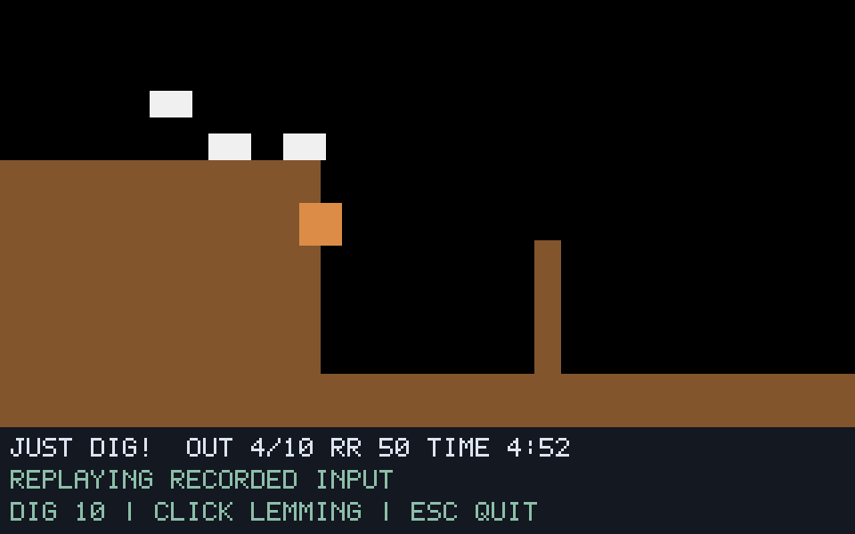

# G07-08 Floater 결과

이슈: [#42](https://github.com/edwardkim/ohmylemmings/issues/42), 상위 [#1](https://github.com/edwardkim/ohmylemmings/issues/1).

## 구현

Floater 영구 능력·수량·이전 낙하량16 초과 시 우산 펼침·원문16단계 이동·안전한 착지를 no_std 코어에 구현했습니다. 펼침 중1픽셀 상승/정지와 이후8단계 하강 반복, 매 픽셀 발 충돌·하부 경계 순서를 보존합니다. Climber와 함께 유지하며 중복/Blocker/제거 할당은 거부합니다. Floating 중 Bomber 만료는 OhNo를 거치지 않고 Exploding으로 전환합니다.

SDL은 F키·클릭·안정된 ID 재생·FLOAT 수량·원본 Umbrella 양방향 스프라이트/발 앵커를 지원합니다. `floater.jsonl`은 영구 능력과 이동 표 커서를 기록합니다. `--synthetic-floater`는 자체 생성 발판·낙차·벽을 사용합니다. 시뮬레이션에 리소스·렌더링·I/O 의존성을 추가하지 않습니다.

## 검증

- 코어 새10개는 영구 할당/거부·Climber/Bomber 공존·이전 낙하량 임계값·양방향 표/반복·양수 이동의 각 픽셀 착지·상승/정지·음수 좌표·하부 경계·잘못된 복원/산술 오류·배치 원자성을 다룹니다. 네이티브 새2개와 기존 숫자 앵커의 Floating5조합 확장, Python 새4개를 포함합니다.
- 고정 Pascal48함수와 FloatParametersTable 원문의 실제 실행, 합성10사례/20재생/8420상태·SDL906캡처가 일치합니다. 모든 경계의 지형·객체 맵·두 영구 능력·표 커서를 대조합니다. CI는 같은 golden/어댑터 해시를 원본 없이 검사합니다.
- 원본 Fun02 네이티브4실행/1204상태/92캡처가 기준 함수와 일치합니다. 렌더 간격1/7·실시간·실제 F키/클릭은 모두 경계54 ID0이며 상태 서명 `8eb7c43feff72784934802504336b38f79ac017850a02b6757b180e895df3bad`입니다. 긴 낙하의 경계194에서 펼치고199에서1픽셀 상승하며225에서Walking으로 안전하게 착지합니다. 검증은 출구 이전300호출까지입니다.
- 별도 실제 UI 실행에서 받은 Pause231/Resume277도 기준 함수에 그대로 재생했습니다. 301상태/25캡처·서명 `81f295b5d2b92f1a6ff48cd7f31582c273088f2db24ed2813d871344b4b1fcca`이며 위 네 실행과 구분합니다. 로그 파서가3토큰 Pause/Resume와4토큰 할당/속도를 구별하도록 TDD로 보완했습니다.
- 독립 DOS 두 실행의1351샘플/4749게임 영상 프레임에서 수량10→9·Floater 별도 바이트255·Floating0x400·표 커서 진행과Walking 착지를 읽기 전용으로 관측했습니다. 입력은 counter55의Falling(568,41)이며 선택값3입니다. 194/195/198/199/202/220/260/300 전체320×160 장면이 두 실행 모두0픽셀 차이입니다. 정확한2배 픽셀/스캔라인·RGB565 코드 정규화만 사용하며 커서 마스크·이동·색 허용 오차는 없습니다.
- 기존 일곱 직업의 렌더 간격1/7,14재생/4774상태/424캡처와 이전 서명이 일치합니다. F00의341상태 서명 `3e56870904094448fdeab59715ce9c7ad96ec25deb9ff34017cd24058d74d4fe`도 유지합니다.

전체 `make check`293.272초·Rust412개/문서27개/Python69개·포맷/Clippy/오프라인 빌드·전체 모델/SDL·WASM을 통과했습니다. 최종 바이너리 SHA-256은 `5cbce020337264da8131f3db79605cc520f05ebc4622bcc0e0a9c99e743690e7`, 기준 실행은 `a738c516e30596011a98fb5631108695a70a837f965b6b20e74884d54c6c5427`입니다. [manifest](../../assets/manifests/floater.json)에148소스/2324산출물의 출처·크기·해시를 고정합니다.

## 자체 검토와 화면

self-review에서 할당/펼침 임계값·표 진행/애니메이션·픽셀 검사/하부 조기 반환·능력/커서 수명·Bomber 순서·오류 시 보존·계층 독립성·SDL 발 앵커/ID 재생·기준 호스트·DOS 반복 판정을 검토했습니다. 원본224바이트 표는112개(frame,signed-dy) 항목으로 첫8개 뒤 같은8개를13회 저장합니다. DOS의 선형 바이트 커서와 Lemmix/Rust의16단계 논리 커서는 저장 값 자체가 같다는 주장을 하지 않습니다. 원본 표의 모든 반복과 실제 화면을 별도로 확인했습니다. 작성자 자체 검토 결과입니다.

아래는 자체 지형·검사용 사각형 스프라이트의 경계147 두 번째 낙하 화면입니다. 원본 Fun02는 실제 우산 스프라이트를 사용하며 원본 파생 비교 화면·영상은 ignored `assets/local/`에 보관합니다.

## 실행 조건과 한계

reference-1·native-final·original-regressions·dos-proof-1/2·dos-compare-final을 최종 횟수에 포함합니다. native-proof-1의 고정 세 실행은 최종 네 실행으로 대체하고 실제 Pause/Resume 실행만 별도 보조 근거로 남깁니다. 최초 프로필 steps0의 CLI 거부·원본 표240바이트 가정의 진단 실패·합성 보조 검사의 생성 전 개체 인덱스 오류는 수정 후 최종 성공과 구분합니다. 엔진/원문 기준이 불일치한 실행을 통과로 처리하지 않습니다.

원본50개·고정 소스46개와 각 DOS 사본50개의 불변을 확인했습니다. #34의 실제256바이트 seed를 해시로 고정하고 offset0만9→0으로 변경합니다. DOSBox0.74-3·VGA/PC2·fixed10000cycles·같은 seed/mapper/컨트롤러와 서로 다른 녹화 경로를 사용합니다. 원본/EXE·에뮬레이터·게임 메모리는 변경하지 않습니다.

원본 Fun02의 구출/승패·비동기 관측 이상의 원자적 전체 DOS 상태·입력 틱/속도·전체 HUD/음향·모든 직업 상호작용은 인증하지 않습니다. Nuke와 전체 상호작용 마무리가 남아 G07 전체는 진행 중입니다. 게시·실제 CI·병합/종료는 [#42](https://github.com/edwardkim/ohmylemmings/issues/42)에서 추적합니다.

[계약·재현](../tech_insights/issue-42_floater.md), [진행 기록](../working/issue-42_floater.md), [작업일지](../orders/20261019.md#issue-42).

PR [#43](https://github.com/edwardkim/ohmylemmings/pull/43)을 main feab3e8로 병합했고 [main CI](https://github.com/edwardkim/ohmylemmings/actions/runs/39221581981)의 세 작업·실제 로그와 #42 종료를 확인했습니다.
