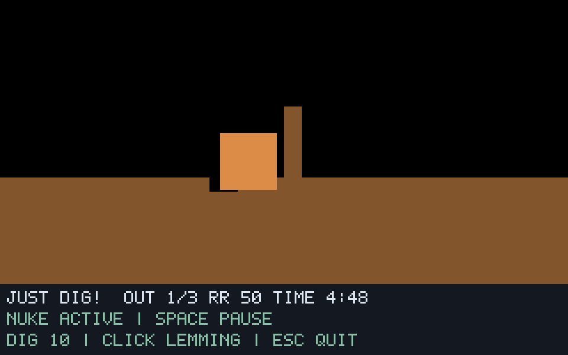

# G07-09 Nuke 결과

이슈: [#44](https://github.com/edwardkim/ohmylemmings/issues/44), 상위 [#1](https://github.com/edwardkim/ohmylemmings/issues/1).

## 구현

Nuke 입력·생성 중지·개체 순서별 타이머79 할당을 no_std 코어에 구현했습니다. 전체 개체 이동/Bomber 처리 뒤 틱마다 한 순서를 처리하고, 기존 타이머와 제외 행동·제거 슬롯·Pause·중복 입력을 구별합니다. 수량을 쓰지 않으며 Blocker 필드 복원·두 영구 능력·폭발/입자는 기존 동작을 재사용합니다. NukeGlitch의 최대 인원 변경은 불변 레벨 총수와 분리합니다.

N키·ID 없는 `120 0 Nuke` 재생·`nuke.jsonl` 상태 추적·텍스트 HUD를 연결했습니다. `--synthetic-nuke`는 자체 Builder 경기장을 사용합니다. 렌더링·파일/플랫폼 I/O를 시뮬레이션에 추가하지 않습니다.

## 검증

- 새 코어11개(통합10/시작 오버플로1)·네이티브2개·Python4개를 검증했습니다. 생성 전/생성 경계·단계/중복·Pause/Resume·제거/기존 타이머·Blocker/영구 능력·OhNo 재설정·목록 오류/오버플로 보존을 다룹니다.
- 고정 원문50함수와 표의 실제 실행, 합성10사례20재생8420상태/1278캡처가 일치합니다. 모든 경계의 지형·객체 맵·8직업·타이머/입자·Nuke 상태를 대조하며 CI는 같은 golden/어댑터 해시를 원본 없이 검사합니다.
- 원본 Fun06 네이티브4실행1364상태/171캡처가 기준 실행과 일치합니다. 고정 Nuke120의 렌더1/7·실시간 세 실행은 `6fd28c668013e917a79ae10910809f68baf7394c9051d5f4e842497e9b6648b0`입니다. 실제 N키는 포커스 확보 뒤121에 기록됐으며 그대로 재생해 `a22f37344de3f1a304d49326ca27d00e91bfc072d0d830fd007cac895b248dee`와 일치합니다. 서로 다른 입력 시점의 서명을 같다고 처리하지 않습니다.
- 동일 프로토콜 독립 DOS 두 실행의802샘플에서 F12 counter118/121·최대 인원50→3·Bomber 수량5 유지·타이머 `[79,0,0]`→`[78,79,0]`→`[77,78,79]`·순서 완료/세 개체 제거를 읽기 전용으로 확인했습니다. 121/122/123/199/200/216/220/260 전체320×160 장면×두 실행이0픽셀 차이입니다. 검사한 게임 영상은2646프레임이며 이후640×400의436프레임을 제외합니다. 전체 혼합 해상도 영상4876프레임은 별도로 보존합니다. 커서 마스크·위치 이동·색 허용 오차는 없습니다.
- 기존8직업16재생5376상태/470캡처와 각 이전 서명, F00의341상태 서명 `3e56870904094448fdeab59715ce9c7ad96ec25deb9ff34017cd24058d74d4fe`가 일치합니다.

전체 `make check`358.801초·Rust425개/문서27개/Python73개·포맷/Clippy/오프라인 빌드·모델/전체 SDL·WASM을 통과했습니다. 이후 DOS 키 전달·기록용 자식 종료/화면 범위 보완을 최종 Python73개와 실제 DOS 두 실행으로 다시 확인했습니다. 바이너리 SHA-256은 `79837fe0a02a3f6fd683aeb92f067252dc23344a8ee1ff0a6ce8088121e55fd6`, 기준 실행은 `10ece6fd27d454fb023cccb79d1489ac57e1a378750ac586d168a7f7aad23662`입니다. [manifest](../../assets/manifests/nuke.json)에157소스/2684산출물 출처·크기·해시를 고정합니다.

## 자체 검토와 화면

self-review에서 입력/생성/이동 이후 순서·마지막 순서 뒤 종료·중복/Pause·기존 타이머·OhNo/Exploding 양수 타이머 복원·목록/산술 오류 보존·계층 독립성·실제 N키/재생·호스트와 DOS 반복 판정을 확인했습니다. DOS213a의 타이머 검사가 제거2140보다 앞서는 경계는 Lemmix와 달라 별도 TDD로 DOS 순서를 구현했습니다. 생성을 영구 중단한 뒤 Rust/Lemmix는 비활성 생성 카운터를 동결하지만 DOS는 계속 반복합니다. 이를 원시 상태 일치로 확대하지 않습니다. 작성자 자체 검토입니다.

아래는 자체 지형·검사용 사각형 스프라이트의 경계218 폭파 화면입니다. 원본 Fun06은 실제 스프라이트/폭발·입자를 사용하며 원본 파생 화면/영상은 ignored 경로에 보관합니다.

## 실행 조건과 한계

최종 reference-2·native-final·original-regressions·DOS proof-4/5·dos-compare-final을 완료 횟수에 포함합니다. reference-1의 중복 host enum 치환 탐지, native-proof-1의 실제 N키 포커스 유실, DOS proof-1의 preview Space 유실·proof-2의 종료 keyup 창 소멸·proof-3의 종료 단축키 미수신/타임아웃은 최종 성공 두 회에서 제외합니다. proof-2의 보조 여덟 장면 일치도 반복 성공 횟수에 넣지 않습니다.

원본50개·고정 소스46개와 각 DOS 사본50개의 불변을 확인합니다. 같은 seed/mapper/컨트롤러·DOSBox0.74-3·VGA/PC2·fixed10000cycles를 사용하며 #34의256바이트 seed offset0만9→0으로 바꿉니다. 키는 해당 기록 자식 창으로 전달하고 녹화를 멈춘 뒤 그 자식만 종료합니다. 원본/EXE·에뮬레이터·게임 메모리를 직접 쓰거나 패치하지 않습니다.

원본 결과 화면은 게임 영역의2배 스캔라인 조건을 따르지 않으므로 비교는 마지막 요청 장면260에서 끝냅니다. 이후 장면·원자적 전체 DOS 상태/입력 틱/속도·원본 하단 기술 패널/미니맵·음향·구출률/승패/재시작은 인증하지 않습니다. 하단 패널은 [G08 HUD 계획](../plans/issue-1_implementation_plan.md#하단-패널의-후속-범위)에 명시했습니다. 전체 직업 전환/상호작용 마무리가 남아 G07 전체는 진행 중입니다. 최종 게시/CI·병합/종료는 [#44](https://github.com/edwardkim/ohmylemmings/issues/44)에서 추적합니다.

[계약·재현](../tech_insights/issue-44_nuke.md), [진행 기록](../working/issue-44_nuke.md), [작업일지](../orders/20261019.md#issue-44).
