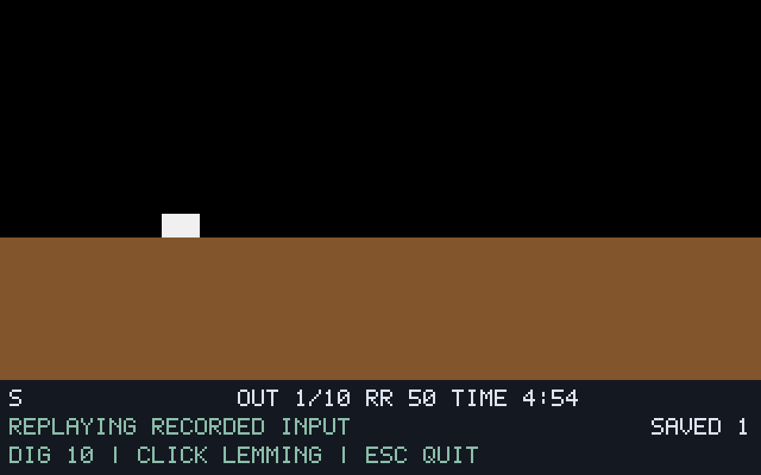

# G08-01 객체·출구/구출 결과

이슈: [#48](https://github.com/edwardkim/ohmylemmings/issues/48), 상위 [#1](https://github.com/edwardkim/ohmylemmings/issues/1).

## 변경과 TDD

no_std 코어에 객체 효과129·Exiting·Rescued·배치 구출 집계를 추가했습니다. 출구는 행동 갱신 뒤 판정하며 Falling/착지 Splat/Floating 우선순위,8프레임 완료, 제거 후 재집계 방지, 타이머/Blocker 저장 맵을 원문대로 처리합니다. 데스크톱은 원본 스프라이트·SAVED 표시·`exit.jsonl`·합성 출구 장면을 연결합니다.

코어11개·데스크톱4개·Python4개 테스트를 추가했습니다. 치명적 착지→출구에서 타이머가41로 되살아나는 실패, 정지 출구의 타이머 만료 후 상태 복원 실패, 별도 Digger 배치가 구출0을 보고하는 실패를 확인해 수정했습니다. 마지막은 기존 배치 테스트에 복원한 두 개체의 같은 틱 구출을 추가했습니다. 입력/좌표 오류의 상태 보존,0..15 객체 인덱스 경계,Pause·Nuke,긴 제목에서도 보이는 HUD도 검사합니다.

## 실제 실행 증거

- **기준:** 고정 원문51함수/표를 FPC로 실행했습니다. 기존 어댑터/golden은 유지하고 별도 출구 호스트·추적만 추가했습니다.
- **합성:** 9사례·18재생·7578상태·1770개 SDL 정확 캡처가 기준 실행과 일치합니다.8직업 허용/거부·제거 후 입력·Pause·Nuke·영구 능력/폭파 타이머·Splat/Floating을 포함합니다.
- **원본 Fun01:** 렌더1/7·실시간·실제 D키/마우스의4재생,2804상태/345캡처가 각각 같은 입력의 기준 실행과 일치했습니다. 모두10마리를 구출했습니다. 고정 입력60은 첫 출구478·첫 구출486·마지막 구출660이며 세 실행의 전체 상태 서명은 `c15a81ff51a7abf0d4b47c55d46cfa5fc8f277b25ec46fe1dfd87d74a076c594`입니다. 실제 클릭은61에 기록되어 별도 입력으로 대조했으며 같은 서명이라고 주장하지 않습니다.
- **새 DOS 관측:** 독립 두 실행(issue-48-dos-3/4)에서 첫 출구 ID5의0~7프레임·제거·구출 수1~3을 관측했습니다. 각각9개 연속 출구 장면(네이티브478~486)의 **전체320×160**이 일치합니다.2배 픽셀 중복/RGB565 정규화 외에 마스크·이동·오차 허용은 없습니다. DOS 원시 제거 프레임0과 정규화 프레임7/end=true의 차이는 [계약](../tech_insights/issue-48_exit_rescue.md)에 명시했습니다.

원본/파생 이미지·영상·실행 파일은 ignored `assets/local/`에만 보관합니다. 아래는 자체 합성 자산의 실제 SDL 화면입니다.

## 검증·자체 검토·추적

기존 모델·8직업/Nuke·2640할당/14혼합 회귀와 전체 `make check` 및 자체 검토 후 Rust/WASM 재검사를 통과했습니다. 결과 수치는 Rust443개·문서27개·Python81개입니다. 원본50개·고정 소스46개의 크기/해시도 확인했습니다. 게시·정확한 HEAD CI·병합·main CI·종료 근거는 [#48](https://github.com/edwardkim/ohmylemmings/issues/48)에서 추적합니다.

자체 검토에서 모든 배치 경로의 제거/구출 집계,타이머 취소 순서,정지/제거 상태 복원,객체 저장 맵 보존,최초 차이 진단과 누락/중복/형식 오류 거부를 확인했습니다. 원본 검증1의 생성 전 개체 인덱스 접근 오류, DOS1의 커서 위치 조정 실패·DOS2의 출구 도달 전 녹화 종료는 성공 집계에서 제외합니다. 성공 원본은 issue-48-original-2, 기준은 issue-48-reference-1, 합성은 issue-48-synthetic-1, DOS 이미지는 issue-48-dos-images-1/2입니다.

[진행 기록](../working/issue-48_exit_rescue.md) · [작업일지](../orders/20261019.md#issue-48) · [출처/해시](../../assets/manifests/exit_rescue.json).

## 후속 범위

이번 결과는 출구·구출 절편입니다. 위험물/함정·시간 종료/구출률/승패·결과 화면/재시작·원본 패널/미니맵·포인터 우선순위/RightClickGlitch·음향·전체 DOS 상태 인증은 후속이며 G08 전체는 진행 중입니다. 다음은 G08-02 위험물/함정 효과입니다.
