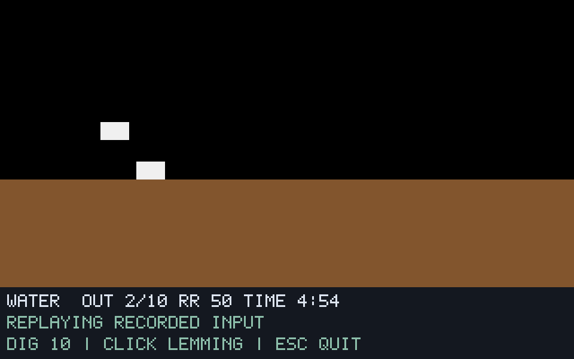

# G08-02 위험물·함정 결과

이슈: [#50](https://github.com/edwardkim/ohmylemmings/issues/50), 상위 [#1](https://github.com/edwardkim/ohmylemmings/issues/1).

## 변경과 TDD

물133→Drowning·불134→Vaporizing과 완료 후 사망/제거, 호출자 소유 함정 상태·ID 순 경합·재사용을 no_std 코어에 연결했습니다. 구출과 사망을 구분하며 Pause는 함정을 진행하지 않습니다. 데스크톱은 원본 함정 프레임·사망 스프라이트·상태 추적/재생을 지원합니다.

코어14개·세션2개·Python4개 테스트를 추가했습니다. API/모듈 누락 Red→Green을 확인했고, 자체 검토에서 물/불 중 타이머 만료가 OhNo가 되는 실패를 발견해 원문대로 즉시 Exploding으로 수정했습니다. DOS 화면 하단 Y>=160의 새 위험물 판정도 실패 테스트 후 제한했습니다.159/160/163·저장 Blocker 맵의 없는 함정 참조·좌표 오류·1프레임/연속 함정·같은 틱 두 개체·제거 후 재집계·죽어가는 개체의 할당/복원을 검사합니다.

## 실제 실행 결과

- **54함수·표:** 고정 원문의 사망 두 함수와 객체 갱신을 실제 FPC로 실행했습니다. 자체 메타데이터/추적 호스트만 확장하고 기존 어댑터/golden은 유지했습니다.
- **합성14사례·28재생:** 11788상태와1714개 SDL 정확 캡처가 기준 실행과 일치합니다. 물/불·공중 진입·8직업·정상/경합/재사용/연속 함정·Pause·물/함정과 Nuke·사망 중 타이머 만료의 즉시 폭발을 포함합니다.
- **원본10재생·3410상태/797캡처:** Fun09 불·Fun17 함정·Fun29 물을 렌더1/7·실시간으로 각각 대조했습니다.340경계에서 각각 Vaporized31·Trapped7·Drowned27이며 같은 고정 입력의 세 재생 상태는 같습니다. 실제 Fun17 Pause241/Resume252는 별도 입력으로 대조했고 Trapped6입니다.
- **새 DOS 네 실행:** 함정 독립 두 실행에서 프레임0~14·각4마리 제거/재사용을, 물에서0~15·22마리, 불에서0~13·21마리 제거를 비동기 read-only로 관측했습니다. 전체320×160의 함정5장면×2·물4·불4, 합계18개 순서 있는 장면이 일치합니다.2배 픽셀 중복과 RGB565 정규화 외에 마스크·좌표 이동·오차 허용은 없습니다. 수정 후 원본을 모두 재실행하고 영상 대조 기준 RGB 바이트가 정확히 같은지도 확인했습니다.

DOS 원시 완료 프레임은 물0·불14이며 정규화된15/13·종료 표지와 구분합니다. 화면 아래 새 트리거 제한은 원본 EXE 지시문 기반 별도 경계 검사입니다.54함수의 직접 대조는 Y<160 영역입니다. 원자적 전체 DOS 상태나 전체 게임 인증을 주장하지 않습니다.

아래는 자체 합성 자산의 실제 SDL 화면입니다. 원본 이미지/영상/실행 파일은 ignored `assets/local/`에만 보관합니다.

## 검사·자체 검토·추적

기존 전체 `make check`로 모델·8직업/Nuke·2640할당/14혼합·출구 회귀를 통과했습니다. 검토 중 타이머/하단 경계를 수정한 후 `make check-rust check-wasm`·경계 테스트·Python85개와 최종 합성/원본 실행을 재검사했습니다. 최종 Rust459개·문서27개이며 전체 CI의 정확한 head/main SHA·실제 로그·병합/종료 근거는 [#50](https://github.com/edwardkim/ohmylemmings/issues/50)에 기록합니다. 원본50개·고정 소스46개의 크기/해시도 확인했습니다.

함정 참조와 ID 순서의 사전 검사·오류 시 보존,논리 틱의 갱신 순서,수량/제거 누계와 메타데이터/누락 경계/중복 ID 거부를 자체 검토했습니다. 사망 중 타이머 만료를 새 실제 기준 사례로 보강했습니다. 작성자 자체 검토입니다.

최종 기준은 issue-50-reference-3, 합성은 issue-50-synthetic-3, 원본은 issue-50-original-2입니다. 기준 호스트1/2의 선언/FPC 변환 오류, 합성1/2·원본1의 검토 전 자료는 최종 횟수에 더하지 않습니다. 최초 DOS 함정1은 수치 관측에는 성공했지만 코드 문자v와 녹화 키가 겹쳐 최종 영상 검증에서 제외했습니다. 최종 DOS는 trap-2/3·water-1·fire-1이며 자체 생성 런타임 seed 외에 원본50개를 수정하지 않았습니다. 관련 전용 프로세스는 종료했습니다.

[계약·재현](../tech_insights/issue-50_hazards.md) · [진행](../working/issue-50_hazards.md) · [일지](../orders/20261019.md#issue-50) · [출처·해시](../../assets/manifests/hazards.json).

## 다음 절편

G08은 진행 중입니다. 다음은 G08-03 시간·구출률·승패 판정입니다. 결과 화면/재시작·원본 패널/미니맵·포인터 우선순위/RightClickGlitch·음향·전체 DOS 인증은 후속입니다.
