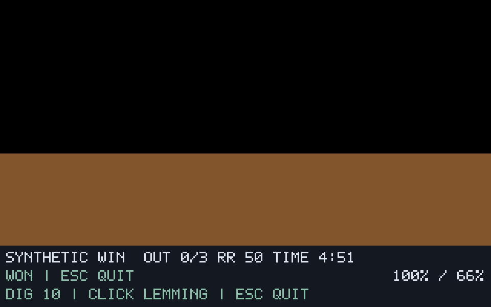

# G08-03 시간·구출률·승패 결과

이슈: [#52](https://github.com/edwardkim/ohmylemmings/issues/52), 상위 [#1](https://github.com/edwardkim/ohmylemmings/issues/1).

## 구현과 TDD

`CompletionRules`가 구출⊆제거⊆생성/총원 검증·정수 목표/구출률·전체 제거/시간 만료 판정을 no_std로 수행합니다. 원래 총원으로 계산하는 목표와 Nuke 후 분모를 구분합니다. 세션은 마지막 개체 갱신 뒤 최초 결과를 보존하며 종료 후 시각·개체·지형·수량·게임 명령이 바뀌지 않습니다. 일반 실행은 `WON`/`LOST`·현재/목표 백분율을 표시하고 카메라/Esc를 지원합니다. 유한 재생은 종료 장면을 기록하고 이후 예약 입력을 적용하지 않습니다.

새 Rust17개(코어11·세션4·입력1·재생1)와 Python5개를 추가했습니다. API/모듈 누락 Red→Green 뒤, 종료 후 시각이 바뀐 잘못된 추적을 허용하는 실패를 확인해 검증기를 보강했습니다. 17틱/초·Pause/시작 glitch·시간0/마지막 구출·Nuke0/2마리·파티클 대기/시간 만료·작은 정수 분모 전수·u32 최대값·잘못된 수량/메타데이터를 검사합니다. 화면 검토에서 자체 HUD의 소문자 제목/% 글리프 누락을 수정했습니다. 캡처 없이 여러 틱을 처리할 때 종료 후 예약 입력이 들어가는 실패도 추가해 재생 경계와 일괄 틱을 차단했습니다.

## 실제 실행

- **원문56함수/표:** 고정 원문 `CheckForGameFinished`·`SetGameResult`를 기존54함수에 더해 FPC로 실행했습니다. 함수 본문은 유지하고 DOS의 개체 갱신 후/시계 감소 전 종료 순서를 자체 호스트로 적용합니다. 원문 `InternalUpdate` 전체 실행과는 구분합니다.
- **합성11사례·22재생:** 6854상태·526개 전체 SDL 정확 캡처가 실제 기준 실행과 일치합니다. 렌더1/7·성공/실패·1분 만료·PauseGlitch·출구 Pause·폭발 파티클·Nuke·0시간·종료 뒤 예약 입력을 포함합니다. 원래80/필요40·Nuke 후1/2 구출이50%/50% 성공으로 판정됩니다.
- **원본 Fun01 7재생:** 12731상태·358개 SDL 정확 캡처가 일치합니다. Digger60 입력으로660경계에서10/10 구출·100%/10% 성공, Nuke120 입력으로271경계에서0/3·0%/10% 실패, 무입력5101경계에서5분 만료 실패를 확인했습니다. 각 렌더1/7 상태가 같고 성공 경로의 실제 시간 재생도 같습니다.
- **새 DOS 3실행·3092샘플:** Fun01 전원 구출100%/10%·성공 표지255, Nuke 후0/3·0%/10%·실패 표지0, Mayhem16의1분 만료·0%/100%·실패0을 정상 키/read-only RAM과 실제 결과 PNG/짧은 영상으로 확인했습니다. 시간 만료는 레벨 인덱스105/초기60초를 확인한 뒤 인정했습니다. 실제 DOS 결과 화면을 직접 확인했고 Fun01 성공/실패의 남은262/285초도 네이티브와 같습니다.

DOS 결과는 비동기 관측의 최종 수치/화면 증거입니다. 네이티브 timeout은 Fun01, DOS timeout은 Mayhem16이며 서로 다른 레벨의 전체 추적/픽셀 일치를 주장하지 않습니다. DOS의 원시 폭발 표시 수량과 정규화 제거+파티클 타이머도 구분합니다.

아래는 원본 파생물이 없는 자체 합성 자산의 실제 SDL 성공 화면입니다.

## 검사·검토·게시

로컬 `make check`에서 모델·8직업/Nuke·2640할당/혼합·출구·물/불/함정·새 완주 회귀의 모든 PASS 로그를 확인했습니다. 다만 전체 셸은143으로 종료되어 전체 명령의 성공으로 집계하지 않습니다. 최종 전체 성공은 정확한 커밋의 CI에서 확인합니다. 화면 수정 후 포맷/Clippy·최종 Rust/문서 테스트를, 검증기 보강 후 Python과 최종 추적을 다시 확인했습니다. 최종 수량은 Rust476·문서27·Python90입니다. 정확한 head/main CI·실제 ZIP 로그·PR/병합/원격 트리·이슈 종료 근거는 [#52](https://github.com/edwardkim/ohmylemmings/issues/52)에서 추적합니다.

작성자 자체 검토입니다. 종료 순서·Nuke 분모·백분율 버림·시간 만료의 파티클 대기 우회·최종 입력/상태 보존·손상 입력·화면 가독성을 검토했습니다. 원본50개/고정 소스46개의 크기·해시를 확인하고 원본/영상/추적은 ignored `assets/local/`에 보존합니다.

최종 기준은 reference-2, 합성/원본은 synthetic-4/original-4입니다. reference-1은 자체 호스트의 대소문자/삽입 문자열 실패이며 원문 실패가 아닙니다. 합성1/2·원본1/2는 HUD 수정 전 소스를 사용한 예비 실행이며, 합성3/원본3은 종료 뒤 재생 검토 전 자료으로 최종 횟수에 더하지 않습니다. 최종 기록은 보강한 추적 검증기로 다시 확인했습니다. DOS 세 실행의 원본50개를 수정하지 않았고 별도 RUSSELL seed를 사용했습니다. 전용 DOSBox/Xvfb 프로세스는 종료했습니다.

[계약·재현](../tech_insights/issue-52_level_outcome.md) · [진행](../working/issue-52_level_outcome.md) · [구현 일지](../orders/20261019.md#issue-52) · [게시 이월 일지](../orders/20261020.md#issue-52) · [출처·해시](../../assets/manifests/completion.json).

## 다음 절편

G08은 진행 중입니다. 다음은 G08-04 결과 화면·재시작입니다. 원본 패널/미니맵·포인터 선택/RightClickGlitch·음향·전체 DOS 인증도 후속입니다.
