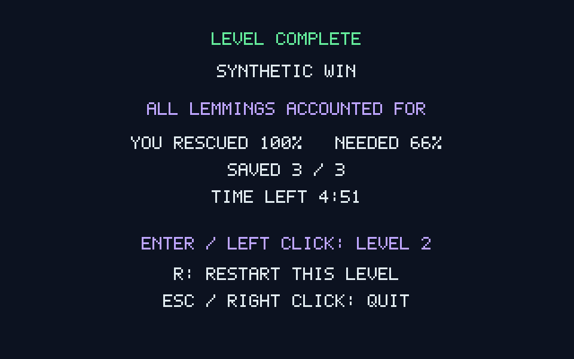
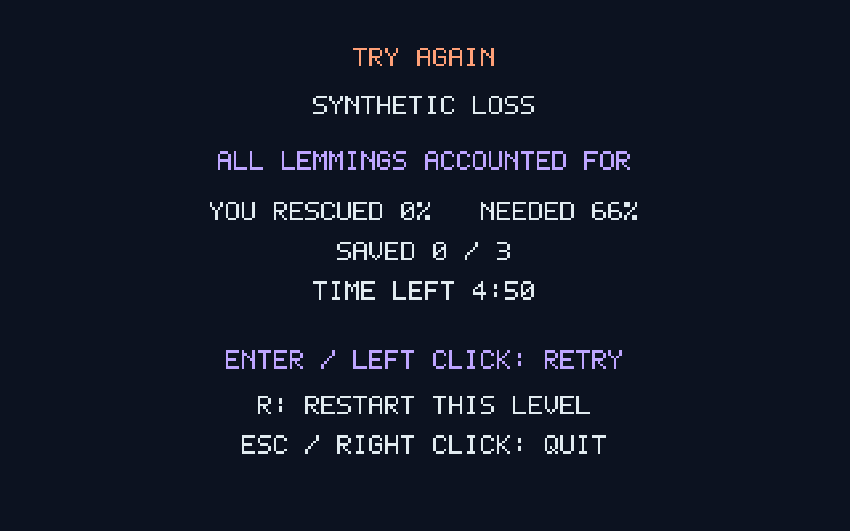

# G08-04 결과 화면·재시작 결과

이슈: [#54](https://github.com/edwardkim/ohmylemmings/issues/54), 상위 [#1](https://github.com/edwardkim/ohmylemmings/issues/1).

## 구현

승패·종료 이유·구출 수/백분율·목표·남은 시간을 별도 결과 화면에 표시합니다. Enter/왼쪽 클릭은 실패 시 재시도·성공 시 다음 레벨이며, R은 항상 방금 한 레벨을 새로 시작합니다. Esc/오른쪽 클릭으로 종료합니다. Fun30 성공 뒤에는 다음 이동 대신 현재 레벨 재시작/종료를 제공합니다.

`LevelRun`이 원래 자산에서 새 Session/View를 구성한 뒤 교체합니다. 다음 파일 누락·손상 또는 세션 구성 오류에서는 현재 결과/상태를 유지합니다. 개체·지형·벽돌·직업 수량·함정·Nuke·시계·파티클·입력·카메라와 렌더 캐시를 초기화하며 이전 재생의 남은 명령과 catch-up 틱을 폐기합니다. 캡처는 시도별 폴더와 `transitions.jsonl`로 구분합니다.

## TDD·실행 검증

새 Rust7개(전환/초기화5·입력1·화면1)를 추가했습니다. 누락 API Red→Green 뒤 승리/실패/마지막 레벨·진행 중 전환 거부·재초기화·로딩/구성 실패 보존·Nuke/시계 잔여분·작동 중 함정·반복 키와 마우스·결과 화면을 검사합니다. 함정 검사는 한 개체를 사용해 종료 순간에도 작동 중인 상태가 남도록 구성했습니다.

- **합성6실행·14시도:** 렌더1/7 각각 성공→재시작→다음 실패, 실패→재시도, 0시간/상한1→재시작을 실제 SDL dummy/software로 실행했습니다. 1752상태·288개 확대/readback 캡처를 확인했습니다. 렌더 간 전체 상태 해시가 같으며 이후 시도에 Pause/Resume/예약 Nuke가 유출되지 않습니다.
- **원본6시도:** Fun01 Digger60 성공 뒤 재시작과 Fun02 이동, 두 레벨의 독립 초기 실행을 비교했습니다. 4286상태·212개 캡처를 확인했고 이후 시도의 상태/원래 지형이 독립 실행과 같습니다. 원본50개·고정 참조46개의 크기/SHA-256도 확인했습니다.
- **실제 X11 3시도:** 전용 display에서 정상 R·왼쪽/오른쪽 클릭을 주입해 성공→동일 레벨 성공→다음 레벨 실패→종료를 확인했습니다. 506상태·93개 캡처가 정확하며 장면 명령은 게임 입력 로그에 들어가지 않습니다.
- **캡처 없는 경로:** 렌더7에서 최초 결과가 그려지지 않아 자동 전환이 대기하는 실패를 발견했습니다. 최초 결과 프레임을 강제로 그려 해결하고 동일 SDL 전환을 재검사했습니다. 결과 전에 시도 상한에 도달하면 미실행 명령을 오류로 반환합니다.

최종 자료는 `assets/local/issue-54-results-2`와 `issue-54-x11-1`입니다. results-1은 마지막 비캡처 경로에서 발견한 실패 자료로 최종 합계에 포함하지 않습니다. 원본 파생 화면/추적은 ignored 경로에만 보관합니다.

다음은 원본 데이터가 없는 자체 합성 자산의 실제 X11 결과 화면입니다.

## 검사·게시와 한계

포맷/Clippy·Rust/문서 테스트·Python90개 및 독립 모델·WASM 빌드를 검사하며, 기존8직업/Nuke·상호작용·구출·위험물·완주와 새 결과 전환을 `make check-desktop`에 포함합니다. 처음 SDL 검사에 로컬 SDK의 실행 라이브러리 경로가 빠져127로 실패한 명령은 성공으로 집계하지 않으며, `LD_LIBRARY_PATH`를 지정한 재실행을 사용합니다. 네이티브 CI의 기존 약8분30초 실행에 새 회귀를 추가해 제한을15분으로 늘렸습니다. 최종 정확한 head/main의 CI·실제 로그·PR/병합·종료는 [#54](https://github.com/edwardkim/ohmylemmings/issues/54)에 기록합니다.

작성자 자체 검토에서 종료 결과 보존·입력/벽시계/자산 초기화·로드 실패 복구·장면별 캡처와 렌더 독립성을 확인했습니다. 결과 UI는 자체320×200 화면입니다. 원본640×350 배경/폰트·접근 코드/메뉴, 기존 미지원 특수 그래픽, 다른 난이도 전환의 구현/전체 DOS 인증은 포함하지 않습니다. R은 어댑터 추가 단축키이며 메뉴 대신 종료합니다.

G08 전체는 진행 중입니다. 다음 절편은 원본 기술 패널/미니맵이며 포인터 선택·RightClickGlitch·음향은 후속입니다.

[계약·재현](../tech_insights/issue-54_results_restart.md) · [진행](../working/issue-54_results_restart.md) · [일지](../orders/20261020.md#issue-54) · [출처·해시](../../assets/manifests/results_restart.json).
