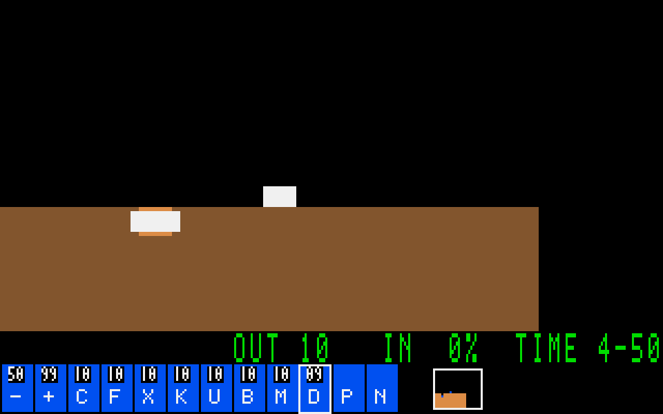

# G08-05 원본 기술 패널·미니맵 통합

이슈: [#56](https://github.com/edwardkim/ohmylemmings/issues/56), 상위 [#1](https://github.com/edwardkim/ohmylemmings/issues/1).

## 변경

텍스트 HUD를 MAIN.DAT 기반 VGA 패널로 바꾸고8직업의 클릭/키보드 선택·남은 수량·초기/현재 생성 속도·Pause·더블클릭 Nuke를 연결했습니다. 미니맵은 변경된 지형과 살아 있는 개체, 카메라를 표시하며 클릭/드래그로 카메라를 옮깁니다. 입력 명령은 기존 control_step/sequence 로그에 들어갑니다. View와 패널 누름/드래그 상태는 새 레벨마다 초기화합니다.

실제 DOS 비교에서 #17의 구간6이 VGA 게임의 패널과 다름을 발견했습니다. 구간2의 별도 패널/폰트39이미지와 UI 전용 팔레트를 연결했습니다. 기존 리소스 API와200이미지는 유지하며 `inspect_ui`는239이미지를 제공합니다. `no_std` 코어에는 UI·SDL 의존성을 추가하지 않았습니다.

## 검증

- 버튼/미니맵 반열린 경계의 실패 테스트를 먼저 확인했습니다. 반복의 경계당1회, 해제/포커스 상실, Pause/Nuke/재생 차단, 키보드 동기화, 수량0/99초과·선택 테두리 복원, 지도 지형9비트 임계값, 세션 교체를 검사했습니다.
- 합성 SDL4재생1364상태에서 렌더1/7의 논리 상태가 같고184개 캡처의 지도/실제 SDL 배율 픽셀을 확인했습니다. Digger의 미니맵 지형5종을 확인했고 Builder/Bomber의 작은 변경은16비트 과반 임계값을 넘지 않아 지도 지형이 유지됩니다.
- 실제 X11 합성197상태·원본 Fun01 180상태와 각각 독립 렌더1/7 재생을 확인했습니다.8개 버튼·실제 직업 할당·속도 누름·Pause/Resume·Nuke 단일/더블클릭·미니맵·1000×700 여백 좌표를 조작했습니다. SDL 배율 검증은 합성151/원본137캡처입니다.
- 기존 #44의 독립 DOS 두 녹화를 재사용한16앵커에서 정보/버튼/미니맵11648픽셀씩186368픽셀이 정확히 일치합니다. 전체 HUD는 각173픽셀이 다르며 서로 다른 선택 테두리·DOS 커서가 있는3슬롯을 명시적으로 비교 영역에서 제외했습니다. 새 DOS 실행이나 전체 화면 일치로 집계하지 않습니다.
- 최종 Rust493/문서27·Python93·Clippy와 자산239이미지(기존200불변/새VGA39의17664픽셀)를 확인했습니다. 전체 로컬 검사와 게시/정확한 CI는 이슈에 최종 결과를 기록합니다.

공개 스크린샷은 자체 합성 자산이며 원본 캡처/영상은 ignored 경로에 보관합니다. 원본 커서/선택 우선순위·열별 지도 갱신 지연·전체 HUD/DOS 상태 인증은 포함하지 않습니다. G08 전체는 진행 중입니다.

[계약·재현](../tech_insights/issue-56_skill_panel.md) · [진행](../working/issue-56_skill_panel.md) · [출처·해시](../../assets/manifests/skill_panel.json).

