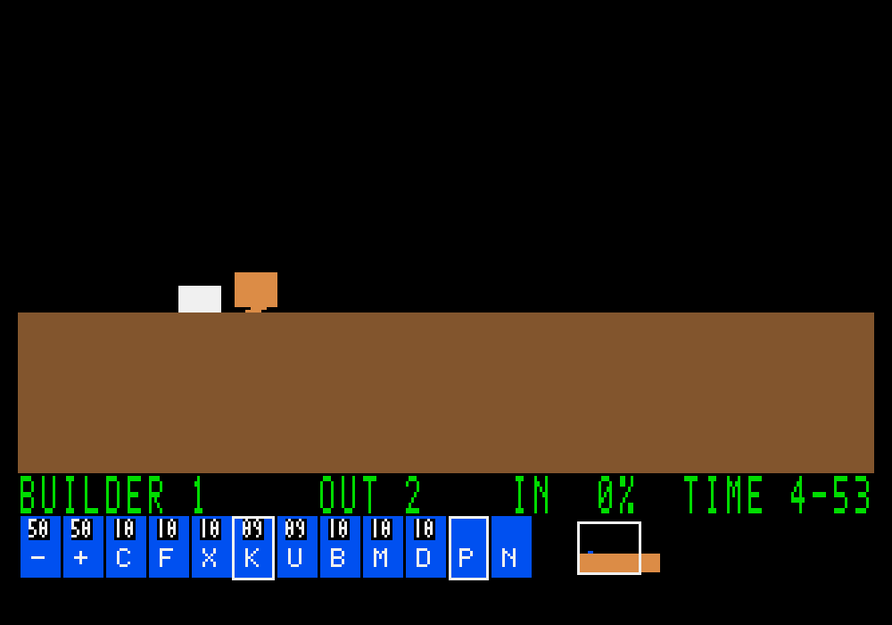

# G08-06 포인터 선택·RightClickGlitch 결과

이슈: [#58](https://github.com/edwardkim/ohmylemmings/issues/58) · [계약·재현·한계](../tech_insights/issue-58_pointer_selection.md) · [출처·해시](../../assets/manifests/pointer_selection.json)

## 변경

거리 기반 클릭과 첫 개체 호버를 동일한 no_std 선택 모델로 교체했습니다. 행동 우선순위·분류별 마지막 개체·겹침 수·능력 명칭, 우클릭 일반 선택·이전 ID 원격 할당, 함정 사망 뒤 영구 Blocker 필드를 연결했습니다. SDL 기본/선택 커서와 제어 경계별 `pointer.jsonl`, 안정 ID 확장 재생을 추가했습니다.

Builder/Digger의 대체 대상 검사 차이를 검토 과정에서 발견해 실패 테스트로 고정했습니다. 대체 여부를 실제 명령 경계에 결정하므로 같은 경계의 앞선 할당도 반영합니다. 기존 안정 ID 재생 형식은 유지합니다.

## 검증 상태

고정 원문53함수/표의 선택44604·원격2·대체3888, 총48494행이 Rust와 정확히 일치합니다. 출력 SHA-256은 `1e3934d00794b303e4e61c591b258fa4a38af864f8923f9e1e0a068ac8183e1b`입니다. 원본 없는 SDL4사례8재생2728상태·288개 배율 캡처에서 렌더1/7의 논리 상태가 같습니다. 함정 ghost는 수량을 쓰고 제거 상태/객체 필드를 유지합니다.

실제 X11은 합성 살아 있는 대상204상태333캡처, 함정 대상145상태90캡처, 원본 Fun03 대상112상태42캡처를 확인했습니다. 각 수치는 실제 입력1실행과 렌더1/7 재생2실행의 캡처 합계이며 상태 수는 실제 입력 실행 기준입니다. 세 실행 모두 우클릭 Down/이동/Left/Up·1000×700 resize/letterbox 경계를 검증했고 논리 상태가 독립 재생과 같습니다. 원본 Fun03은 보유 기술에 맞춰 Blocker→원격 Blocker를 사용합니다. 원본50파일과 이번에 사용한 고정 소스6개의 해시는 유지합니다.

공개 PNG는 자체 합성 자산입니다. 원본 스프라이트 실행은 ignored 경로에 보관합니다. 예비 도구 실행의 키 modifier 해제에 따른 우클릭 풀림·Faller 할당 시점·없는 Bomber 재고 선택 실패는 성공 증거에서 제외했습니다. 실제 버튼을 보존하고 Walking 상태/보유 기술로 검증한 최종 증거만 매니페스트에 포함합니다.

Rust503·문서 예제27·Python93, 포맷/Clippy·WASM과 기존8직업·Nuke·2640할당/혼합·출구 회귀를 확인했습니다. 마지막 자체 검토로 재시작 시 기억/우클릭 초기화, 화면 하단 제거 뒤의 할당/상태 복원, 실패 원자성과 i64 극값 검사를 보강해 해당 테스트와 Clippy를 재실행했습니다.

공통 `make check`의 최종 종료 상태, 게시한 정확한 커밋의 push·PR·main CI와 전체 로그·병합 트리 검증·이슈 완료 결과는 [#58](https://github.com/edwardkim/ohmylemmings/issues/58)에 누적합니다. 원문 비교·SDL 입력·일반 회귀·원격 CI 증거를 구분합니다.

## 범위

원문 충돌의 nil 대상을 네이티브에서 거부한 차이와 선택 메타데이터 호스트 보완은 계약에 명시했습니다. 새 DOS 실행/전체 원시 상태·원본 커서 비트맵 인증을 주장하지 않습니다. G08 전체는 진행 중이며 다음은 한 레벨 통합 완주 검증입니다.
