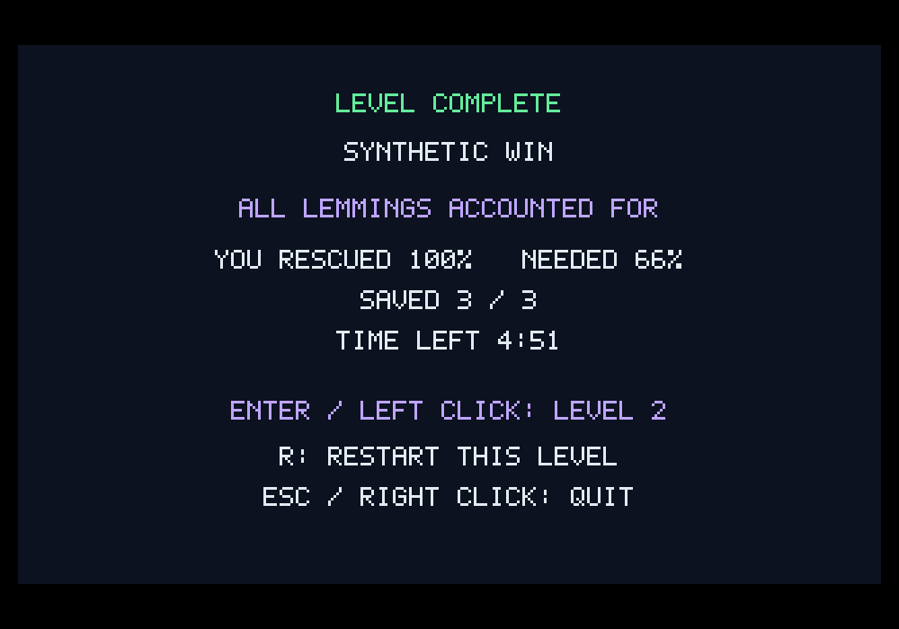

# G08-07 네이티브 한 레벨 통합 완주 결과

이슈: [#60](https://github.com/edwardkim/ohmylemmings/issues/60) · [계약·재현·한계](../tech_insights/issue-60_native_playthrough.md) · [출처·해시](../../assets/manifests/native_playthrough.json)

## 변경과 검증

기존 기능을 한 번의 실제 조작 흐름으로 연결했습니다. 성공 → R 재시작 → Nuke 실패 → 왼쪽 클릭 재시도 → 성공 → Enter 다음 레벨을 검사하는 Rust 통합 회귀와 X11 검증 도구, DOS 완주 관측/검증기를 추가했습니다. 게임 동작을 변경할 결함은 발견하지 않았습니다.

| 실제 SDL 실행 | 시도별 상태 수 | 독립 재생 | 실제/재생 배율 캡처 | 원문 실행 |
|---|---|---|---|---|
| 자체 합성 자산 | 178 / 238 / 166 / 81 = 663 | 12 | 149 / 393 | 적용 안 함 |
| 원본 Fun01→Fun02 | 667 / 285 / 666 / 81 = 1699 | 12 | 240 / 675 | 네 시도 모두 일치 |

모든 논리 상태가 렌더 간격1/7/13의 독립 재생과 일치합니다. 첫 성공의 간격13은 실시간입니다. Pause·생성 속도 유지·미니맵 이동/복귀·resize/letterbox·단일/두 번 Nuke·지형/입력/포인터 초기화와 새 ID 0을 확인했습니다. 결과 고정과 전환 실패의 원자성도 합성 회귀로 확인합니다.

공개 PNG는 1000×700 SDL readback입니다. 원본 화면과 DOS 동영상은 ignored 경로에 보관합니다.

새 DOS 성공 세 녹화는 모두10마리 구출·100%·목표10%·성공이며 Nuke 실패 녹화는0/3·0%·목표10%·실패입니다. 별도 고정 입력 네이티브 완주661상태·84캡처도 원문 실행과 일치합니다. 각 성공 녹화3518게임 영상 프레임에서 최초 Exiting의 아홉 연속320×160 전체 장면이 순서대로 정확히 일치했습니다(세 실행27앵커). 성공 결과의 DOS 레벨 인덱스 선행 증가와 과도 샘플을 발견해 검증기를 수정하고 실패 테스트로 고정했습니다. 원자적 DOS 전체 trace나 결과 아트워크 동등성은 주장하지 않습니다.

## 자체 검토와 게시

실제 UI 입력과 고정 입력 화면 비교, 원문 실행과 DOS 비동기 관측을 분리해 검토했습니다. 검증 도구의 버퍼링된 보조 trace 참조·결과 고정 틱 대기·비최종 캡처 조회 문제를 수정했으며 예비 실패를 성공 횟수에 포함하지 않습니다. Xvfb 경고 PIPE 정체와 기존 출력 경로 재사용으로 실패한 실행도 제외합니다. 최종 실행의 제어 스크립트/증거 해시를 고정합니다.

전체 로컬 검사·정확한 게시 커밋의 push/PR/main CI, 실제 전체 로그·병합 트리·이슈 종료 결과는 [#60](https://github.com/edwardkim/ohmylemmings/issues/60)에 기록합니다. 이 검증과 선행 #48~#58로 G08 완료 기준을 충족하는지 판단하고, 게시 검증 후 상위 #1의 G08을 완료 처리합니다. 다음 목표는 G09 웹의 동일 코어 경계입니다.
