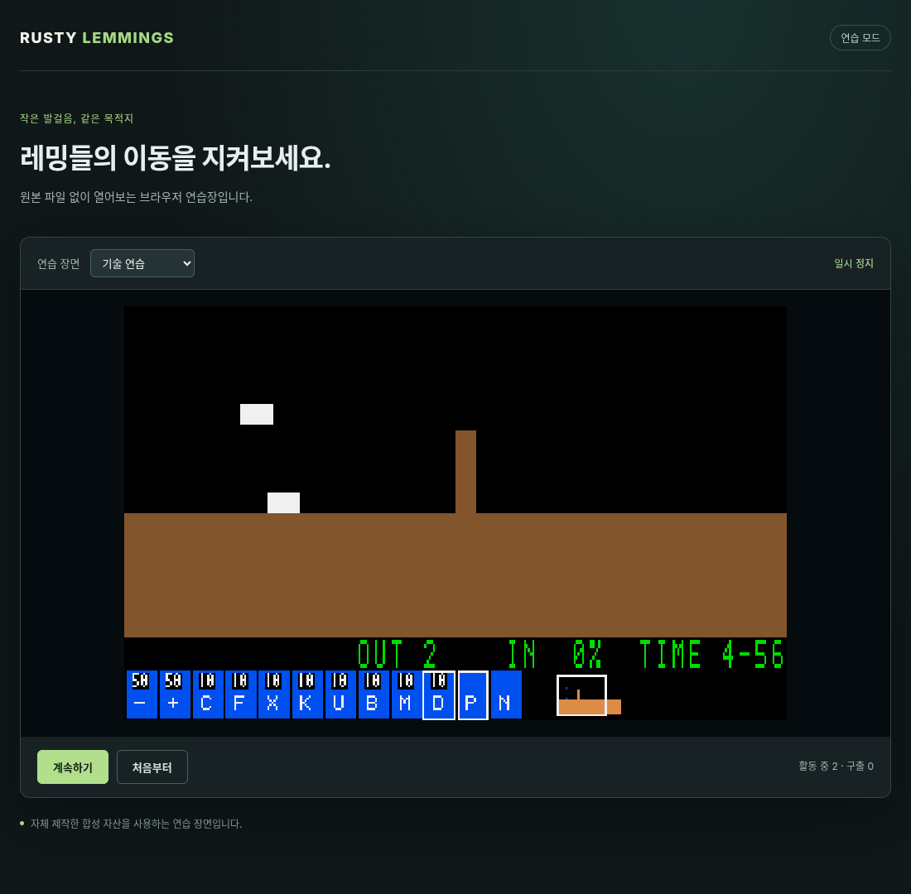

# G09-03 실제 JS/WASM·합성 브라우저 검증

이슈: [#66](https://github.com/edwardkim/ohmylemmings/issues/66) · [구현 계약](../tech_insights/issue-66_wasm_browser.md) · [웹 실행 안내](../../apps/web/README.md)

기준 main `bdbed5c053ca19cd84fd2e9cbe238bd6dd4a104e`에서 `lemmings-web` JS/WASM 경계를 추가했습니다. 공통 game/session의 장면·시뮬레이션·CPU 화면을 그대로 사용하며 core/resources/session/game과 desktop Rust 소스는 바꾸지 않았습니다. 원본 없는 합성 장면 선택·일시정지/재개·처음부터 실행을 실제 브라우저에서 제공합니다.

## TDD와 경계

공개 API 미구현 실패→호스트 계약6개, 빌드 도구 미구현 실패→Python5개를 확인했습니다.8개 기술의 직접 core 명령·안정 ID·지형/프레임, 잘못된 입력/시간/초기화의 상태/위상 보존, 동결 결과·복사본 소유권·명시적 시간/틱을 검사합니다. 자체 검토에서 JS u32 선변환의 소수 잘림을 막도록 숫자를 검증 후 변환했고, 같은 경계의 연속 Pause/Resume은 큐 의도를 읽도록 보강했습니다. 두 보강도 실패 테스트 후 구현했습니다.

최종 호스트 계약6개와 native/WASM Clippy를 재검사했습니다. 전체 Rust519개·문서28개·Python106개, 기존 SDL/기술·결과/패널/포인터 회귀와 새 실제 브라우저 검사는 make check에서 실행합니다. 최종 종료 결과와 정확한 게시 커밋의 전체 검사는 #66에 기록합니다.

## 실제 WASM과 네이티브 대조

고정 Rust1.93.1과 wasm-bindgen crate/CLI0.2.129로 WASM·ES module·타입 선언을 생성했습니다. 원본·Node/NPM·번들러 없이13개 합성 사례를 렌더 간격1/7의26회 실행했습니다. 각 경계의 전체 진단 상태와 모든 지형/브릭/원시 객체 맵의 SHA-256, 렌더한 모든 RGB 바이트의 SHA-256이 네이티브 추적과 같습니다.

- 전체 상태4100개, 논리320×200 RGB2357개, 불투명 Canvas readback2357개 일치.
- 8개 기술·Pause/Resume·RR·Nuke, 합성 성공/실패/입자/0시간 경계를 포함합니다.
- 잘못된 숫자/명령·새 게임 실패 보존, 시간 전달과 틱 분리, 프레임 복사본, 동결 결과를 실제 JS/WASM에서도 확인했습니다.
- 60/120/144Hz에서 같은1초17틱, 프레임 예산/빚 보존, 숨김 중 미공급/복귀 시 이미 공급한 빚 보존, 역행/잘못된 시각 거절을 확인했습니다.

네이티브 producer와 WASM 모두 같은 WebGame을 실행하는 경로 비교입니다. 별도의 Rust 계약6개에서 WebGame과 직접 core/game 명령·맵·프레임도 비교합니다. 원작 규칙 회귀는 기존 golden/참조 검사에 계속 의존합니다.

## 사용자 Chromium19222

사용자가 준비한 Chrome152.0.7977.82 CDP19222에서 같은26회 대조를 별도로 통과했습니다. 실제 실행 페이지에서 진행·일시정지/재개·빠른 연속 토글·합성 구출 완료(3구출)·다시 시작을 확인했고 미처리 JS 예외는0개입니다. 도구에 브라우저 surface가 노출되지 않아 사용자가 지정한 CDP로 소유한 로컬 테스트 탭을 제어했습니다. 브라우저 재시작 사이 일시적인 연결 거절은 새 응답 확인 후 재연결해 최종 검증했습니다.

## 출처·CI·후속

[도구 해시](../../assets/manifests/web_tools.json)는 공식 CLI release API digest와 아카이브/단일 실행 파일을 고정합니다. Cargo.lock의 기존 패키지는 유지하고 wasm32에 필요한 registry11개만 추가했습니다. [증거 해시](../../assets/manifests/web_browser.json)에 소스·생성 WASM/JS·native producer·브라우저/수동 UI 결과·스크린샷·검토 기록을 고정합니다. 바이너리와 생성물은 ignored assets/local에만 보관합니다. 스크린샷은 자체 합성 자산으로 원본 파생물이 아닙니다.

CI에 원본/target/도구/Cargo cache 없는 Web browser 작업을 추가했습니다. 최종 make check·자체 검토·한글 PR·정확한 push/PR/main의 네 작업 성공·실제 전체 로그·checkout/같은 병합 트리·이슈 종료는 #66에 누적합니다. G09 전체는 진행 중이며 다음은 G09-04 실제 입력/원본 자산 선택·공급/레벨 전환 UX입니다. 원본 동일 레벨의 브라우저 완주는 G09-05에서 검증합니다.
