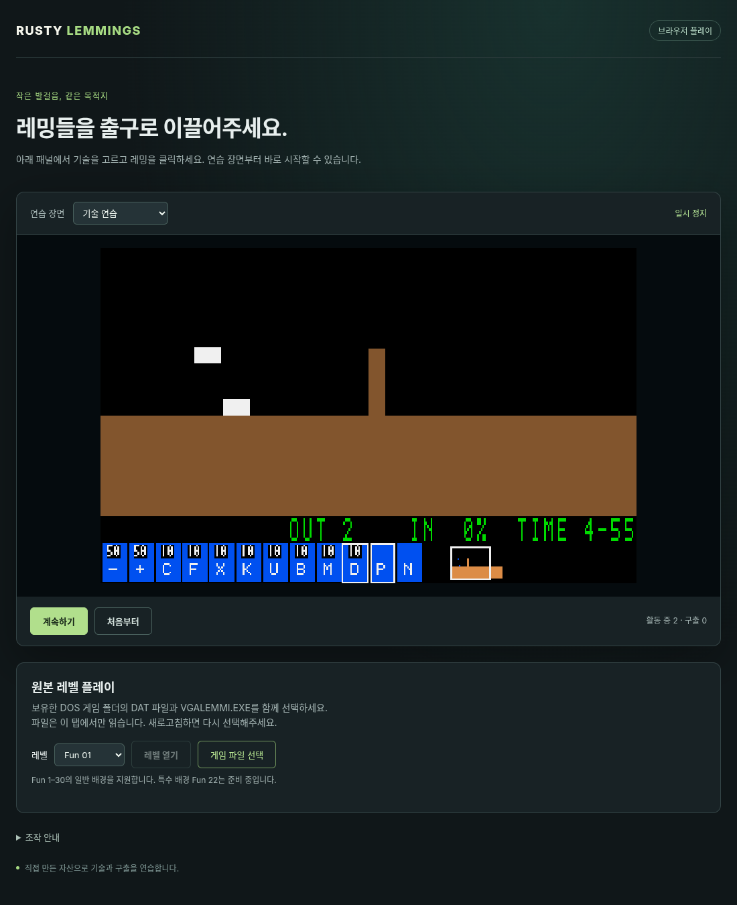

# G09-04 브라우저 입력·원본 자산·레벨 전환

이슈: [#68](https://github.com/edwardkim/ohmylemmings/issues/68) · 상위 [#1](https://github.com/edwardkim/ohmylemmings/issues/1)

브라우저의 키·기술 패널·포인터/우클릭·미니맵과 사용자 선택 원본 바이트 공급을 연결했습니다. 진행 중 재시작과 완료 후 다음/재도전은 같은 LevelRun으로 새 세션·View·시계를 구성합니다. 원본 누락·손상·특수 배경 오류는 현재 실행을 유지하며 복구할 수 있습니다.

[실행 안내](../../apps/web/README.md) · [계약](../tech_insights/issue-68_web_input_assets.md) · [출처·해시](../../assets/manifests/web_input_assets.json)

## 확인한 동작

- Rust TDD 새5개: 파일명/중복/크기·불변 바이트 보존, 누락/손상/숫자 오류의 원자성, 키/패널/틱 누름·포커스, 성공→다음/실패→재도전·재시작, 창작 바이트를 읽는 직접 native Assets/LevelRun과 레벨1/2/30 대조.
- SDL 독립 입력 대조1개:8기술×150경계에서 Session/입력 기록·선택과 모든 지형/브릭/객체 바이트를 비교하고88개 전체 RGB를 비교했습니다. 기존6개 WebGame 계약도 유지합니다.
- 실제 WASM 기본24사례/48회에서7742전체 진단 상태·모든 맵 SHA-256·4456논리 RGB/불투명 Canvas readback이 네이티브와 같습니다. DOM의 CSS 좌표,8개 기술 버튼/할당, 누름 해제/포커스, 더블클릭, 우클릭 조합의 fallback, 실제 File 객체와 전환도 통과했습니다.
- 선택 원본의 모든 고정 파일을 크기/SHA-256 검증하고 Fun01/02/03의 초기150틱·기술/카메라/재시작을 추가했습니다. headless Chromium과 사용자 Chrome152/CDP19222 각각27사례/54회·8648전체 상태·4978RGB/Canvas가 같습니다.
- 별도 CDP19222 trusted 키·마우스로8개 기술, 우클릭 중 왼쪽 누름의 실제 pointermove buttons3, 전체 폭파 더블클릭과 화면 밖 버튼 해제를 확인했습니다. 실제 페이지에서23원본 파일 선택, Fun01/02 원본 스프라이트·패널/미니맵, 미지원 Fun22/손상 파일의 이전 게임·화면 보존, 재시작과 합성 성공→다음→실패→재도전을 확인했습니다. 제품 페이지 JS 예외0개입니다.

원본 화면은 ignored assets/local/issue-68-review/original-ui.png에만 보관합니다. 로컬 http://127.0.0.1:8080/ 미리보기에는 선택된 원본 Fun01을 일시 정지해 두었습니다. 공개 스크린샷은 창작 장면입니다.

## 자체 검토와 회귀

사용자 승인에 따라 작성자 자체 검토를 진행했습니다. 자동 pointer capture 해제 때 더블클릭 기록을 지우던 오류와 마우스 두 번째 버튼이 pointerdown을 만들지 않는 경우를 재현/회귀 검사로 수정했습니다. 원본 모드의 연습 장면 선택 placeholder도 보강했습니다. 폼·IME 키, 외부 좌표·숫자 선검증, 숨김/중단·포커스, 바이트 소유권/누수와 로드 실패 보존을 검토했습니다. core/resources/session/game 규칙 소스와 기존 registry 패키지는 변경하지 않았습니다. 추가 의존성은 workspace 내부 테스트 두 경로뿐입니다.

최종 make check 종료0, Rust525/문서28/Python106·포맷/Clippy·WASM·전체 SDL/기술/결과/포인터·실제 브라우저를 통과했습니다(844.77초). 전체 로그 SHA-256은 `c968905e212d6e22e6a00dc495fc614fcc52277fafca09965c2732b3c01d2620`입니다. 정확한 push/PR/main의 네 CI 작업·실제 ZIP 전체 로그·같은 병합 트리/원격 blob 검증 결과는 게시 후 #68에 기록합니다. 이 문서와 매니페스트는 검토한 소스·실행 산출물의 근거를 보존합니다.

G09-04의 입력/자산/전환을 검증했습니다. 원본 한 레벨의 브라우저 성공·실패 통합 완주와 시도별 네이티브 대조는 G09-05 후속이며 G09 전체는 진행 중입니다. 새 DOS 실행·120레벨 인증·음향·배포는 포함하지 않습니다.
