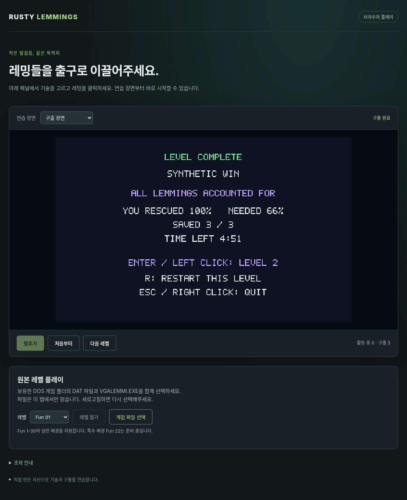

# G09-05 브라우저 통합 완주 결과

이슈: [#70](https://github.com/edwardkim/ohmylemmings/issues/70) · 상위 [#1](https://github.com/edwardkim/ohmylemmings/issues/1)

원본 Fun01의 브라우저 전원 구출·재시작·Nuke 실패·재도전·다음 Fun02를 실제 제품 페이지에서 검증했습니다. 네 시도의 모든 제어 경계와 맵·화면이 네이티브 재생과 일치합니다. [계약](../tech_insights/issue-70_web_playthrough.md) · [출처/해시](../../assets/manifests/web_playthrough.json).

## 구현

선택적 로컬 관측 API와 tick 단위 기록, Nuke 진단 필드·안정 ID 입력 직렬화를 추가했습니다. 공통 core/resources/session/game 소스와 Cargo 의존성/lockfile은 바꾸지 않았습니다. 원본 없는 통합 여정·손상 거절 검사를 CI에 연결했습니다. 기존 입력/완료/자산 공급 경로를 그대로 실제 DOM에서 실행합니다.

## 실제 원본 브라우저와 네이티브

Chromium152.0.7977.82, 사용자 CDP19222, http://192.168.2.146:8080/?journey=70 에서 실제 rAF·trusted 키/마우스와23파일 선택으로 실행했습니다. 새 원본 다운로드나 서버 업로드는 없습니다.

| 시도 | 결과 | 제어 경계 수 | 실제 Canvas 캡처 | 마지막 구출 |
| --- | --- | ---: | ---: | --- |
| Fun01 최초 | Won | 666 | 53 | 10/10,100% |
| R 재시작·조기 Nuke | Lost | 287 | 24 | 0/3, 원래 총원10 |
| 결과 클릭 재도전 | Won | 661 | 53 | 10/10,100% |
| Enter Fun02 | Playing 후 중단 | 81 | 7 | 새 ID0·새 세션 |
| 합계 | 네 시도 | 1695 | 137 | 전원 구출 두 번 |

모든1695경계의 전체 진단 상태·세 맵 SHA-256과 초기/최종 실제 맵,137장면의 state/view/논리 RGB/Canvas RGBA가 raw 이벤트 네이티브 재생과 일치했습니다. 안정 ID 입력만 받는 독립 SDL12회(render1/7/13×4시도)도 전체 정규화 상태·각 경계 변형·최종 맵이 같습니다. SDL 픽셀 readback684회도 일치했습니다.

첫 시도는 Digger61, Pause63, RR51..55를64..68, Resume74 경계에 기록했습니다. 실패는 Nuke135, 재도전은 Digger63 경계입니다. 초기/재시작/재도전 pristine 상태와 맵·기술/포인터/누름·시계가 같고 다음 레벨도 ID0부터 시작합니다. 단일 Nuke 클릭은 무시하고 충분히 떨어진 더블클릭으로만 실행했습니다. Pause/RR 누름 반복·미니맵 끌기·760px 크기 변경/외부 클릭·숨김700ms/복귀·결과 고정300ms와 제품 JS 예외0개를 확인했습니다.

원본의 동일 raw 입력을 WASM에서60/120/144Hz·render1/7/13으로 추가12회 재생해5085개 전체 상태/맵 바이트와300개 논리 RGB를 비교했고 모두 일치했습니다. 제품 JS 예외는0개입니다.

## 원본 없는 자동 회귀

같은 제품 DOM과 WASM에 통제한 rAF 시각을 공급합니다. 합성 네 시도656상태(169/240/166/81)·57장면이 raw 네이티브와 같고, 독립 SDL12회·픽셀 readback651회도 같습니다. WASM12회 추가 재생1968상태·127장면은 시간 분할과 렌더 간격에 독립적입니다. 관측기 예산3에서60/120/144Hz 각각17개 경계를 빠짐없이 기록했습니다.

기존24사례/7742상태/4456논리 RGB·Canvas 회귀도 통과했습니다. 여기에는 누락/손상·미지원 파일/전환 오류 후 기존 게임/시계·화면 보존과 숨김/복귀·분할/빚 검사가 포함됩니다. 새 Rust 진단/순서 입력 검사1개와 Python 검증기9개는 TDD로 실패를 먼저 확인하고 통과시켰습니다.

전체 `make check` 종료0: Rust526/문서28/Python115, 포맷/Clippy·오프라인 빌드·상태 재생·WASM·전체 SDL/기술/판정/패널/포인터·기존/신규 실제 브라우저 검사를 통과했습니다. 로그 SHA-256 `5fcd1ac2f4d16b1a1b7967ce7fe1542df38f019abd9d196f9482441974b46220`. 작성자 자체 검토에서 진단 완전성·시도/입력 경계·독립 재생·Canvas/원본 보관·기본 배치 실행을 확인했고 미해결 항목은 없습니다. 초기 원격 Web CI에서는 `--bin web_trace`가 데스크톱 바이너리를 제외하는 클린 빌드 결함을 발견했습니다. 두 패키지를 `--bins`로 빌드하도록 수정하고 기존 실행 파일을 치운 상태의 통합 검사로 보완했습니다. 공통 게임/입력·기록 형식은 바뀌지 않았습니다. 정확한 게시 push/PR/main 네 작업 CI·실제 전체 로그·병합 트리는 #70에서 기록합니다.

## 화면·보관·완료 판단

공개 PNG는 직접 만든 합성 자산만 포함합니다. 원본 추적/맵·RGB/화면과 생성 바이너리는 ignored assets/local에 보관하고 공개 manifest에는 출처·크기·해시와 결과만 기록합니다. 각 증거 트리는 POSIX 경로 정렬 색인으로 검증합니다.

G09-01~04의 공유 경계·자산·WASM·입력/전환에 이번 동일 원본 레벨 완주·실패·초기화·네이티브 대조가 더해져 G09 기능 기준을 충족했습니다. 정확한 push/PR/main 네 작업 CI·전체 로그와 같은 병합 트리를 확인한 뒤 #70과 상위 #1에서 G09를 마감합니다. 다음은 G10 사운드 통합입니다. 기존 #60 DOS 증거는 별도이며 새 DOS 녹화·전체120레벨/특수 배경·음향·배포를 이번 통과로 집계하지 않습니다. 사용자 승인 원격 미리보기와 TCP8080 방화벽 허용을 유지합니다.
