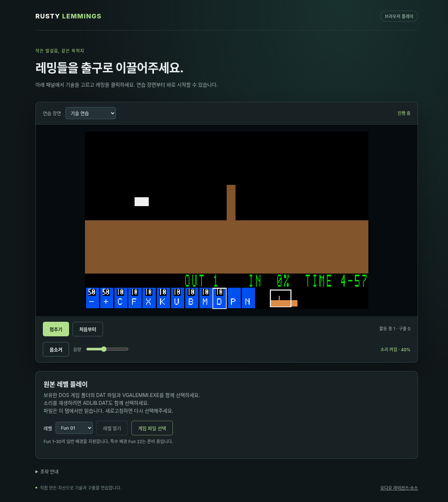
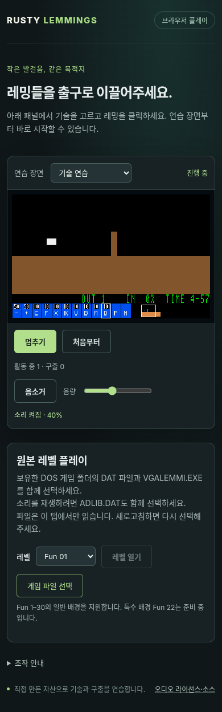

# G10-05 SDL/Web 오디오 출력

이슈: [#80](https://github.com/edwardkim/ohmylemmings/issues/80) · 상위 [#1](https://github.com/edwardkim/ohmylemmings/issues/1)

SDL과 웹에서 게임 명령→검증된 OPL/PCM→실제 장치 경로를 연결했습니다. 원본 ADLIB.DAT 공급과 연습 음원, 볼륨/음소거·사용자 활성화·장치/자원 오류·숨김/중단/결과·재시작의 큐/세대를 처리합니다. 게임 상태·지형·픽셀과 재생 입력은 음향 소비와 독립적입니다.

[계약·재현·한계](../tech_insights/issue-80_audio_output.md) · [출처/해시](../../assets/manifests/audio_output.json)

- TDD: owned continuation·공유 출력·WASM API·검사기·라이선스/소스 배포의 실패→통과를 확인했습니다.
- 합성6조합/249492프레임의 fixed native/actual WASM PCM·전체 진단/맵/RGB, OfflineAudioContext 샘플을 대조했습니다. 실시간 AudioContext graph nonzero와 node/시간 상한, 활성화 거부/race·컨텍스트 재생성·숨김/재개·음량0·큰 시간 점프를 검사했습니다.
- SDL 생산 service는 dummy device에서 실제 큐 소비/비우기를 확인했고 음향 on/off의20개 상태/캡처 파일이 일치합니다. 없는 장치에서도 게임을 계속합니다. 별도 실제 PipeWire backend도 nonzero PCM/큐 소비를 통과했습니다.
- 원본6조합/249492프레임의 native/actual WASM 및 비보안 LAN HTTP/실시간 원본 graph를 통과했습니다. 원본50파일 해시를 유지했습니다.
- 실제 Chromium19222에서 autoplay flag 없이 trusted 클릭/userActivation·음소거·탭 숨김/복귀·S/PageUp/PageDown·음량0·재시작 세대를 확인했습니다. AudioContext API가 없는 별도 탭도 게임을 계속하고 소리 버튼의 disabled 상태를 유지했습니다.
- 원본 Fun01~03 포함 웹 회귀8648상태/4978Canvas가 통과했습니다. 새 외부 Cargo 패키지/선정 OPL 코어 변경은 없습니다.
- 라이선스 전문·재빌드 소스·WASM/소스 해시를 웹에 제공합니다. source archive의 private/local/symlink 배제·재현성·Git 없는 추출본을 검사했습니다. 실제 소스 복사본의 라이브러리 출력을0으로 바꾸고 native/WASM 재빌드·재링크를 확인합니다. 이 의도적 무음 결과는 제품 합성 일치의 근거로 집계하지 않습니다.

최종 전체 make check 종료0: Rust596/문서29/Python155(신규 Rust9/Python9), 포맷/Clippy·오프라인 빌드·기존 독립 C/PCM·전체 SDL/직업/판정/패널/포인터·Web7742상태4456Canvas·통합656상태57Canvas/독립12재생 및 WASM12재생1968상태127RGB·새 출력/소스 배포를 통과했습니다. 로그 SHA-256 `042d6639424eab59f791987f82e9f4c958ab3251dcb37d0c3ecbc783bed6babe`. 고정 입력 소스 묶음의 Git 없는 실제 native/WASM 재빌드·무음 대체 라이브러리 재링크도 통과했습니다. 자체 검토 미해결0입니다. 소스 배포 검사를 추가하기 전 실행과 고정되지 않은 입력 경로의 초기 재링크 로그는 보존하고 최종 통과 근거에서 제외합니다.

## 화면

## 후속

G10-05 게시/정확한 push·PR·main 네 작업 CI·ZIP 전체 로그/checkout·동일 트리를 확인한 뒤 이슈를 마감합니다. 다음은 G10-06 실제 DOS/native/browser 통합 청취·대조와 G10 마감입니다. 하드웨어/DAC·전체 곡·주관적 청취/실제 비동기 위상 일치는 이번 단계의 장치 경로 검사와 구별합니다.
