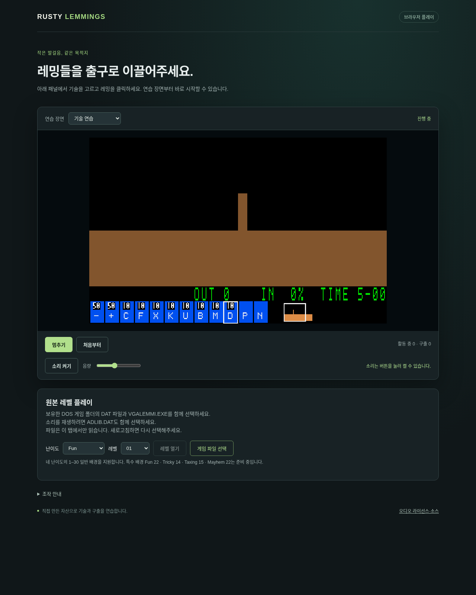

# G11-02 네 난이도 선택·전환 검증

이슈: [#87](https://github.com/edwardkim/ohmylemmings/issues/87) · 상위 [#1](https://github.com/edwardkim/ohmylemmings/issues/1).

기준 main `ae8ab7cddbb1aa02c6fe93b426b5ba6d9a2f2b30`의 Fun 한정을 해소했다. 기존 typed LevelId로 공유 로더·SDL CLI·Web 선택/진단·재시작/Continue·재생 메타데이터를 연결했다. 기존 Fun CLI/API와 난이도가 없는 이전 재생 자료는 유지한다. [계약·참조·한계](../tech_insights/issue-87_rank_selection.md).

| 검증 | 범위 |
| --- | --- |
| TDD | 난이도 이름/경계 successor와 잘못된 replay ID의 실패를 먼저 확인. 선택·재시작·원자적 교체·음향 cursor/세대·Mayhem 종료 회귀 추가 |
| 정적 ID/자원 선택 |120개 ID의 요청 DAT과 기존 CatalogEntry 대조. 원본120개 실행 통과 판정은 아님 |
| 제품 호스트 | SDL/Web 난이도 선택과 저장 입력, 원본 일반 레벨 진입·실제 WASM/native 상태·맵·RGB/Canvas 대조 |
| 화면 | 아래 화면은 원본 없이 합성 연습 장면에서 새 난이도 선택 UI를 표시 |

로컬 `make check-rust check-python check-wasm` 종료0: Rust603/문서29/Python164와 format/clippy·WASM 빌드 통과. 원본 선택 검사는35사례/70회·12,564상태·7,225RGB/Canvas를 실제 WASM/native에서 대조했다. 제품 DOM에서는8개 선택/재시작·3개 난이도 경계 Continue·Mayhem 종료·파일 실패 보존을 확인했다. SDL dummy/software는 원본8진입점의648상태와80개 readback·기존 Pause/Resume 입력·초기 수치/재고를 기준 목록과 대조했다. 창작 바이트의 SDL 경계3개와 원본 특수4개의 명시적 거부도 확인했다. 원본50개는 전후 크기/해시가 같다.

검사 로그·원본 파생 자료는 ignored `assets/local/issue-87-review/`, 공개 수치·출처·해시는 [rank_selection.json](../../assets/manifests/rank_selection.json)에 기록한다. 정확한 로컬 검사 결과와 자체 검토·PR head/merge SHA·게시/병합 CI는 #87과 연결 PR에 기록한다. CI를 생략하거나 이전 코드 CI를 이번 코드 검증으로 집계하지 않는다.

특수4장면은 아직 연결하지 않았다. 일반116개는 소스 진입 범위이며 전체116개 완주나 DOS 내부 상태 인증이 아니다. G11 전수120개 완주·COMP 마감과 성능 측정은 미완료다. 다음은 G11-03 특수 장면 연결이다.
