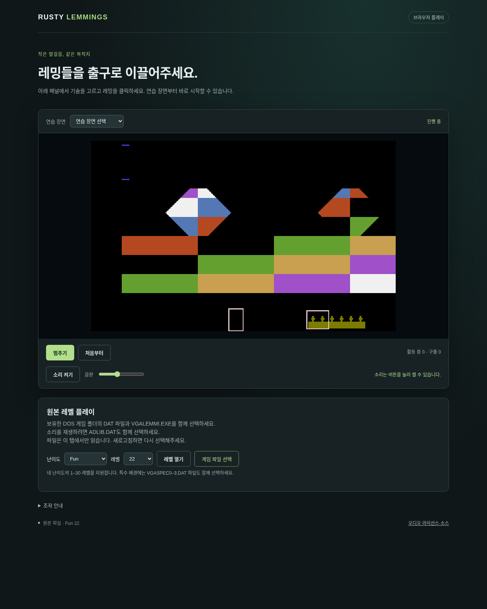

# G11-03 특수4개 장면 연결 결과

이슈: [#89](https://github.com/edwardkim/ohmylemmings/issues/89) · 상위 [#1](https://github.com/edwardkim/ohmylemmings/issues/1) · [계약·재현](../tech_insights/issue-89_special_scenes.md) · [진행](../working/issue-89_special_scenes.md).

Fun22/Tricky14/Taxing15/Mayhem22의 VGASPEC을 공통 게임 로더와 동적 지형 재합성·SDL/Web에 연결했다. Web 파일 허용 목록과 화면 안내를 갱신했고 배경/객체 RGB 차이와 다리 지정 색을 유지한다. 기존 LevelId·재시작/Continue·음원 선택을 재사용한다. 기준 main은 `facbc46ea2d3644574520f00fca6c43d3952c3b2`다.

| 검사 | 결과 |
| --- | --- |
| TDD | 기존 거부 경로에서 특수3검사 실패 확인 후 구현; source 선택4종·(304,0)·투명/검정·무시한 일반 배치·삭제/다리/객체 가림·오류 전달·교체 실패/재시작 |
| 로컬 Rust/Python/WASM | `make check-rust check-python check-wasm` 종료0. Rust606·문서29·Python164, fmt/clippy·빌드·WASM·기존 상태/음향 회귀 통과 |
| 실제 WASM/native | 창작/합성33 + 선택 원본10 = 43사례×렌더1/7, 86회·14,980상태·8,617 RGB/Canvas readback. 모든 상태/맵/View/렌더 일치 |
| 제품 DOM | 기존 난이도8선택/재시작·경계3회·종료 유지. 특수4선택/재시작/Continue·음악 ID, 누락/손상 교체8건에서 세션/View/음원/화면 보존 |
| 실제 SDL | 원본 특수4개×렌더1/7, 각80경계: 648상태·80 SDL readback. 초기 수치/재고를 고정 카탈로그와, 전 경계 상태를 native Web과 대조 |
| 정적 독립 증거 재사용 | 네 충돌 맵·팔레트 일치. 불꽃 위상을 맞춘 전체 RGBA가 독립 검증된 #19 해시와 일치. iteration0의21픽셀 위상 차이는 기존 계약으로 유지 |
| 자원 보존 | 원본50개 전후 크기/SHA-256 불변. 원본·실행 로그·파생 화면은 ignored assets/local, 공개는 검증 메타데이터/창작 화면 |

이전 #85/#87 증거를 당시 소스 기준으로 유지하고 새 [special_scenes.json](../../assets/manifests/special_scenes.json)에 현재 일반116+특수4개의 소스 범위와 검증 한계를 기록한다. 전체120개 초기340경계·3회 반복/양 플랫폼 완주와 COMP 전체 인증·성능 측정은 후속이다.

## 자체 검토·게시

author self-review: 소스 선택/수명, 두 팔레트·다리/객체 우선순위, 정상 장면 회귀, immutable bank·오류 원자성, 음악/세대, 창작 fixture와 실제 호스트 경계를 검토했다. 미해결 지적0개. 의존성·CI 워크플로·HTTP8080·방화벽·CDP19222 loopback은 변경하지 않았다.

정확한 게시 head, 한글 PR의 **MERGED** 상태, push/PR/main CI 네 작업과 로그 검증, 상위 #1 갱신·#89 종료는 [GitHub #89](https://github.com/edwardkim/ohmylemmings/issues/89)에서 최종 기록한다. 전체 SDL 합성·Web 완주/음향 검사는 게시 CI에서 실행한다.

## 화면

실제 Chromium 제품 UI에 창작 VGASPEC을 파일 선택으로 공급했다. 원본 이미지를 포함하지 않는다. 특수 그림·선택한 Fun22·새 파일 안내를 확인했다.

